# src/frontend/settings 架构

## 目录定位

模型、资源仓库、GitHub 反馈连接、并发及新目标软限额配置。GitHub 采用 Device Flow，页面仅持公开 Client ID 与短期授权码；资源服务器账号仍为占位。并发实时状态不覆盖草稿；软限额默认关闭，显式保存与新周期生效相区分，失败保留输入且不盲目重试。 反馈预置公开产品连接；版本更新迁到账号菜单的独立弹窗，设置表单不因查看日志而卸载。

本文描述当前实现。通过分析目录边界后维护的 [源码架构脚本](../../../scripts/source-architecture.mjs) 同步清单和声明；代码变更时仍须核对职责、关键成员与关系。

## 代码清单

| 文件 | 当前职责 |
| --- | --- |
| [AdmissionSettings.tsx](AdmissionSettings.tsx) | 配置应用级 Agent 并发上限，展示真实准入占用与等待数量。 |
| [budget-settings-state.ts](budget-settings-state.ts) | 管理额度及显式逐请求模式草稿、版本化保存，隔离页面卸载后的异步响应；缺省仍是运行间软限额。 |
| [budget-settings.css](budget-settings.css) | 对应界面的布局与视觉样式。 |
| [BudgetSettings.tsx](BudgetSettings.tsx) | 展示用户显式配置的新目标 Token/费用软限额，与全局并发设置相邻但独立保存。 |
| [GitHubFeedbackSettings.tsx](GitHubFeedbackSettings.tsx) | 设置页的 GitHub 反馈连接入口，展示设备授权码及固定目标仓库。 |
| [models.css](models.css) | 供应商列表和模型表单布局。 |
| [ModelSettings.tsx](ModelSettings.tsx) | 设置页的自定义供应商、连接表单与模型目录编辑器。 |
| [SettingsView.tsx](SettingsView.tsx) | 模型供应商、运行并发、新目标软限额、GitHub 反馈连接、仓库与共享服务设置；版本与更新由账号菜单独立打开。 |

## 架构类图

### AdmissionSettings.tsx

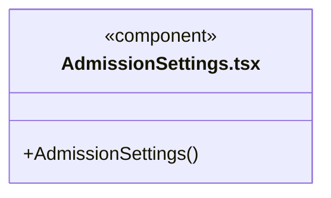

直接依赖：[../../bridge/contracts/admission.ts](../../bridge/contracts/admission.ts)、[../tasks/useAdmission.ts](../tasks/useAdmission.ts)、[../tasks/admission.css](../tasks/admission.css)。

### budget-settings-state.ts

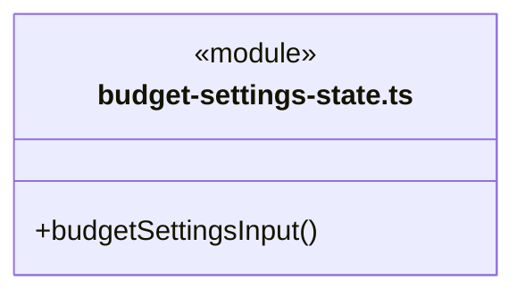

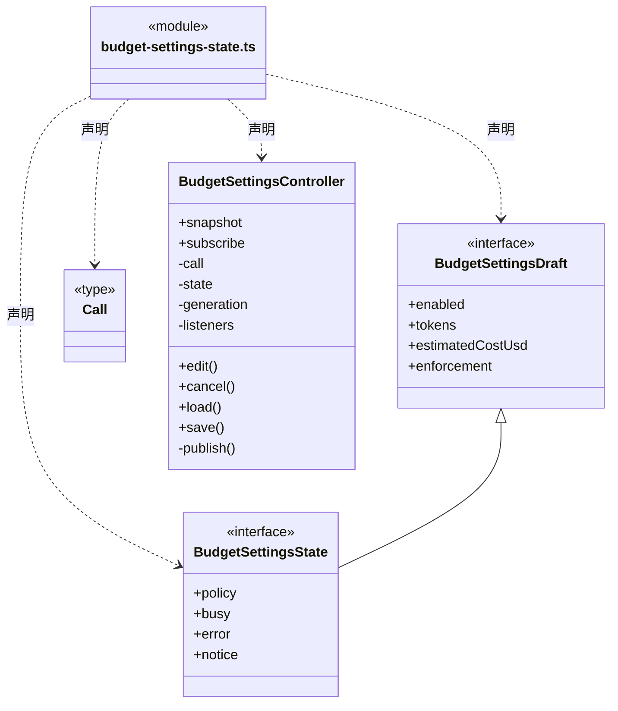

直接依赖：[../../bridge/contracts/scope-budget.ts](../../bridge/contracts/scope-budget.ts)。

### budget-settings.css

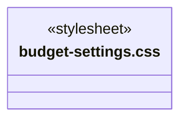

### BudgetSettings.tsx

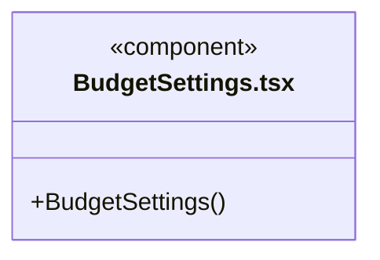

直接依赖：[budget-settings-state.ts](budget-settings-state.ts)、[budget-settings.css](budget-settings.css)。

### GitHubFeedbackSettings.tsx

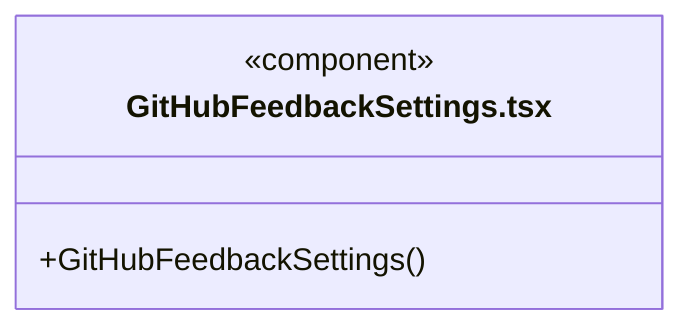

直接依赖：[../../bridge/contracts/github-feedback.ts](../../bridge/contracts/github-feedback.ts)。

### models.css

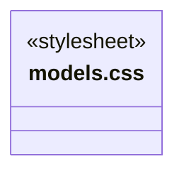

### ModelSettings.tsx

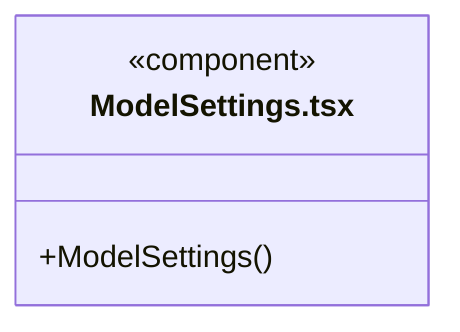

直接依赖：[../../bridge/contracts/models.ts](../../bridge/contracts/models.ts)、[models.css](models.css)。

### SettingsView.tsx

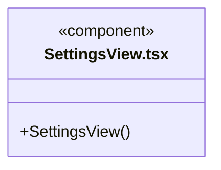

直接依赖：[../../bridge/contracts/resources.ts](../../bridge/contracts/resources.ts)、[ModelSettings.tsx](ModelSettings.tsx)、[AdmissionSettings.tsx](AdmissionSettings.tsx)、[BudgetSettings.tsx](BudgetSettings.tsx)、[GitHubFeedbackSettings.tsx](GitHubFeedbackSettings.tsx)。

### 本目录调用边界

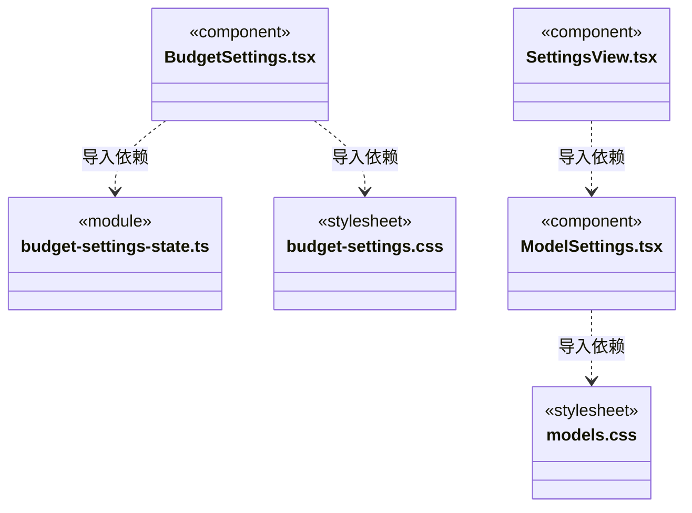

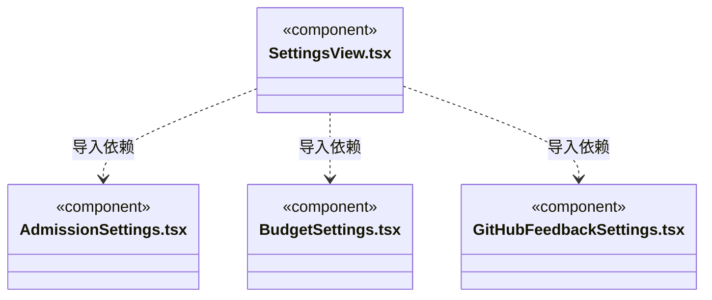

## 子目录导航

无子目录。

[返回上层](../ARCHITECTURE.md)。

每次修改本目录代码，同步维护文件头、关键契约说明及本图。未实现的治理、证据验收和自动编排能力不列入当前类图。

## 设计契约 v1 与落地范围

以下内容区分已接通能力与后续设计；以各节的实现状态为准，不将目标图当作现状图。维护源：[CONTRACT.md](CONTRACT.md)；生成类图时同步附加，勿直接修改本附录。

# 设置界面

版本与更新已迁到左下角账号菜单，由独立 [updates](../updates/ARCHITECTURE.md) 视图展示；设置页不再重复装配更新组件。打开更新弹窗不会卸载设置页，模型、预算与 GitHub 反馈连接草稿继续由各表单持有。

GitHub 连接已预置公开产品配置；普通用户直接连接，高级字段保留在折叠区，不要求复制 Client ID。

`GitHubFeedbackSettings` 独立装配反馈连接；公开 Client ID、owner/repo、可见性和“连接并允许反馈自动提交”组成明确授权。后端返回短期 userCode 后，用户点击才打开固定 GitHub 登录页，页面按 nextPollAt 轮询；离开页面停止轮询，不取消已保存连接。取消／断开、错误与不可用安全存储有明确状态，失败保留配置输入。UI 不接收 token 或 device_code，也没有创建 Issue、查看逐条反馈或开发进度的 IPC。

等待文案明确要求保持设置页打开，直到本机显示“已连接”再继续反馈；网页授权成功本身不表示本机已核验并保存连接。返回设置页会恢复仍有效的 flow 轮询，不要求重复网页授权；未增加后台轮询或反馈结果通知。

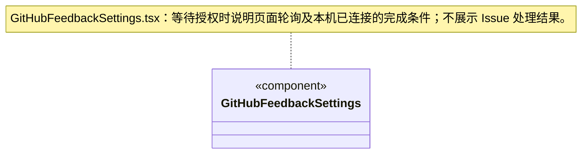

`SettingsView` 独立装配模型、执行并发、新目标软限额和资源仓库设置，仓库服务失败不阻止配置运行策略。运行设置表单始终保留在同一渲染位置，仓库异步加载只改变仓库区域，不重挂载已可交互的表单或清除草稿。

`AdmissionSettings` 从可靠设置读取版本，显式保存 1～32 的全局运行上限。输入草稿不随占用变化重置；版本冲突后由用户刷新确认。`useAdmission` 与会话共用一个窗口级游标订阅，显示实际占用/上限和等待数量；降低上限可以暂时出现占用高于上限，不结束已有任务。读取失败保留旧数据并明确可能过期。

`BudgetSettings` 默认关闭，用户至少明确一项 Token / 美元额度才可启用。`budget-settings-state` 保留草稿和期望版本，显式读取/保存、不轮询、不重复提交；读取未成功时禁用表单，保存失败保留输入，未知结果先刷新核实。禁用提交清除额度；重新启用须重新明确。设置只冻结到之后创建的周期，既有目标和 waiting 不受全局改配影响。

界面明确“运行间软限额”：单轮中的多个请求、重试或自动摘要可能超额；在途须先结算，用量未知不能按零放行，同周期启用后串行结算。设置页不领取运行、不解除审批、不消费 waiting 或恢复历史；真正启动仍由调度事务、知识基线、成员及工作区租约检查。

## 逐请求预算（R06）

用户可显式勾选逐请求预留；缺省仍为旧软限额。草稿和版本保存模式，说明保守模型容量预留、未知保持占用及本地估价。读取失败不显示为关闭，设置不自动保存，也不改变旧目标。

### 配置 Loop 引擎

供应商表单保存所属 Pi/Claude Code/Codex，后两者分别锁定 Anthropic Messages/OpenAI Responses。同一服务供多个引擎使用时分别保存配置。运行中任务不热替换；旧未声明引擎的配置继续显示 Pi。
