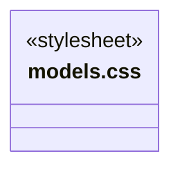
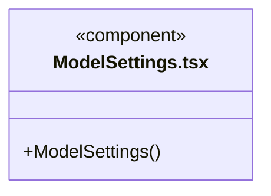
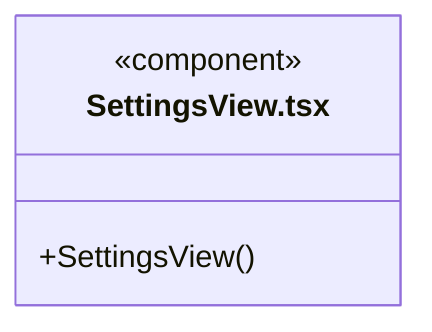
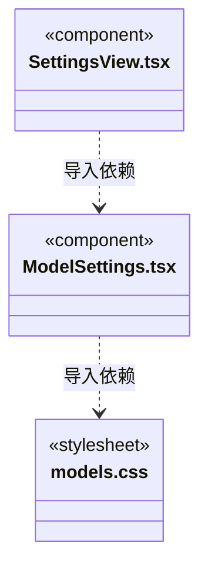

# src/frontend/settings 架构

## 目录定位

模型及仓库配置界面，凭据仅提交主进程保存，账户仍按当前占位语义处理。

本文描述当前实现。通过分析目录边界后维护的 [源码架构脚本](../../../scripts/source-architecture.mjs) 同步清单和声明；代码变更时仍须核对职责、关键成员与关系。

## 代码清单

| 文件 | 当前职责 |
| --- | --- |
| [models.css](models.css) | 供应商列表和模型表单布局。 |
| [ModelSettings.tsx](ModelSettings.tsx) | 设置页的自定义供应商、连接表单与模型目录编辑器。 |
| [SettingsView.tsx](SettingsView.tsx) | 模型供应商、仓库目录、共享服务和账号服务器占位设置。 |

## 架构类图

### models.css

### ModelSettings.tsx

直接依赖：[../../bridge/contracts/models.ts](../../bridge/contracts/models.ts)、[models.css](models.css)。

### SettingsView.tsx

直接依赖：[../../bridge/contracts/resources.ts](../../bridge/contracts/resources.ts)、[ModelSettings.tsx](ModelSettings.tsx)。

### 本目录调用边界

## 子目录导航

无子目录。

[返回上层](../ARCHITECTURE.md)。

每次修改本目录代码，同步维护文件头、关键契约说明及本图。未实现的治理、证据验收和自动编排能力不列入当前类图。
