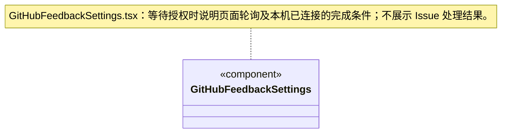

# 设置界面

版本与更新已迁到左下角账号菜单，由独立 [updates](../updates/ARCHITECTURE.md) 视图展示；设置页不再重复装配更新组件。打开更新弹窗不会卸载设置页，模型、预算与 GitHub 反馈连接草稿继续由各表单持有。

GitHub 连接已预置公开产品配置；普通用户直接连接，高级字段保留在折叠区，不要求复制 Client ID。

`GitHubFeedbackSettings` 独立装配反馈连接；公开 Client ID、owner/repo、可见性和“连接并允许反馈自动提交”组成明确授权。后端返回短期 userCode 后，用户点击才打开固定 GitHub 登录页，页面按 nextPollAt 轮询；离开页面停止轮询，不取消已保存连接。取消／断开、错误与不可用安全存储有明确状态，失败保留配置输入。UI 不接收 token 或 device_code，也没有创建 Issue、查看逐条反馈或开发进度的 IPC。

等待文案明确要求保持设置页打开，直到本机显示“已连接”再继续反馈；网页授权成功本身不表示本机已核验并保存连接。返回设置页会恢复仍有效的 flow 轮询，不要求重复网页授权；未增加后台轮询或反馈结果通知。

`SettingsView` 独立装配模型、执行并发、新目标软限额和资源仓库设置，仓库服务失败不阻止配置运行策略。运行设置表单始终保留在同一渲染位置，仓库异步加载只改变仓库区域，不重挂载已可交互的表单或清除草稿。

`AdmissionSettings` 从可靠设置读取版本，显式保存 1～32 的全局运行上限。输入草稿不随占用变化重置；版本冲突后由用户刷新确认。`useAdmission` 与会话共用一个窗口级游标订阅，显示实际占用/上限和等待数量；降低上限可以暂时出现占用高于上限，不结束已有任务。读取失败保留旧数据并明确可能过期。

`BudgetSettings` 默认关闭，用户至少明确一项 Token / 美元额度才可启用。`budget-settings-state` 保留草稿和期望版本，显式读取/保存、不轮询、不重复提交；读取未成功时禁用表单，保存失败保留输入，未知结果先刷新核实。禁用提交清除额度；重新启用须重新明确。设置只冻结到之后创建的周期，既有目标和 waiting 不受全局改配影响。

界面明确“运行间软限额”：单轮中的多个请求、重试或自动摘要可能超额；在途须先结算，用量未知不能按零放行，同周期启用后串行结算。设置页不领取运行、不解除审批、不消费 waiting 或恢复历史；真正启动仍由调度事务、知识基线、成员及工作区租约检查。

## 逐请求预算（R06）

用户可显式勾选逐请求预留；缺省仍为旧软限额。草稿和版本保存模式，说明保守模型容量预留、未知保持占用及本地估价。读取失败不显示为关闭，设置不自动保存，也不改变旧目标。

### 统一供应商模型目录

供应商表单只保存连接、协议、凭据与模型目录，不显示引擎选项，不为每个引擎复制供应商。Agent 配置使用内置三引擎菜单，模型按真实协议兼容性筛选；更新供应商不会改变 Agent 选择的引擎，也不热替换已启动运行。旧 engine 字段只为读取旧文件保留，编辑保存时移除。
