# src/frontend/shell 架构

## 目录定位

工作区侧栏、会话选择、用户栏与右侧扩展页签；会话区与项目级视图区分开。向会话传递活动页签状态，隐藏页签保留草稿/节点选择并降低成员与任务图同步频率。 软件内新版提醒只打开设置，沿用编辑离页检查，不隐式下载或重启。

本文描述当前实现。通过分析目录边界后维护的 [源码架构脚本](../../../scripts/source-architecture.mjs) 同步清单和声明；代码变更时仍须核对职责、关键成员与关系。

## 代码清单

| 文件 | 当前职责 |
| --- | --- |
| [App.tsx](App.tsx) | 桌面外壳：工作区下展示对话，中间固定主 Agent 会话（对话/任务视图），右侧独立扩展区承载架构/流程等视图；可调整宽度的侧边栏、工作区选择、页签、轮询、全局页面和未提交修改提示。 |
| [ExtensionArea.tsx](ExtensionArea.tsx) | 工作区右侧扩展页签，独立于中央对话管理浏览器、命令终端、架构与内部运行诊断视图。 |
| [extensions.css](extensions.css) | 中央对话与右侧扩展区的分栏、空页签及各扩展面板布局。 |
| [runtime-navigation.ts](runtime-navigation.ts) | 把全局运行页的定位目标核对为现有主会话，并只更新本机页签与任务图选择。 |
| [shell.css](shell.css) | 工作区外壳、侧栏、页签、菜单和主题布局样式。 |
| [state-labels.ts](state-labels.ts) | 界面工作区与工具任务状态的中文标签。 |
| [tabs.ts](tabs.ts) | 页签种类、默认布局、排序与本机布局恢复。 |
| [UserMenu.tsx](UserMenu.tsx) | 本地用户栏菜单、主题切换与设置入口。 |
| [useSidebarWidth.ts](useSidebarWidth.ts) | 管理侧边栏宽度、拖动与键盘调整，并在本地保留布局。 |
| [workspace-list.css](workspace-list.css) | 工作区树、项目行操作与内嵌编辑菜单的布局。 |
| [WorkspaceList.tsx](WorkspaceList.tsx) | 左侧工作区树及其对话列表，承载新对话、项目重命名和移除入口。 |

## 架构类图

### App.tsx

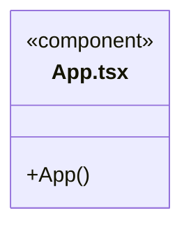

直接依赖：[../../bridge/contracts/workspace.ts](../../bridge/contracts/workspace.ts)、[../resources/ResourceRepositoryView.tsx](../resources/ResourceRepositoryView.tsx)、[../settings/SettingsView.tsx](../settings/SettingsView.tsx)、[../settings/SoftwareUpdates.tsx](../settings/SoftwareUpdates.tsx)、[WorkspaceList.tsx](WorkspaceList.tsx)、[ExtensionArea.tsx](ExtensionArea.tsx)、[../../bridge/contracts/resources.ts](../../bridge/contracts/resources.ts)、[tabs.ts](tabs.ts)、[../components/Icon.tsx](../components/Icon.tsx)、[../components/Empty.tsx](../components/Empty.tsx)、[../conversation/Conversation.tsx](../conversation/Conversation.tsx)、[UserMenu.tsx](UserMenu.tsx)、[useSidebarWidth.ts](useSidebarWidth.ts)、[state-labels.ts](state-labels.ts)、[../runtime/RuntimeOverview.tsx](../runtime/RuntimeOverview.tsx)、[../runtime/runtime-view-state.ts](../runtime/runtime-view-state.ts)、[runtime-navigation.ts](runtime-navigation.ts)。

### ExtensionArea.tsx

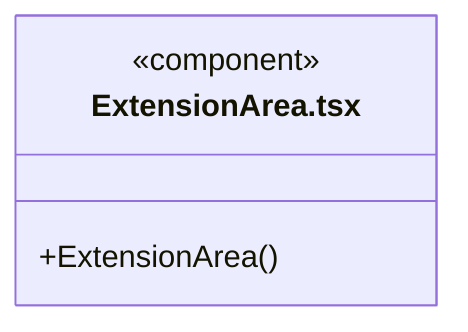

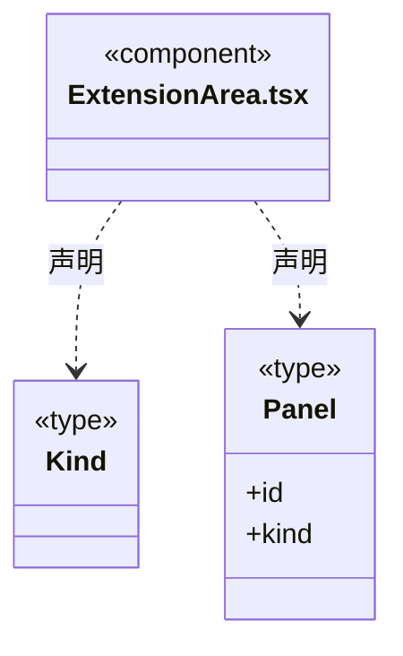

直接依赖：[../../bridge/contracts/workspace.ts](../../bridge/contracts/workspace.ts)、[../team/TeamView.tsx](../team/TeamView.tsx)、[../workspace/WorkspaceView.tsx](../workspace/WorkspaceView.tsx)、[../automation/AutomationView.tsx](../automation/AutomationView.tsx)、[../diagnostics/WorkspaceDiagnostics.tsx](../diagnostics/WorkspaceDiagnostics.tsx)、[../components/Icon.tsx](../components/Icon.tsx)、[extensions.css](extensions.css)。

### extensions.css

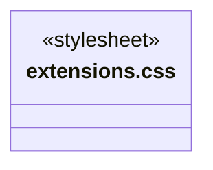

### runtime-navigation.ts

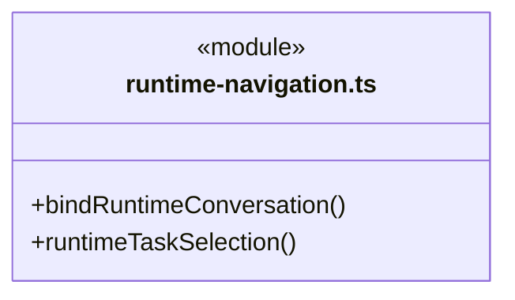

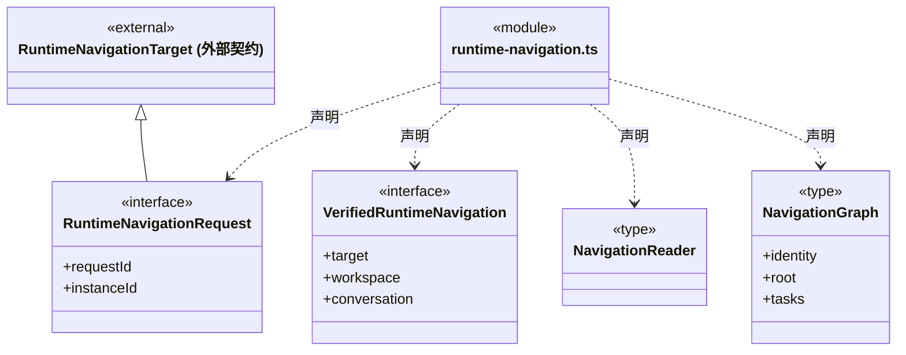

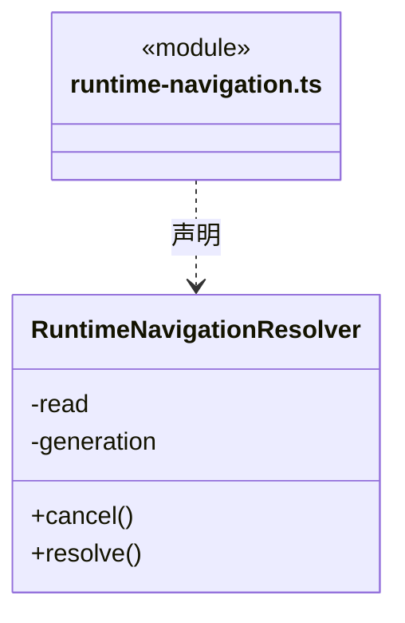

直接依赖：[../../bridge/contracts/workspace.ts](../../bridge/contracts/workspace.ts)、[../../bridge/contracts/dispatch.ts](../../bridge/contracts/dispatch.ts)、[../runtime/runtime-view-state.ts](../runtime/runtime-view-state.ts)、[tabs.ts](tabs.ts)。

### shell.css

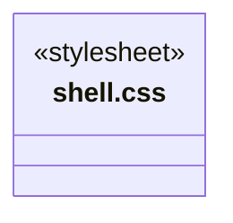

### state-labels.ts

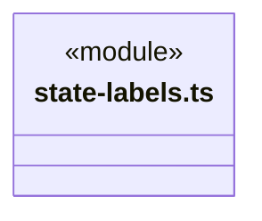

### tabs.ts

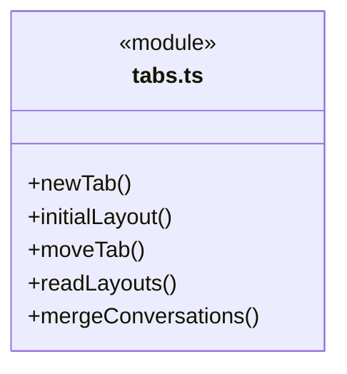

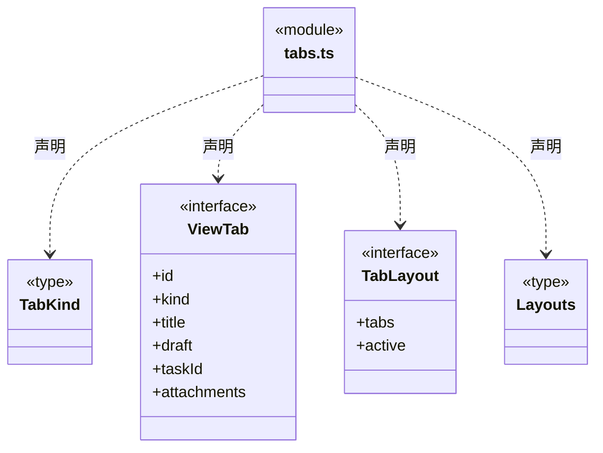

直接依赖：[../../bridge/contracts/chat.ts](../../bridge/contracts/chat.ts)。

### UserMenu.tsx

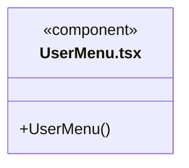

直接依赖：[../components/Icon.tsx](../components/Icon.tsx)。

### useSidebarWidth.ts

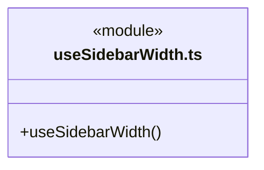

### workspace-list.css

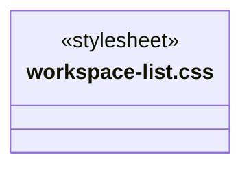

### WorkspaceList.tsx

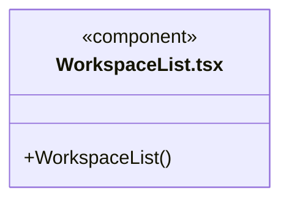

直接依赖：[../../bridge/contracts/workspace.ts](../../bridge/contracts/workspace.ts)、[tabs.ts](tabs.ts)、[../components/Icon.tsx](../components/Icon.tsx)、[state-labels.ts](state-labels.ts)、[workspace-list.css](workspace-list.css)。

### 本目录调用边界

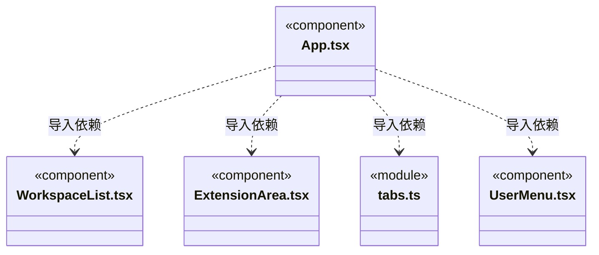

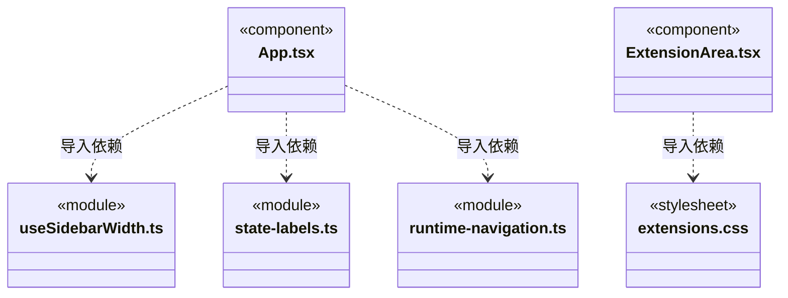

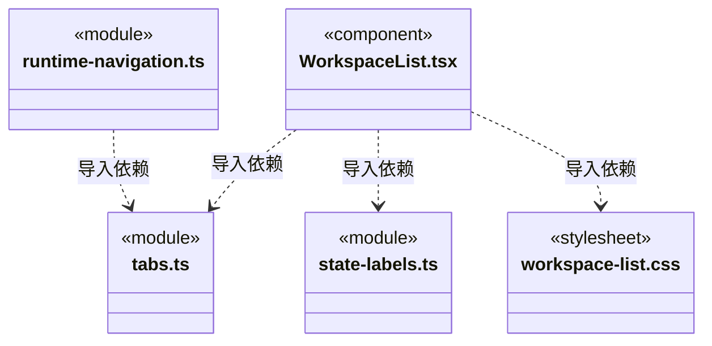

## 子目录导航

无子目录。

[返回上层](../ARCHITECTURE.md)。

每次修改本目录代码，同步维护文件头、关键契约说明及本图。未实现的治理、证据验收和自动编排能力不列入当前类图。

## 设计契约 v1 与落地范围

以下内容区分已接通能力与后续设计；以各节的实现状态为准，不将目标图当作现状图。维护源：[CONTRACT.md](CONTRACT.md)；生成类图时同步附加，勿直接修改本附录。

# 工作区外壳与原会话定位

`App` 保存工作区页签、草稿与附件，界面选择不代表后端运行。全局“运行管理”挂载独立只读 `RuntimeOverview`；离开该页卸载其读取，不创建或恢复任务。

运行页的 `onOpen` 只携带 `workspaceId/rootSessionId` 与可选 `scopeId/taskId`。`RuntimeNavigationResolver` 依次读取工作区清单、该工作区的 `loop.list`、再次读取清单，要求同一实例始终为 running，且原根存在真实 chat 记录并属于该工作区。缺失、不可读或身份冲突明确失败，不调用 open、chat、resume、dispatch 或重试接口。

导航只复用已绑定该根的聊天页签；本机没有页签时，新增绑定真实历史的页签，不挪用未发送草稿页签，不改原标题、草稿或附件。两次点击不会建立重复绑定。切屏、新导航和卸载使旧请求失效，迟到失败也不覆盖新页面。工作区实例变化重新挂载会话投影，原本机草稿保持。

一次性 `RuntimeNavigationRequest` 交给 `Conversation`；任务图与周期加载完成后再次核对原身份并消费。选中旧周期仅影响展示，不改变实际开放目标。消费后请求清除，后续轮询或返回对话不会重复重置用户选择；不存在节点和周期不回退为最新目标。
