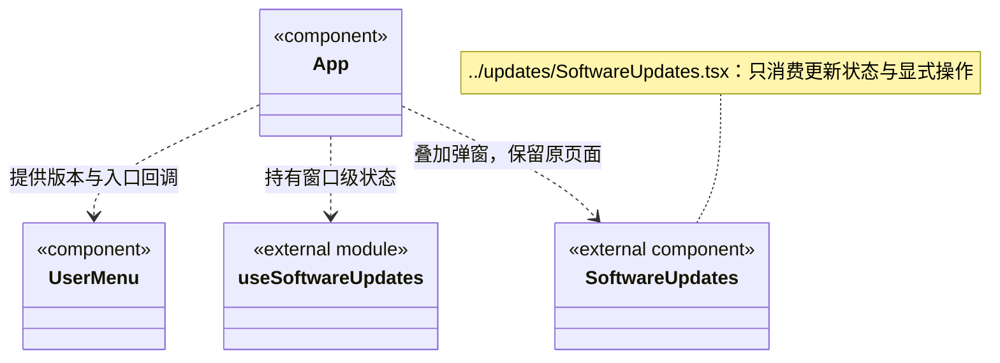

# 工作区外壳与原会话定位

`App` 保存工作区页签、草稿与附件，界面选择不代表后端运行。全局“运行管理”挂载独立只读 `RuntimeOverview`；离开该页卸载其读取，不创建或恢复任务。

账号菜单展示当前版本、检查／查看更新与“最近一次更新”，未登录也可使用。`App` 挂载唯一 `useSoftwareUpdates`，把同一快照交给 `UserMenu`、新版提醒与 `SoftwareUpdates` 弹窗；菜单不读取或修改更新服务。查看日志和点击提醒只打开原生模态框，不切换 screen，不触发离页检查或卸载原会话／设置表单；Escape／关闭回到原按钮。明确“检查更新”才请求检查，已有新版直接展示，下载与重启安装各自需要点击。

更新呈现独立归入 [updates](../updates/ARCHITECTURE.md)，通过固定 IPC 依赖公开更新契约，不将账号登录、菜单展示或弹窗状态放进 backend/updater。菜单位置是本次已确认的变化点；检查、下载与排空安装的规则保持原后端归属，变化频率没有统计结论。

运行页的 `onOpen` 只携带 `workspaceId/rootSessionId` 与可选 `scopeId/taskId`。`RuntimeNavigationResolver` 依次读取工作区清单、该工作区的 `loop.list`、再次读取清单，要求同一实例始终为 running，且原根存在真实 chat 记录并属于该工作区。缺失、不可读或身份冲突明确失败，不调用 open、chat、resume、dispatch 或重试接口。

导航只复用已绑定该根的聊天页签；本机没有页签时，新增绑定真实历史的页签，不挪用未发送草稿页签，不改原标题、草稿或附件。两次点击不会建立重复绑定。切屏、新导航和卸载使旧请求失效，迟到失败也不覆盖新页面。工作区实例变化重新挂载会话投影，原本机草稿保持。

一次性 `RuntimeNavigationRequest` 交给 `Conversation`；任务图与周期加载完成后再次核对原身份并消费。选中旧周期仅影响展示，不改变实际开放目标。消费后请求清除，后续轮询或返回对话不会重复重置用户选择；不存在节点和周期不回退为最新目标。
