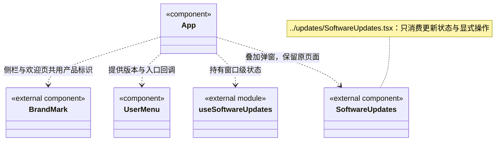

# 工作区外壳与原会话定位

对话列表与会话历史菜单共用 `ConversationEntries` 和本机 `TabLayout`：自定义标题不覆盖原任务目标，移除条目保存工作区隔离的 `hiddenTaskIds`，轮询和重开不复活；删除最后一项创建空对话，不停止后台运行或删除日志。运行总览的显式定位可以恢复被移除条目。红色运行灯取 `runtime.snapshot` 的 ready 工作区及实际主／成员 running 记录，排队、历史状态和持久等待不点亮，读取失败清除观察。工作区菜单使用 portal 以点击坐标锚定左上角，视口边缘避让，支持键盘与焦点返回；折叠按钮紧邻项目名。

`ExtensionArea` 向业务架构传递完整的 `WorkspaceView` 与共享快照，使负责人入口复用项目岗位登记时仍核实真实运行状态和实例。登记、返回原模块及选择状态由业务视图持有；外壳不生成岗位或执行责任写入。

`App` 保存工作区页签、草稿与附件，界面选择不代表后端运行。全局“运行管理”挂载独立只读 `RuntimeOverview`；离开该页卸载其读取，不创建或恢复任务。

侧栏使用大写简称 CBIM 和 `components/BrandMark`，欢迎页展示完整名称 CBIM Assistant。BrandMark 直接引用品牌 SVG，外壳样式只约束尺寸和排版；用户头像与产品标识保持各自语义，不改变账号或工作区状态。

账号菜单只有一个“版本与更新”，同时展示最近检查时间，未登录也可使用。有新版时按同一公开状态高亮菜单并在用户栏显示带可访问名称的主题绿点；关闭横幅不移除这两个提醒。`App` 挂载唯一 `useSoftwareUpdates`，同一快照交给菜单、提醒和弹窗；菜单不自行请求更新服务。打开入口只叠加原生模态框，不切换 screen、不卸载原会话或设置表单；Escape／关闭回到原按钮。弹窗可手动检查，点击下载后由后端继续校验、排空及自动安装重启；窗口不追加 install 调用，失败后才提供明确重试。

更新呈现独立归入 [updates](../updates/ARCHITECTURE.md)，通过固定 IPC 依赖公开更新契约，不将账号登录、菜单展示或弹窗状态放进 backend/updater。菜单位置是本次已确认的变化点；检查、下载与排空安装的规则保持原后端归属，变化频率没有统计结论。

运行页的 `onOpen` 只携带 `workspaceId/rootSessionId` 与可选 `scopeId/taskId`。`RuntimeNavigationResolver` 依次读取工作区清单、该工作区的 `loop.list`、再次读取清单，要求同一实例始终为 running，且原根存在真实 chat 记录并属于该工作区。缺失、不可读或身份冲突明确失败，不调用 open、chat、resume、dispatch 或重试接口。

导航只复用已绑定该根的聊天页签；本机没有页签时，新增绑定真实历史的页签，不挪用未发送草稿页签，不改原标题、草稿或附件。两次点击不会建立重复绑定。切屏、新导航和卸载使旧请求失效，迟到失败也不覆盖新页面。工作区实例变化重新挂载会话投影，原本机草稿保持。

一次性 `RuntimeNavigationRequest` 交给 `Conversation`；任务图与周期加载完成后再次核对原身份并消费。选中旧周期仅影响展示，不改变实际开放目标。消费后请求清除，后续轮询或返回对话不会重复重置用户选择；不存在节点和周期不回退为最新目标。

扩展区将真实治理启动回执交给 Shell，按原工作区绑定新会话，不覆盖其他草稿。右上运行绿点与展开工作区详情入口已移除；工作区管理在左侧更多菜单中保留，不删除后台状态或既有任务。团队文件编辑与业务编辑共用页签离开保护。

## 自动化会话定位

App 将自动化历史的真实 taskId 交给 showStartedTask，复用已有会话或新建条目，保留原草稿和附件；不重新运行任务。右侧旧自动化条目复用同一工作区视图，不建立第二份配置或调度服务。
