# src/frontend/tasks 架构

## 目录定位

主会话任务图及独立目标增量；显式补充使用持久冻结请求。成员节点按需核实执行事实，图变化标记旧报告，分页基线不拼接；核实不启动模型，未知结果不当作未执行，候选不替代验收。

本文描述当前实现。通过分析目录边界后维护的 [源码架构脚本](../../../scripts/source-architecture.mjs) 同步清单和声明；代码变更时仍须核对职责、关键成员与关系。

## 代码清单

| 文件 | 当前职责 |
| --- | --- |
| [continuation-state.ts](continuation-state.ts) | 管理显式目标补充的本地草稿、冻结请求与回执，不直接依赖 React 或桌面全局对象。 |
| [DispatchGraph.tsx](DispatchGraph.tsx) | 把当前主会话的已提交派发图绘制为可选择的任务节点流程图。 |
| [execution-report-state.ts](execution-report-state.ts) | 验证成员执行核实报告的身份和分页基线，并保存一次显式读取的前端状态。 |
| [execution-report.css](execution-report.css) | 选中成员任务的只读执行核实报告排版。 |
| [FlowView.tsx](FlowView.tsx) | 显示知识校验和索引任务的实际状态与结果。 |
| [graph-layout.ts](graph-layout.ts) | 为主会话任务图计算可测试的 DAG 分层坐标与有向连线路径，供任务视图绘制。 |
| [graph-state.ts](graph-state.ts) | 主会话派发图的前端增量投影，核对身份和游标后原子合并完整提交。 |
| [member-activity.css](member-activity.css) | 主对话中的成员活动卡片与任务节点详情排版。 |
| [member-event-state.ts](member-event-state.ts) | 把成员公开事件分页归并为稳定的运行视图，供卡片与任务详情共用。 |
| [MemberActivity.tsx](MemberActivity.tsx) | 在主对话中展示最近的成员任务与公开执行动态，并链接到对应任务节点详情。 |
| [MemberExecutionReport.tsx](MemberExecutionReport.tsx) | 在任务节点详情中展示一次显式核实的派发、日志与工具回执报告，独立于成员流式正文。 |
| [MemberRunTranscript.tsx](MemberRunTranscript.tsx) | 以成员身份显示公开消息和工具过程，供主会话成员卡片及任务详情共用。 |
| [MemberTaskDetail.tsx](MemberTaskDetail.tsx) | 展示任务图选中成员的公开运行正文、工具过程、计划与候选，以及独立的只读执行核实报告。 |
| [scope-goal.css](scope-goal.css) | 对话摘要与任务根详情共用的目标计划卡片、历史选择和证据排版。 |
| [scope-state.ts](scope-state.ts) | 主会话目标周期的增量投影和展示状态，供对话摘要与任务根详情共用。 |
| [ScopeContinuationForm.tsx](ScopeContinuationForm.tsx) | 目标卡片中的显式纯文本补充入口，展示已冻结请求、查询与同命令重试。 |
| [ScopeGoalPanel.tsx](ScopeGoalPanel.tsx) | 复用展示本轮真实目标、静态角色分配、逐项审阅及历史周期，供主对话摘要和任务根详情使用。 |
| [SessionTaskView.tsx](SessionTaskView.tsx) | 以节点流程图展示当前主会话的派发任务，并在选择根或任务后显示对应执行详情。 |
| [task-graph.css](task-graph.css) | 主会话派发图、可读任务节点与按需详情的自适应布局。 |
| [useExecutionReport.ts](useExecutionReport.ts) | 为选中成员任务装配只读核实控制器，将图/周期变化投影为报告过期提示。 |
| [useMemberRun.ts](useMemberRun.ts) | 按成员运行身份轮询公开流式事件，支持卡片预览与任务详情的增量读取。 |
| [useScopeContinuation.ts](useScopeContinuation.ts) | 在主会话层装配唯一补充控制器，向对话卡和任务根提供同一份草稿、提交锁及回执状态。 |
| [useSessionGraph.ts](useSessionGraph.ts) | 按主对话 taskId 同步派发图、目标摘要和选中详情，为主对话和任务图提供同一投影与历史选择。 |

## 架构类图

### continuation-state.ts

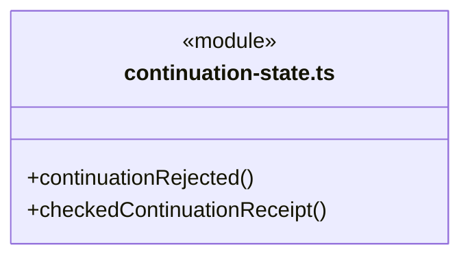

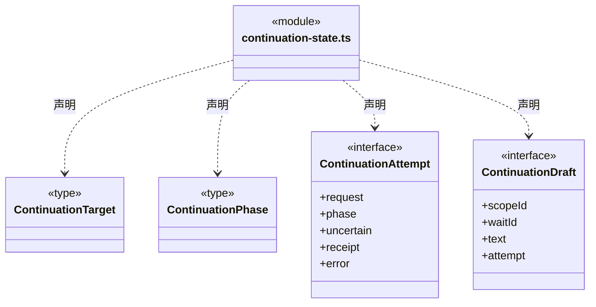

成员 1/2（同名节点为同一声明，跨图合并阅读）。

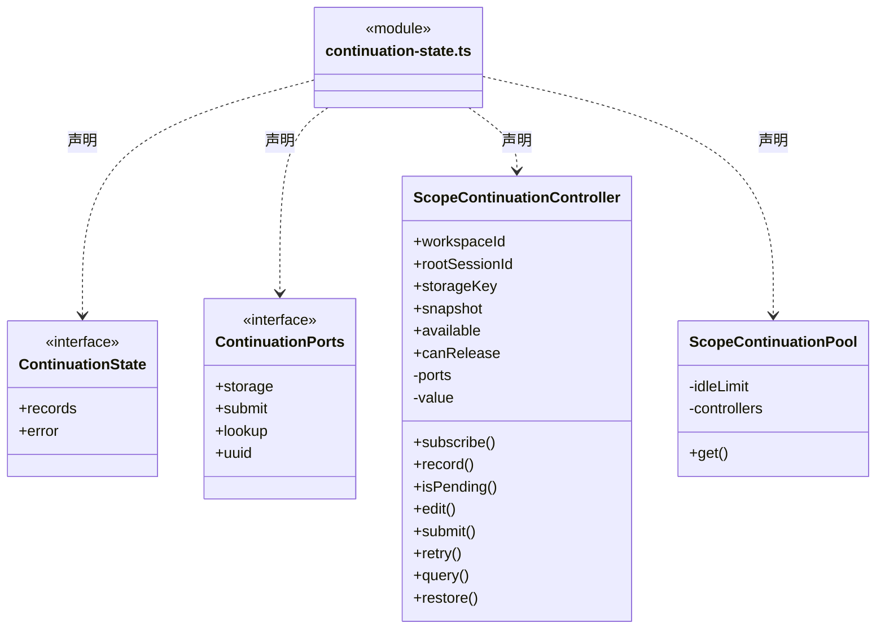

成员 2/2（同名节点为同一声明，跨图合并阅读）。

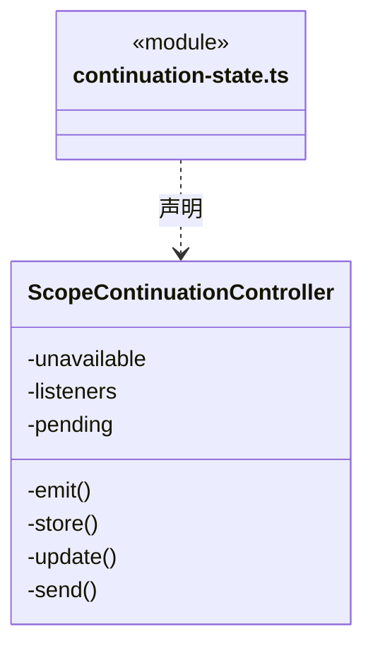

直接依赖：[../../bridge/contracts/dispatch.ts](../../bridge/contracts/dispatch.ts)。

### DispatchGraph.tsx

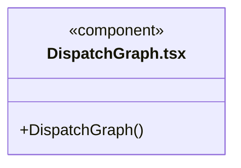

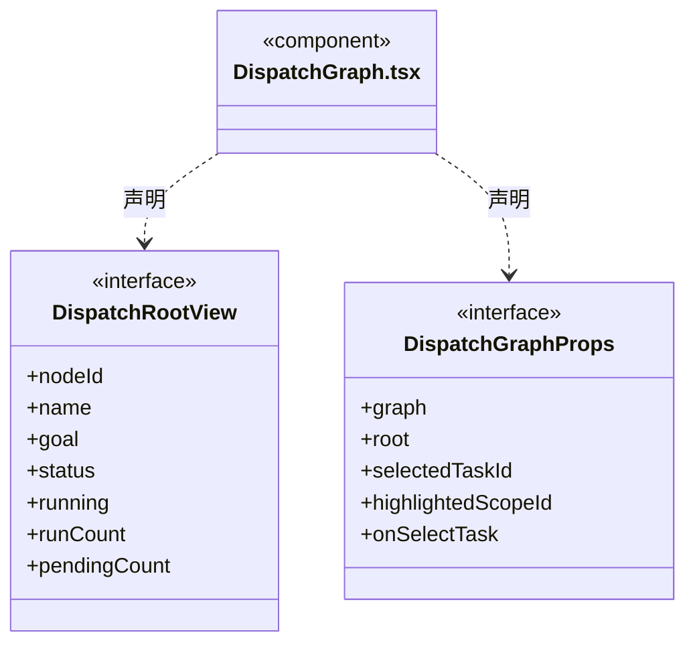

直接依赖：[../../bridge/contracts/dispatch.ts](../../bridge/contracts/dispatch.ts)、[../components/Icon.tsx](../components/Icon.tsx)、[graph-layout.ts](graph-layout.ts)、[task-graph.css](task-graph.css)。

### execution-report-state.ts

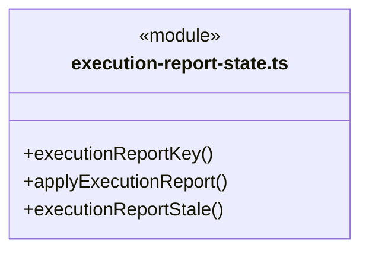

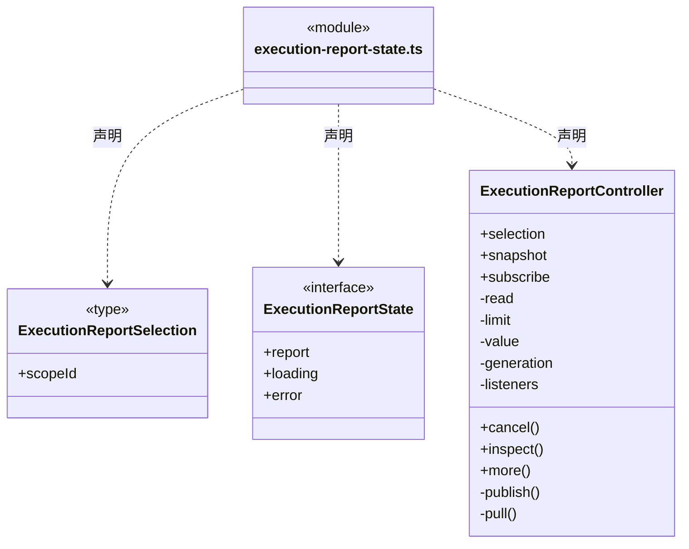

直接依赖：[../../bridge/contracts/dispatch.ts](../../bridge/contracts/dispatch.ts)。

### execution-report.css

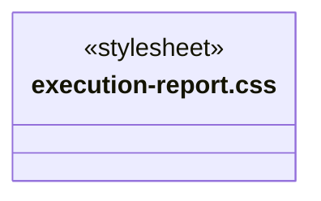

### FlowView.tsx

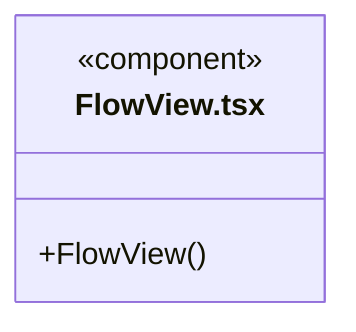

直接依赖：[../../bridge/contracts/workspace.ts](../../bridge/contracts/workspace.ts)、[../components/Icon.tsx](../components/Icon.tsx)、[../components/Empty.tsx](../components/Empty.tsx)、[../shell/state-labels.ts](../shell/state-labels.ts)。

### graph-layout.ts

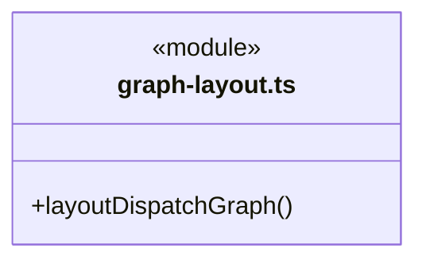

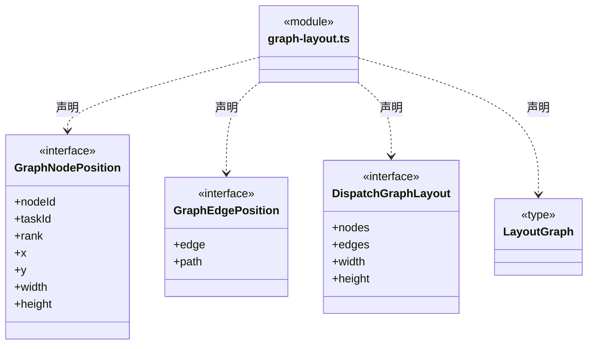

直接依赖：[../../bridge/contracts/dispatch.ts](../../bridge/contracts/dispatch.ts)。

### graph-state.ts

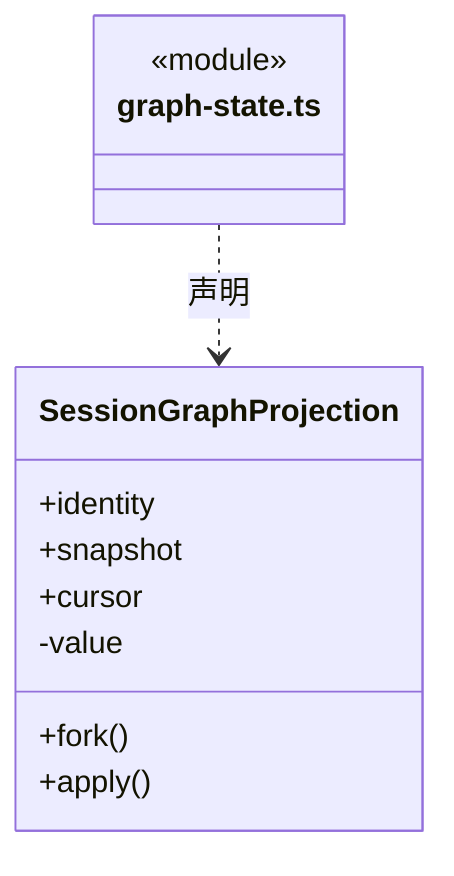

直接依赖：[../../bridge/contracts/dispatch.ts](../../bridge/contracts/dispatch.ts)。

### member-activity.css

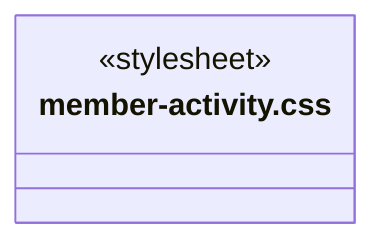

### member-event-state.ts

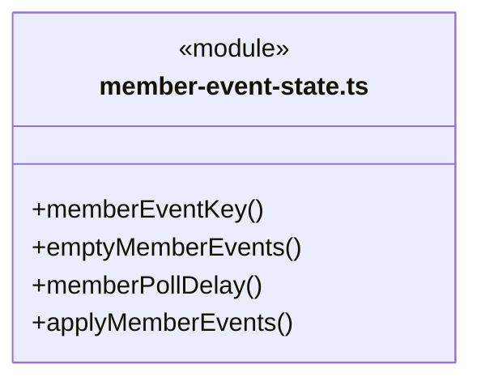

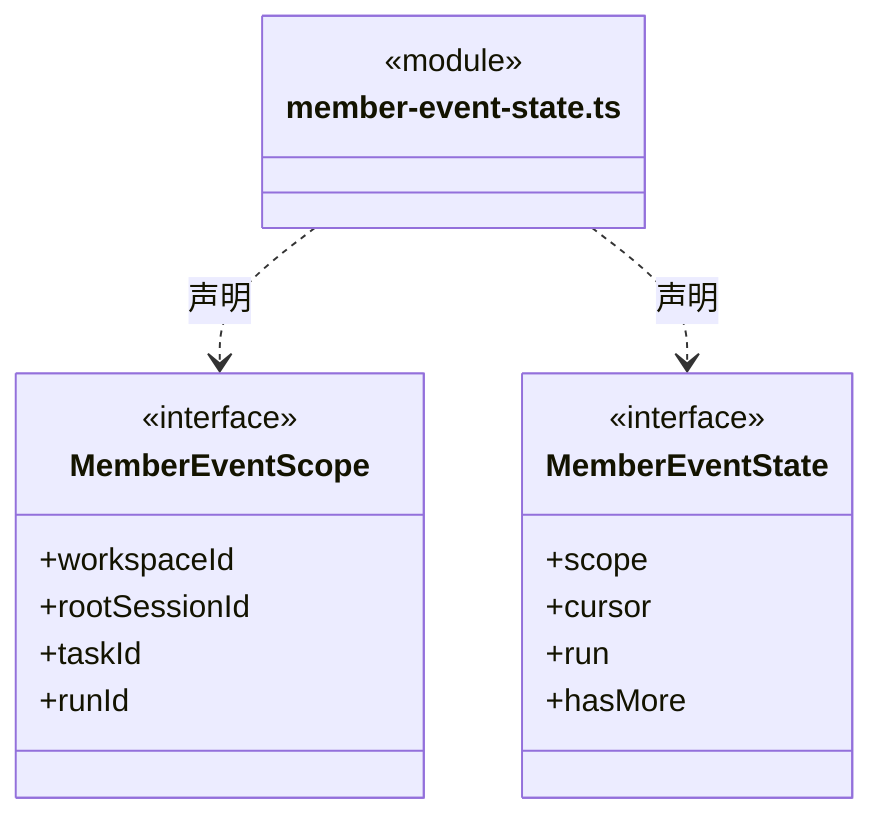

直接依赖：[../../bridge/contracts/dispatch.ts](../../bridge/contracts/dispatch.ts)、[../../bridge/contracts/execution.ts](../../bridge/contracts/execution.ts)。

### MemberActivity.tsx

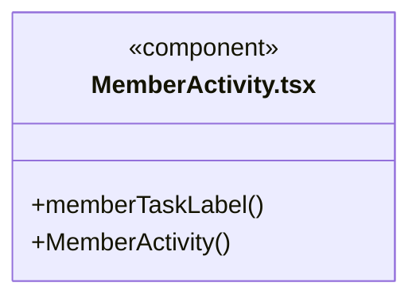

直接依赖：[../../bridge/contracts/dispatch.ts](../../bridge/contracts/dispatch.ts)、[../components/Icon.tsx](../components/Icon.tsx)、[useMemberRun.ts](useMemberRun.ts)、[MemberRunTranscript.tsx](MemberRunTranscript.tsx)、[member-activity.css](member-activity.css)。

### MemberExecutionReport.tsx

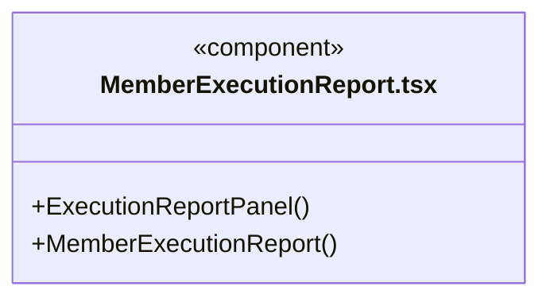

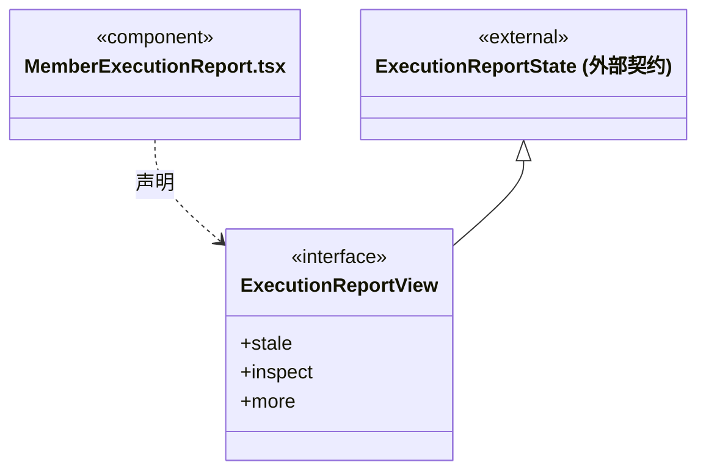

直接依赖：[../../bridge/contracts/dispatch.ts](../../bridge/contracts/dispatch.ts)、[useExecutionReport.ts](useExecutionReport.ts)、[execution-report-state.ts](execution-report-state.ts)、[execution-report.css](execution-report.css)。

### MemberRunTranscript.tsx

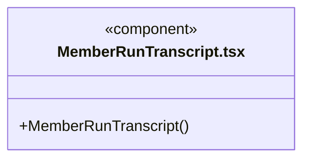

直接依赖：[../../bridge/contracts/execution.ts](../../bridge/contracts/execution.ts)、[../conversation/transcript.ts](../conversation/transcript.ts)、[../conversation/MarkdownMessage.tsx](../conversation/MarkdownMessage.tsx)、[../conversation/WorkStatus.tsx](../conversation/WorkStatus.tsx)。

### MemberTaskDetail.tsx

```mermaid
classDiagram
class N_src_frontend_tasks_MemberTaskDetail_tsx["MemberTaskDetail.tsx"] {
  <<component>>
  +MemberTaskDetail()
}
```

直接依赖：[../../bridge/contracts/dispatch.ts](../../bridge/contracts/dispatch.ts)、[../../bridge/contracts/execution.ts](../../bridge/contracts/execution.ts)、[../../bridge/contracts/chat.ts](../../bridge/contracts/chat.ts)、[../conversation/QuestionCard.tsx](../conversation/QuestionCard.tsx)、[useMemberRun.ts](useMemberRun.ts)、[MemberRunTranscript.tsx](MemberRunTranscript.tsx)、[MemberExecutionReport.tsx](MemberExecutionReport.tsx)、[MemberActivity.tsx](MemberActivity.tsx)、[member-activity.css](member-activity.css)。

### scope-goal.css

```mermaid
classDiagram
class N_src_frontend_tasks_scope_goal_css["scope-goal.css"] {
  <<stylesheet>>
}
```

### scope-state.ts

```mermaid
classDiagram
class N_src_frontend_tasks_scope_state_ts["scope-state.ts"] {
  <<module>>
  +scopeGoalView()
  +currentScope()
  +completeSessionRead()
}
```

```mermaid
classDiagram
class N_src_frontend_tasks_scope_state_ts["scope-state.ts"] {
  <<module>>
}
class N_src_frontend_tasks_scope_state_ts_SessionScopeProjection["SessionScopeProjection"] {
  +identity
  +snapshot
  +cursor
  +fork()
  +apply()
  -value
}
N_src_frontend_tasks_scope_state_ts ..> N_src_frontend_tasks_scope_state_ts_SessionScopeProjection : 声明
class N_src_frontend_tasks_scope_state_ts_GoalView["GoalView"] {
  <<interface>>
  +label
  +tone
  +phase
}
N_src_frontend_tasks_scope_state_ts ..> N_src_frontend_tasks_scope_state_ts_GoalView : 声明
class N_src_frontend_tasks_scope_state_ts_SessionReadProjection["SessionReadProjection"] {
  +identity
  +graph
  +scopes
  +graphCursor
  +scopeCursor
  +selected()
  +detailStamp()
  +detail()
  +apply()
  -graphs
  -goals
  -details
}
N_src_frontend_tasks_scope_state_ts ..> N_src_frontend_tasks_scope_state_ts_SessionReadProjection : 声明
class N_src_frontend_tasks_scope_state_ts_ScopeGoalState["ScopeGoalState"] {
  <<interface>>
  +scopes
  +selectedScopeId
  +historyScopeId
  +selectedScope
  +openScope
  +activeScope
  +waitingScope
  +selectedGoalView
  +currentGoalView
  +graph
  +loading
  +detailLoading
  +error
  +selectScope
}
N_src_frontend_tasks_scope_state_ts ..> N_src_frontend_tasks_scope_state_ts_ScopeGoalState : 声明
```

直接依赖：[../../bridge/contracts/dispatch.ts](../../bridge/contracts/dispatch.ts)、[graph-state.ts](graph-state.ts)。

### ScopeContinuationForm.tsx

```mermaid
classDiagram
class N_src_frontend_tasks_ScopeContinuationForm_tsx["ScopeContinuationForm.tsx"] {
  <<component>>
  +ScopeContinuationForm()
}
```

直接依赖：[useScopeContinuation.ts](useScopeContinuation.ts)。

### ScopeGoalPanel.tsx

```mermaid
classDiagram
class N_src_frontend_tasks_ScopeGoalPanel_tsx["ScopeGoalPanel.tsx"] {
  <<component>>
  +ScopeGoalPanel()
}
```

```mermaid
classDiagram
class N_src_frontend_tasks_ScopeGoalPanel_tsx["ScopeGoalPanel.tsx"] {
  <<component>>
}
class N_src_frontend_tasks_ScopeGoalPanel_tsx_ScopeGoalPanelProps["ScopeGoalPanelProps"] {
  <<interface>>
  +state
  +compact
  +testId
  +continuation
}
N_src_frontend_tasks_ScopeGoalPanel_tsx ..> N_src_frontend_tasks_ScopeGoalPanel_tsx_ScopeGoalPanelProps : 声明
```

直接依赖：[scope-state.ts](scope-state.ts)、[../components/Icon.tsx](../components/Icon.tsx)、[ScopeContinuationForm.tsx](ScopeContinuationForm.tsx)、[useScopeContinuation.ts](useScopeContinuation.ts)、[scope-goal.css](scope-goal.css)。

### SessionTaskView.tsx

```mermaid
classDiagram
class N_src_frontend_tasks_SessionTaskView_tsx["SessionTaskView.tsx"] {
  <<component>>
  +sessionRuns()
  +sessionRoot()
  +SessionTaskView()
}
```

成员 1/2（同名节点为同一声明，跨图合并阅读）。

```mermaid
classDiagram
class N_src_frontend_tasks_SessionTaskView_tsx["SessionTaskView.tsx"] {
  <<component>>
}
class N_src_frontend_tasks_SessionTaskView_tsx_SessionTaskViewProps["SessionTaskViewProps"] {
  <<interface>>
  +workspaceId
  +taskId
  +runs
  +queued
  +now
  +busy
  +onQueueChange
  +onQueueContinue
  +onChat
  +onStop
  +graph
  +graphLoading
  +graphError
  +onRefreshGraph
  +scopeState
  +continuation
}
N_src_frontend_tasks_SessionTaskView_tsx ..> N_src_frontend_tasks_SessionTaskView_tsx_SessionTaskViewProps : 声明
```

成员 2/2（同名节点为同一声明，跨图合并阅读）。

```mermaid
classDiagram
class N_src_frontend_tasks_SessionTaskView_tsx["SessionTaskView.tsx"] {
  <<component>>
}
class N_src_frontend_tasks_SessionTaskView_tsx_SessionTaskViewProps["SessionTaskViewProps"] {
  <<interface>>
  +active
  +selectedTaskId
  +onSelectTask
}
N_src_frontend_tasks_SessionTaskView_tsx ..> N_src_frontend_tasks_SessionTaskView_tsx_SessionTaskViewProps : 声明
```

直接依赖：[../../bridge/contracts/execution.ts](../../bridge/contracts/execution.ts)、[../../bridge/contracts/dispatch.ts](../../bridge/contracts/dispatch.ts)、[../conversation/WorkStatus.tsx](../conversation/WorkStatus.tsx)、[../conversation/MessageQueue.tsx](../conversation/MessageQueue.tsx)、[DispatchGraph.tsx](DispatchGraph.tsx)、[MemberTaskDetail.tsx](MemberTaskDetail.tsx)、[ScopeGoalPanel.tsx](ScopeGoalPanel.tsx)、[scope-state.ts](scope-state.ts)、[useScopeContinuation.ts](useScopeContinuation.ts)、[task-graph.css](task-graph.css)。

### task-graph.css

```mermaid
classDiagram
class N_src_frontend_tasks_task_graph_css["task-graph.css"] {
  <<stylesheet>>
}
```

### useExecutionReport.ts

```mermaid
classDiagram
class N_src_frontend_tasks_useExecutionReport_ts["useExecutionReport.ts"] {
  <<module>>
  +useExecutionReport()
}
```

直接依赖：[../../bridge/contracts/dispatch.ts](../../bridge/contracts/dispatch.ts)、[execution-report-state.ts](execution-report-state.ts)。

### useMemberRun.ts

```mermaid
classDiagram
class N_src_frontend_tasks_useMemberRun_ts["useMemberRun.ts"] {
  <<module>>
  +useMemberRun()
}
```

直接依赖：[member-event-state.ts](member-event-state.ts)。

### useScopeContinuation.ts

```mermaid
classDiagram
class N_src_frontend_tasks_useScopeContinuation_ts["useScopeContinuation.ts"] {
  <<module>>
  +continuationTarget()
  +useScopeContinuation()
}
```

```mermaid
classDiagram
class N_src_frontend_tasks_useScopeContinuation_ts["useScopeContinuation.ts"] {
  <<module>>
}
class N_src_frontend_tasks_useScopeContinuation_ts_ContinuationModel["ContinuationModel"] {
  <<interface>>
  +options
  +label
}
N_src_frontend_tasks_useScopeContinuation_ts ..> N_src_frontend_tasks_useScopeContinuation_ts_ContinuationModel : 声明
class N_src_frontend_tasks_useScopeContinuation_ts_ScopeContinuationView["ScopeContinuationView"] {
  <<interface>>
  +scopeId
  +waitId
  +text
  +record
  +editable
  +canSubmit
  +canRetry
  +pending
  +error
  +modelLabel
  +edit
  +submit
  +query
  +retry
}
N_src_frontend_tasks_useScopeContinuation_ts ..> N_src_frontend_tasks_useScopeContinuation_ts_ScopeContinuationView : 声明
```

直接依赖：[../../bridge/contracts/dispatch.ts](../../bridge/contracts/dispatch.ts)、[scope-state.ts](scope-state.ts)、[continuation-state.ts](continuation-state.ts)。

### useSessionGraph.ts

```mermaid
classDiagram
class N_src_frontend_tasks_useSessionGraph_ts["useSessionGraph.ts"] {
  <<module>>
  +useSessionGraph()
}
```

直接依赖：[../../bridge/contracts/dispatch.ts](../../bridge/contracts/dispatch.ts)、[scope-state.ts](scope-state.ts)。

### 本目录调用边界

```mermaid
classDiagram
class N_src_frontend_tasks_DispatchGraph_tsx["DispatchGraph.tsx"] {
  <<component>>
}
class N_src_frontend_tasks_graph_layout_ts["graph-layout.ts"] {
  <<module>>
}
class N_src_frontend_tasks_task_graph_css["task-graph.css"] {
  <<stylesheet>>
}
class N_src_frontend_tasks_MemberActivity_tsx["MemberActivity.tsx"] {
  <<component>>
}
class N_src_frontend_tasks_useMemberRun_ts["useMemberRun.ts"] {
  <<module>>
}
class N_src_frontend_tasks_MemberRunTranscript_tsx["MemberRunTranscript.tsx"] {
  <<component>>
}
N_src_frontend_tasks_DispatchGraph_tsx ..> N_src_frontend_tasks_graph_layout_ts : 导入依赖
N_src_frontend_tasks_DispatchGraph_tsx ..> N_src_frontend_tasks_task_graph_css : 导入依赖
N_src_frontend_tasks_MemberActivity_tsx ..> N_src_frontend_tasks_useMemberRun_ts : 导入依赖
N_src_frontend_tasks_MemberActivity_tsx ..> N_src_frontend_tasks_MemberRunTranscript_tsx : 导入依赖
```

```mermaid
classDiagram
class N_src_frontend_tasks_MemberActivity_tsx["MemberActivity.tsx"] {
  <<component>>
}
class N_src_frontend_tasks_member_activity_css["member-activity.css"] {
  <<stylesheet>>
}
class N_src_frontend_tasks_MemberExecutionReport_tsx["MemberExecutionReport.tsx"] {
  <<component>>
}
class N_src_frontend_tasks_useExecutionReport_ts["useExecutionReport.ts"] {
  <<module>>
}
class N_src_frontend_tasks_execution_report_state_ts["execution-report-state.ts"] {
  <<module>>
}
class N_src_frontend_tasks_execution_report_css["execution-report.css"] {
  <<stylesheet>>
}
N_src_frontend_tasks_MemberActivity_tsx ..> N_src_frontend_tasks_member_activity_css : 导入依赖
N_src_frontend_tasks_MemberExecutionReport_tsx ..> N_src_frontend_tasks_useExecutionReport_ts : 导入依赖
N_src_frontend_tasks_MemberExecutionReport_tsx ..> N_src_frontend_tasks_execution_report_state_ts : 导入依赖
N_src_frontend_tasks_MemberExecutionReport_tsx ..> N_src_frontend_tasks_execution_report_css : 导入依赖
```

```mermaid
classDiagram
class N_src_frontend_tasks_MemberTaskDetail_tsx["MemberTaskDetail.tsx"] {
  <<component>>
}
class N_src_frontend_tasks_useMemberRun_ts["useMemberRun.ts"] {
  <<module>>
}
class N_src_frontend_tasks_MemberRunTranscript_tsx["MemberRunTranscript.tsx"] {
  <<component>>
}
class N_src_frontend_tasks_MemberExecutionReport_tsx["MemberExecutionReport.tsx"] {
  <<component>>
}
class N_src_frontend_tasks_MemberActivity_tsx["MemberActivity.tsx"] {
  <<component>>
}
N_src_frontend_tasks_MemberTaskDetail_tsx ..> N_src_frontend_tasks_useMemberRun_ts : 导入依赖
N_src_frontend_tasks_MemberTaskDetail_tsx ..> N_src_frontend_tasks_MemberRunTranscript_tsx : 导入依赖
N_src_frontend_tasks_MemberTaskDetail_tsx ..> N_src_frontend_tasks_MemberExecutionReport_tsx : 导入依赖
N_src_frontend_tasks_MemberTaskDetail_tsx ..> N_src_frontend_tasks_MemberActivity_tsx : 导入依赖
```

```mermaid
classDiagram
class N_src_frontend_tasks_MemberTaskDetail_tsx["MemberTaskDetail.tsx"] {
  <<component>>
}
class N_src_frontend_tasks_member_activity_css["member-activity.css"] {
  <<stylesheet>>
}
class N_src_frontend_tasks_scope_state_ts["scope-state.ts"] {
  <<module>>
}
class N_src_frontend_tasks_graph_state_ts["graph-state.ts"] {
  <<module>>
}
class N_src_frontend_tasks_ScopeContinuationForm_tsx["ScopeContinuationForm.tsx"] {
  <<component>>
}
class N_src_frontend_tasks_useScopeContinuation_ts["useScopeContinuation.ts"] {
  <<module>>
}
class N_src_frontend_tasks_ScopeGoalPanel_tsx["ScopeGoalPanel.tsx"] {
  <<component>>
}
N_src_frontend_tasks_MemberTaskDetail_tsx ..> N_src_frontend_tasks_member_activity_css : 导入依赖
N_src_frontend_tasks_scope_state_ts ..> N_src_frontend_tasks_graph_state_ts : 导入依赖
N_src_frontend_tasks_ScopeContinuationForm_tsx ..> N_src_frontend_tasks_useScopeContinuation_ts : 导入依赖
N_src_frontend_tasks_ScopeGoalPanel_tsx ..> N_src_frontend_tasks_scope_state_ts : 导入依赖
```

```mermaid
classDiagram
class N_src_frontend_tasks_ScopeGoalPanel_tsx["ScopeGoalPanel.tsx"] {
  <<component>>
}
class N_src_frontend_tasks_ScopeContinuationForm_tsx["ScopeContinuationForm.tsx"] {
  <<component>>
}
class N_src_frontend_tasks_useScopeContinuation_ts["useScopeContinuation.ts"] {
  <<module>>
}
class N_src_frontend_tasks_scope_goal_css["scope-goal.css"] {
  <<stylesheet>>
}
class N_src_frontend_tasks_SessionTaskView_tsx["SessionTaskView.tsx"] {
  <<component>>
}
class N_src_frontend_tasks_DispatchGraph_tsx["DispatchGraph.tsx"] {
  <<component>>
}
N_src_frontend_tasks_ScopeGoalPanel_tsx ..> N_src_frontend_tasks_ScopeContinuationForm_tsx : 导入依赖
N_src_frontend_tasks_ScopeGoalPanel_tsx ..> N_src_frontend_tasks_useScopeContinuation_ts : 导入依赖
N_src_frontend_tasks_ScopeGoalPanel_tsx ..> N_src_frontend_tasks_scope_goal_css : 导入依赖
N_src_frontend_tasks_SessionTaskView_tsx ..> N_src_frontend_tasks_DispatchGraph_tsx : 导入依赖
```

```mermaid
classDiagram
class N_src_frontend_tasks_SessionTaskView_tsx["SessionTaskView.tsx"] {
  <<component>>
}
class N_src_frontend_tasks_MemberTaskDetail_tsx["MemberTaskDetail.tsx"] {
  <<component>>
}
class N_src_frontend_tasks_ScopeGoalPanel_tsx["ScopeGoalPanel.tsx"] {
  <<component>>
}
class N_src_frontend_tasks_scope_state_ts["scope-state.ts"] {
  <<module>>
}
class N_src_frontend_tasks_useScopeContinuation_ts["useScopeContinuation.ts"] {
  <<module>>
}
N_src_frontend_tasks_SessionTaskView_tsx ..> N_src_frontend_tasks_MemberTaskDetail_tsx : 导入依赖
N_src_frontend_tasks_SessionTaskView_tsx ..> N_src_frontend_tasks_ScopeGoalPanel_tsx : 导入依赖
N_src_frontend_tasks_SessionTaskView_tsx ..> N_src_frontend_tasks_scope_state_ts : 导入依赖
N_src_frontend_tasks_SessionTaskView_tsx ..> N_src_frontend_tasks_useScopeContinuation_ts : 导入依赖
```

```mermaid
classDiagram
class N_src_frontend_tasks_SessionTaskView_tsx["SessionTaskView.tsx"] {
  <<component>>
}
class N_src_frontend_tasks_task_graph_css["task-graph.css"] {
  <<stylesheet>>
}
class N_src_frontend_tasks_useExecutionReport_ts["useExecutionReport.ts"] {
  <<module>>
}
class N_src_frontend_tasks_execution_report_state_ts["execution-report-state.ts"] {
  <<module>>
}
class N_src_frontend_tasks_useMemberRun_ts["useMemberRun.ts"] {
  <<module>>
}
class N_src_frontend_tasks_member_event_state_ts["member-event-state.ts"] {
  <<module>>
}
class N_src_frontend_tasks_useScopeContinuation_ts["useScopeContinuation.ts"] {
  <<module>>
}
class N_src_frontend_tasks_scope_state_ts["scope-state.ts"] {
  <<module>>
}
N_src_frontend_tasks_SessionTaskView_tsx ..> N_src_frontend_tasks_task_graph_css : 导入依赖
N_src_frontend_tasks_useExecutionReport_ts ..> N_src_frontend_tasks_execution_report_state_ts : 导入依赖
N_src_frontend_tasks_useMemberRun_ts ..> N_src_frontend_tasks_member_event_state_ts : 导入依赖
N_src_frontend_tasks_useScopeContinuation_ts ..> N_src_frontend_tasks_scope_state_ts : 导入依赖
```

```mermaid
classDiagram
class N_src_frontend_tasks_useScopeContinuation_ts["useScopeContinuation.ts"] {
  <<module>>
}
class N_src_frontend_tasks_continuation_state_ts["continuation-state.ts"] {
  <<module>>
}
class N_src_frontend_tasks_useSessionGraph_ts["useSessionGraph.ts"] {
  <<module>>
}
class N_src_frontend_tasks_scope_state_ts["scope-state.ts"] {
  <<module>>
}
N_src_frontend_tasks_useScopeContinuation_ts ..> N_src_frontend_tasks_continuation_state_ts : 导入依赖
N_src_frontend_tasks_useSessionGraph_ts ..> N_src_frontend_tasks_scope_state_ts : 导入依赖
```


## 子目录导航

无子目录。

[返回上层](../ARCHITECTURE.md)。

每次修改本目录代码，同步维护文件头、关键契约说明及本图。未实现的治理、证据验收和自动编排能力不列入当前类图。

## 设计契约 v1 与落地范围

以下内容区分已接通能力与后续设计；以各节的实现状态为准，不将目标图当作现状图。维护源：[CONTRACT.md](CONTRACT.md)；生成类图时同步附加，勿直接修改本附录。

### 主会话任务派发图的增量消费契约

状态：`SessionTaskView` 默认显示真实主会话根与任务节点流程图；`DispatchGraph` 绘制可选择节点及有向派发/依赖连线，`graph-layout.ts` 计算稳定 DAG 布局。点击根后展开 `ScopeGoalPanel` 的真实周期目标、计划、审阅与受阻原因，以及队列和执行轮次；点击业务任务打开 `MemberTaskDetail`。运行轮次或普通问答不会被自动转换为派发任务。

#### 归属与显示内容

图只属于 `workspaceId + rootSessionId` 指定的主 Agent 会话，位于中间会话区的“任务视图”；右侧扩展页签中的团队/业务架构仍属于整个工作区。切换主会话必须换图，不把全工作区任务混到当前会话。

根显示主 Agent 与主会话标识；每个任务节点显示责任 Agent、模块列表、目标、执行状态及必要的等待/失败原因。根是 `SessionRootNode`（`kind: 'session-root'`），业务节点是 `TaskNode`（`kind: 'task'`）；同一个成员多次接单可对应多个节点。组织成员节点与任务节点不可混用。

不同主会话拥有独立主 Agent 实例。根详情显示图根的 `agentInstanceId` 和调度通道，以及运行摘要 `conversationBinding` 中已记录的对话通道。主 Agent 负责调度与受控知识治理，业务任务属于独立执行 Agent；图、成员动态卡和详情不提供主角色业务自执行标识，知识维护也不伪造业务节点。历史缺少绑定时明确提示未知，图与日志绑定冲突时提示重新同步，不用角色名推导身份。

没有派发图但已有主会话身份时，只显示从该会话运行记录提取的主 Agent 根，并说明尚未派发成员任务；新建草稿尚无会话时显示开始对话入口。没有任务时不画虚假的成员节点、连线或进度百分比。图加载失败保留已确认内容并报告同步中断，跨工作区/跨主会话快照不进入视图。

流程图采用从上到下分层：启用的派发边与依赖边共同决定拓扑层级；HTML 节点维持 248×192 像素的可读卡片，SVG 只承载有箭头的连线，实线是派发、虚线是依赖。跨层连线绕到卡片区外侧，不穿过中间正文。状态和文字更新不改变位置；拓扑层级不变时，同层新节点追加，不移动原节点，新依赖改变层级时允许必要移动。图内滚动查看大图，不把所有文字缩小到屏幕宽度。详情在较窄会话区域下移至图下方。

选中根的标识为 `session:<rootSessionId>`，选中任务使用 taskId，undefined 关闭详情。节点是可键盘操作的 button，选择只打开详情，不触发执行或授权；关闭详情不停止任务。主 Agent 原有队列、停止与完整计划保留在根详情，默认不在图下堆叠长文字流。

`ScopeGoalPanel` 在主对话使用 compact 摘要，在任务根默认展开；双方传入同一个 `ScopeGoalState`，不会独立建立第二条轮询。历史选择仅改变选中详情及图的突出周期，整张会话 DAG 和其他周期节点仍存在且可选择。未选择历史时跟随后端 active 周期，否则取最后首次创建的周期；不按客户端时间或随机 ID 猜测顺序。原始输入、附件数量、责任分配、逐项要求、审阅及证据引用均来自选中详情；240 字摘要之外的完整受阻原因可在展开后查看。

`scopeGoalView` 只从已提交摘要和当前图派生状态。active + review.complete 显示“完成申请待复核”；只有 closed + completed + hasPlan + review.complete 才显示“目标已完成”，缺审阅依据的历史保持警告。无业务计划的 completed 周期显示“本轮对话结束”；legacy 不补造原始目标，历史根不能借用当前运行的目标或标题。人工项只显示“尚未取得人工验收决定”，成员 result_ready 仍为候选。`currentGoalView` 始终对应当前/最新周期，不受历史选择改变；`selectedGoalView` 只控制浏览内容。活动周期根保留停止按钮，不能仅因最新主模型 run 已结束就隐藏；按钮明确停止当前周期，不重开正在浏览的历史。

持久等待必须来自 `scope.status=waiting`，显示“等待补充 · 执行已暂停”；模型 `review.awaiting_user` 仅显示“已请求补充 · 等待暂停确认”，不冒充检查点已提交。`openScope` 包含 active/waiting，`activeScope` 仅含 active，`waitingScope` 仅含 waiting；三者从完整摘要列表选取，独立于历史浏览。自动选择优先未关闭周期，后台等待不能被最近历史覆盖。

等待卡展示摘要原因，展开后读取完整 `scope.wait.reason` 与记录时间；关闭后保留等待历史，但取消状态优先于旧等待状态。等待根保留“取消当前任务”，浏览历史时说明当前另有待补充目标，按钮不会复活所选历史。显式纯文本补充通过下述专用表单提交，人工验收尚未接通；普通队列不能作为恢复入口，根队列也禁用“继续队列”。同版本详情必须匹配摘要中的等待身份、目标版本、输入版本与创建时间，旧等待详情不能拼到新摘要上。

#### 显式补充与通信未知

`ScopeContinuationForm` 仅显示 `useScopeContinuation` 提供的状态与操作，不自行生成命令。主对话和任务根接收同一 Hook 返回值；仅当前 waiting、选中详情和摘要身份/版本一致且同步正常时允许写入。历史选择只读，不能通过旧卡片恢复当前目标。接受补充后旧计划保留，但 `needsReplan` 显示“补充已受理 · 等待更新计划”；详情按记录展示补充正文和输入版本，不将旧审阅自动视为新输入已完成。

`ScopeContinuationController` 按 workspace/root 隔离本机索引，草稿按 scope/wait 保存。首次提交先持久化严格冻结的 `GoalContinuationRequest`，包括真实 waiting、两个预期版本、UUID 命令、未经裁剪的纯文本和实际模型/权限；保存失败不调用 IPC。仅在用户点击时调用 `loop.goalContinue`，不存在挂载、刷新或模型判断触发的自动提交。附件与人工批准不属于本步请求。

`ScopeContinuationPool` 在同一 renderer 中复用同会话控制器，避免切换工作区后旧回执覆盖重新打开的草稿；超过缓存目标数时只回收无订阅、无在途请求的历史对象。真正重开应用从本机记录恢复，不共享另一个 renderer 的内存状态；服务端仍以 wait/command 的持久化幂等保护处理多窗口重复请求。

回执须通过 bridge schema，并逐一核对 workspace/root/scope/command/wait、目标与输入版本、正文和 options。`scopeStatus` 仅是回执读取时的周期状态，`runId` 是持久化运行标识，二者不能用来宣称模型正在执行。明确的未受理错误保留草稿供修正；命令冲突、运行中止、通信超时或无法校验的响应一律保留冻结请求为未知。曾经结果未知的请求，即使同 ID 重试随后返回拒绝，也不能解除冻结换 ID 重发。

`loop.goalContinuation` 只读查询本次命令；返回 undefined 仍是未知，不证明服务器未执行。未知时可查询或在相同当前 waiting 下重试完全相同的请求；双击由控制器的同步 attempt 状态与在途集合拦截。重开将未结束的提交归为未知，只自动查询，不发送；损坏的本机记录显示错误并停止新提交，不覆盖可能已受理的未知记录。历史可查询既有命令，但不提供提交/重试按钮。迟到回执仍写入原会话记录，不刷新已切换的新会话。

成员详情以独立成员署名展示公开流式正文、最近工具状态、可选运行轮次，以及目标、模块、候选和证据。授权、问题回答与停止仍需显式操作；使用后端公开投影，不展示原生私有推理事件或原生会话路径字段。详情请求按 workspace/root/task/run 完整身份隔离；运行中按一秒增量补读，隐藏时降至五秒，终态须补齐 `hasMore` 后才停止轮询。主对话活动摘要最多显示三个任务，完整任务仍由流程图查看。

`useMemberRun` 的身份或 `enabled` 变化会重建投影；`active` 只调整观察频率，重新激活时补读。公开事件自身携带 workspace/task/run，主会话归属由后端请求核验与 Hook 的作用域代际共同保证。协议错误清空下次请求游标，保留界面上次正文及错误提示，随后请求权威 reset；卸载只丢弃迟到响应，不停止运行。`refresh` 合并到当前在途读取，不额外排队，和图 Hook 的“在途刷新后再补读一次”语义不同。

`MemberTaskDetail` 为四层身份设置独立组件 key；历史轮次只读，只有当前活动轮次读取审批/问题并提供操作按钮。提交失败分别保留读取错误和操作错误，卸载不撤回已提交的后端操作。`MemberRunTranscript` 只排版后端公开投影，compact 模式仅展示最近一项消息，不缩小日志读取范围，也不负责敏感内容识别。

#### 异常执行记录核实

`MemberExecutionReport` 位于 `MemberTaskDetail` 的执行轮次选择器之后、实时正文之前；它与 `MemberRunDetail` 独立，缺失或损坏日志不会遮住报告入口。两个兄弟视图的 React key 分别带 `report:` 和 `transcript:` 前缀，在同一执行身份下仍保持独立实例，任务由运行转终态时新增提示不能导致报告订阅与正文相互替换。任务视图仍是节点 DAG，不把核实报告改成全会话文字流。任务原有候选也必须属于当前选中 `runId`，旧轮次不能显示后来的交付结果。

`useExecutionReport` 为 workspace/root/scope/task/run 选择创建独立 `ExecutionReportController`；构造、挂载、订阅、显示页签和图更新均不请求。只有“核实执行记录”“重新核实”“加载更多工具记录”显式调用只读 `dispatch.executionReport`，不调用模型、审批、问题回答、收件确认、启动、停止或恢复。没有运行轮次时只核实该任务的领取登记，不猜测最新日志。切换节点或轮次取消前端观察并忽略迟到结果，不撤销后端读取，也不改变任务。

报告须经过 bridge schema 和完整身份校验，检查候选/工具回执所属运行、工具分类数量、页大小和连续游标。工具列表按默认 50 条的有界页面显式追加；同一 basis 才合并，服务端 `paginationReset` 或 `changed_during_read` 替换旧页，不能拼接不同时间的证据。读失败保留已核实报告并明确提示；报告没有修改图、知识或日志的能力。

前端将 task revision、plan revision/status、实际所属 scope 的状态/goal revision 与图游标和报告基线比较。变化只标记报告版本不同，暂停继续加载旧页并等待用户重新核实；不自动回读全部日志。浏览历史周期不会为成员传入别的 scope：`SessionTaskView` 始终按选中任务的 `scopeId` 取真实摘要。

展示上分开“尚未领取执行”“有在途执行记录”“执行轮次已结算”“执行结果未知”。failed/cancelled/missing 日志不能显示成未执行；没有完整回执不代表没有副作用。工具 succeeded 只表示收到成功回执，候选始终“尚未验收”，输入/结果哈希明确不是业务产物指纹。原始工具参数/输出、冻结知识、凭据和原生会话路径不属于公开报告，前端不提供重试、改派或人工验收操作。

实线派发从父 → 子，依赖线从前置 → 后续；父任务等待子结果以节点状态和关联详情展示，不画结果反向边。任务结果“可交接”与“已验收”分开，v1 只有候选、不绘制虚假的验收通过标记。Agent 状态来自后端事实，前端不凭聊天内容、文本长度或计时推算进度百分比。

#### 增量接口与本地状态

`Conversation` 用 `tab.taskId` 作为 rootSessionId，通过 `useSessionGraph` 读取 [Bridge 契约](../../bridge/contracts/CONTRACT.md) 的 `dispatch.sessionRead`；类型和 Core 的无 IO 图校验/归并函数只经 bridge/contracts 引入，不直接导入 backend。请求携带 graphCursor、scopeCursor、可选 selectedScopeId 和 detailStamp，响应在同一存储屏障返回图增量、目标摘要增量及选中详情。目标变化不推动用于验收的图游标。

```ts
// graph-state.ts 的公开接口；校验失败保持上一次可信投影。
class SessionGraphProjection {
  constructor(identity: GraphIdentity);
  readonly cursor?: GraphCursor;
  readonly snapshot?: GraphSnapshot;
  apply(response: GraphDelta): GraphSnapshot;
}
// Hook 返回 ScopeGoalState + refresh；当前周期状态与历史选择分开，不创建或派发任务。
useSessionGraph(workspaceId, rootSessionId, active);
```

1. 初次进入加载图和目标摘要 Snapshot；后续分别携带已成功应用的 cursor 读取 Delta。noop 保持原对象引用，组件不重复刷新全部节点和目标正文。详情 stamp 未变时不传完整输入、计划或审阅。
2. 一个 GraphEventBatch 的 changes 全部验证、一次应用；节点和连线可在同批创建。不先显示节点后补边，也不拆开更新 Agent 状态。
3. delta.from 必须与对应流的本地 cursor 相等；seq 连续、streamId 一致。同序号不同内容或断档报协议错误；保留原组合，下次不携带 cursor 获取权威 reset 快照，不接受跳号增量。`SessionReadProjection` 用 fork 验证图、目标与详情，全部通过才替换组合，任意一部分失败不能先发布另一部分。
4. reset 的 identity 必须与当前会话一致，cursor 必须等于 snapshot.cursor；一次替换投影。正常 delta 仅替换变化对象，保持未变节点和用户展开状态的引用。
5. 切换会话作废旧请求作用域并停止旧轮询；迟到结果即使成功也不能覆盖新会话。错误保留上次可用图并标记“同步中断”，不清空成无任务。
6. 每个图最多一个在途补读，手动刷新合并进同一请求序列，在途期间多次刷新只安排一次后续补读。当前采用轮询：活动页签一秒，后台页签或隐藏窗口五秒；每次响应最多读取 100 个完整提交批次，hasMore 时让出事件循环继续补读。界面暂停刷新不等于后端任务停止。
7. 不在每秒轮询中重新回读全部 RunJournal。图与成员事件各按自身游标增量读取；展开证据只显示已经收到的引用，不额外读取原始工具输出。保持主对话输入、消息队列和任务图相互独立。
8. 详情可能领先分页摘要；最多缓存 8 份详情，只在摘要和详情 stamp 一致时显示，追页期间不混用不同版本。两条流中任一仍有 hasMore 时仅推进内部投影；都追到同一读取屏障后一次发布给界面。分页失败保留上一完整 UI 组合，不发布半页图或目标。相同详情版本内容不同、跨会话详情、摘要/详情身份或版本冲突均拒绝；历史选择改变时，在途响应可以更新共同图和摘要，但不能覆盖新的选择。查看历史不会触发执行、审批、确认收件或目标恢复。

AgentGraphView 是当前图的局部状态和任务引用，不泄露其他根会话的工作内容。工作区组织图需要的全局成员状态走另一授权接口，不能复用此图的局部空闲状态当作全局空闲。

#### 当前图展示结构

```mermaid
classDiagram
class SessionTaskView { <<component>> }
class DispatchGraph { <<component>> }
class GraphLayout { <<module>> }
class MemberTaskDetail { <<component>> }
class MemberExecutionReport { <<component>> }
class ExecutionReportController { <<module>> }
class ScopeGoalPanel { <<component>> }
class ScopeContinuationForm { <<component>> }
class ScopeContinuationController { <<module>> }
class UseScopeContinuation { <<module>> }
class SessionReadProjection { <<module>> }
class GraphContract { <<bridge boundary>> }
SessionTaskView --> DispatchGraph : 当前会话流程图
SessionTaskView --> MemberTaskDetail : 按需成员详情
MemberTaskDetail --> MemberExecutionReport : 所选轮次只读核实
MemberExecutionReport --> ExecutionReportController : 显式读取与同基线分页
SessionTaskView --> ScopeGoalPanel : 复用选中目标详情
ScopeGoalPanel --> ScopeContinuationForm : 当前等待显式补充
ScopeContinuationForm --> UseScopeContinuation : 共享视图与操作
UseScopeContinuation --> ScopeContinuationController : 草稿冻结与回执恢复
SessionReadProjection --> GraphContract : 同屏障图与目标增量
DispatchGraph --> GraphLayout : 稳定拓扑坐标
GraphLayout --> GraphContract : 真实节点与连线
```

布局测试覆盖有向关系、跨层、无重叠、禁用边、循环/缺失端点、状态变化稳定及新增同层节点不挤动旧节点。组件与增量测试覆盖默认流程图、真实根空态、按需根详情、不同工作区/会话隔离、noop 引用保持、完整批次和错误响应不改变已有投影。`test:members` 对打包程序、实际 Pi 与可控本机模型做实时流验证；不以假静态节点作为真实派发进度验收。
