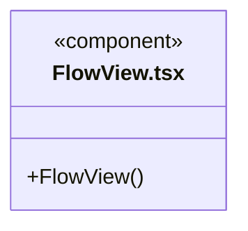
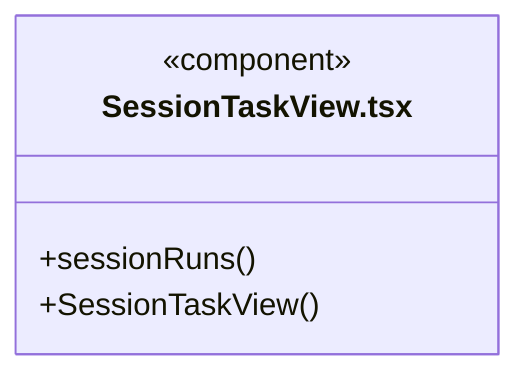

# src/frontend/tasks 架构

## 目录定位

当前会话执行视图与维护任务展示，按工作区和任务身份过滤。

本文描述当前实现。通过分析目录边界后维护的 [源码架构脚本](../../../scripts/source-architecture.mjs) 同步清单和声明；代码变更时仍须核对职责、关键成员与关系。

## 代码清单

| 文件 | 当前职责 |
| --- | --- |
| [FlowView.tsx](FlowView.tsx) | 显示知识校验和索引任务的实际状态与结果。 |
| [SessionTaskView.tsx](SessionTaskView.tsx) | 当前会话的任务视图，展示执行轮次、工具证据及该会话的待执行队列。 |

## 架构类图

### FlowView.tsx

直接依赖：[../../bridge/contracts/workspace.ts](../../bridge/contracts/workspace.ts)、[../components/Icon.tsx](../components/Icon.tsx)、[../components/Empty.tsx](../components/Empty.tsx)、[../shell/state-labels.ts](../shell/state-labels.ts)。

### SessionTaskView.tsx

直接依赖：[../../bridge/contracts/execution.ts](../../bridge/contracts/execution.ts)、[../conversation/WorkStatus.tsx](../conversation/WorkStatus.tsx)、[../conversation/MessageQueue.tsx](../conversation/MessageQueue.tsx)。

## 子目录导航

无子目录。

[返回上层](../ARCHITECTURE.md)。

每次修改本目录代码，同步维护文件头、关键契约说明及本图。未实现的治理、证据验收和自动编排能力不列入当前类图。
