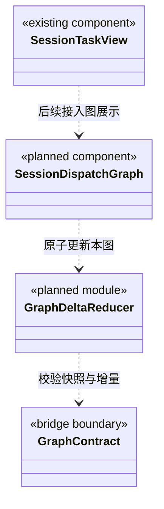

### 主会话任务派发图的增量消费契约

状态：界面接入设计，尚未实现派发图渲染。本目录当前 `SessionTaskView` 展示会话内已有单次执行计划、步骤及证据；不将它描述为多成员调度图。

#### 归属与显示内容

图只属于 `workspaceId + rootSessionId` 指定的主 Agent 会话，位于中间会话区的“任务视图”；右侧扩展页签中的团队/业务架构仍属于整个工作区。切换主会话必须换图，不把全工作区任务混到当前会话。

根显示主 Agent 与主会话标识；每个任务节点显示责任 Agent、模块列表、目标、执行状态及必要的等待/失败原因。TaskNode.kind 区分根锚点和业务任务；同一个成员多次接单可对应多个节点。组织成员节点与任务节点不可混用。

实线派发从父 → 子，依赖线从前置 → 后续；父任务等待子结果以节点状态和关联详情展示，不画结果反向边。任务结果“可交接”与“已验收”分开，v1 只有候选、不绘制虚假的验收通过标记。Agent 状态来自后端事实，前端不凭聊天内容、文本长度或计时推算进度百分比。

#### 增量接口与本地状态

通过 [Bridge 契约](../../bridge/contracts/CONTRACT.md) 的拟定 `dispatch.graphSnapshot / dispatch.graphDelta` 读取；类型来源只依赖 bridge/contracts，不导入 backend 实现。

```ts
type SessionGraphViewState = {
  identity: GraphIdentity;
  cursor?: GraphCursor;
  loading: boolean;
  stale: boolean;
  snapshot?: GraphSnapshot;
};
// 后续 reducer 的输入形状；不是已经存在的导出函数。
declare function applyGraphDelta(
  current: SessionGraphViewState, response: GraphDelta
): SessionGraphViewState;
```

1. 初次进入加载 Snapshot；后续携带已成功应用的 cursor 读取 Delta。noop 保持原对象引用，组件不重复刷新全部节点。
2. 一个 GraphEventBatch 的 changes 全部验证、一次应用；节点和连线可在同批创建。不先显示节点后补边，也不拆开更新 Agent 状态。
3. delta.from 必须与本地 cursor 相等；seq 连续、streamId 一致，重复批次只应用一次。同序号不同内容报协议错误；断档从原游标补读，不丢弃缺失区间。
4. reset 的 identity 必须与当前会话一致，cursor 必须等于 snapshot.cursor；一次替换投影。正常 delta 仅替换变化对象，保持未变节点和用户展开状态的引用。
5. 切换会话递增请求代际并中止旧订阅/轮询；迟到结果即使成功也不能覆盖新会话。错误保留上次可用图并标记“同步中断”，不清空成无任务。
6. 每个图最多一个在途补读；收到已提交事件通知时合并唤醒。无订阅时自适应轮询，隐藏视图降低频率；hasMore 连续补批但限制单轮工作量。界面暂停刷新不等于后端任务停止。
7. 不在每秒轮询中重新回读全部 RunJournal。内存投影按游标增量返回，详细证据在用户展开时单独读；保持主对话输入、消息队列和任务图相互独立。

AgentGraphView 是当前图的局部状态和任务引用，不泄露其他根会话的工作内容。工作区组织图需要的全局成员状态走另一授权接口，不能复用此图的局部空闲状态当作全局空闲。

#### 目标结构类图（待实现）



渲染在成员封装和调度行为验证后实现。届时须测试 noop 不重建对象、批次原子性、重复/断档/重置、切换会话迟到响应、断线补读、增删边后的布局稳定性；假数据演示不能作为真实派发进度验收。
