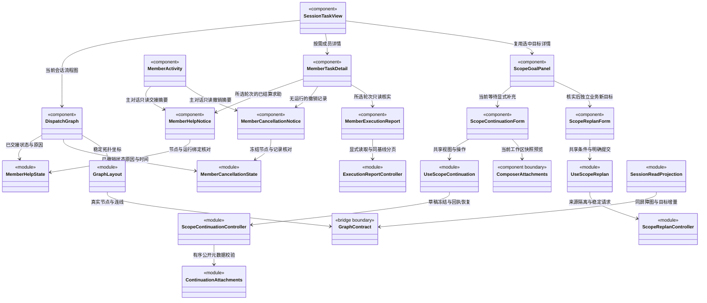
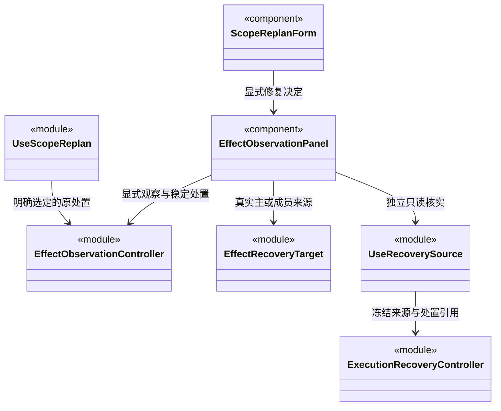

### 负责人交接与历史定位

`memberCheckpointView` 严格核对显式 `checkpointAbandonment` 的周期、原运行、检查点、预约、计划及任务版本；只有 cancelled 且未产生第二 run 的原任务才显示“已为交接放弃”。普通取消/失败/中断仍为封存，缺失或损坏审计不补造原因，也不冒充“从未执行”。主对话、图标签及详情共用这一投影，无额外轮询。

检查点卡保留原原因与预约说明，另列处置原因、原主运行、命令、版本、租约变化及时间；租约只是当时事实，不要求今天仍等于该值。原岗位与模型继续由 `OwnerExecutionDetails` 展示，当前负责人另经显式核实。没有处置/恢复按钮，渲染进程不能冒用主调度身份。

目标审阅中的 `superseded` 保留真实原任务与新成果关系；`goalTaskReference` 仅允许所选周期与图、唯一任务的 workspace/root/scope 全部一致时打开已有详情。缺失节点只显示原 ID，不选择其他会话同名任务；选择不执行工具、不改变边、负责人、草稿或验收意见。两处目标卡复用已有导航，不创建新执行连线。

### 运行内补充与目标输入版本

`ScopeActiveInputs` 复用目标周期详情的增量记录，显示 pending、accepted、rejected 与 unknown；不新增轮询、读取附件或自动重试。接受正文是实际发往原生运行的队列快照，可能已经展开附件资料，不能冒称原始用户措辞。原始 `goal.input` 与旧计划分别保留；accepted 只说明加入输入队列并登记新版本，不证明模型已处理或业务完成。

`scopeGoalView` 在开放周期中优先显示未核实输入，不能让旧 complete/awaiting_user 审阅覆盖它。停止及中断保持真实终态，另外提示尚未核实的补充；损坏的 completed 与未知输入组合不显示目标完成。无计划的普通对话接受补充后仍保持对话语义，不生成虚假的业务计划。

`SessionReadProjection` 核对同一 stamp 的详情形状、全部尝试数量和未核实状态；任一不一致保留上一组完整图/摘要/详情。无变化继续复用对象，输入版本变化不要求图游标跟着变化。详情历史默认折叠，不根据时间猜输入顺序；每条接受记录显示后端版本与原运行/队列身份。旧周期缺字段时不补造。

### 仓库范围的报告展示

`ExecutionReportPanel` 对精确 repository scope 显示仓库资料身份，不标成业务工作区文件。共用 `RepositoryScopeDetails` 只展示后端核实的安全范围；不由前端签发授权或让仓库读取满足文件基线/检查点。旧工作区、知识和未知范围保持原有文案，原生流式正文与该报告各自独立。

### 按人工决定显式继续

`currentHumanDecisions` 先按验收项取跨依据的最新记录，再限定当前等待和当前人工项；`humanContinuationTarget` 同时检查目标/输入/决定版本、等待身份及摘要详情一致性。界面列出本等待全部最新意见，不能挑旧接受跳过新拒绝；缺意见的人工项仍需后续确认。

`HumanContinuationController` 在独立的本机会话索引保存冻结请求，双卡复用一份实例。显式点击才调用 `loop.humanContinue`；请求无自由正文、actor 或客户端证明。记录先落盘再发送，损坏/不可写或超过有界容量时停止新提交，不删除旧意图。首次明确受理前拒绝才可修正重发；冲突、重放、通信未知保持原命令，查询 `loop.humanContinuation` 或同请求重试。重开仅查询，查询为空仍为未知；一旦出现未知，后来拒绝不能解冻换 ID。

回执校验完整会话/周期/等待/命令身份、三个版本、决定集合及模型权限；已受理记录只允许外层周期状态更新，固定意图不能改变。`accepted` 只表示新运行意图受理。历史只读查询，不能恢复别的周期；迟到结果只写原会话。

发送后回执若因本地配额或容量未能持久化，保留原请求、已有回执和明确错误，阻止新提交及重发，但仍允许只读查询该命令。查询只校验原身份，保存成功才恢复新操作；无法保存时继续保留错误，重开从先前已持久的未知意图查询，不能制造第二次执行。

`HumanContinuationForm` 与 `HumanDecisionPanel` 是两个独立动作：保存不会启动，继续不会生成批准。列表、模型、命令和通信状态两处同步，普通聊天草稿及附件保留。`ScopeGoalPanel` 按有区分的 continuation 联合类型显示文本补充或人工来源，人工证据展示 decisionId/continuationId，不伪造 toolCallId。主 Agent 的满足结论仍须后端审阅及完成门禁复核，旧等待的接受不自动继承。

### 本机人工决定

`useHumanDecisions` 为当前 root 复用一个 `HumanDecisionController`，供对话摘要与任务根的 `HumanDecisionPanel` 共用。当前安全 waiting、同步的目标详情及 human 验收项才开放新决定；历史只读。菜单不默认选择文件基线，明确选择后点击核实才读取文件，没有文件轮询或挂载自动核实。

预览固定 scope/criterion、当前详情版本和所选基线。切换选择、目标更新或明确未受理使旧预览不能提交；迟到响应不能覆盖更新的预览。接受、拒绝、要求补证均须明确选择，后两者须说明原因。展示真实候选、所选文件观察和不可消除的范围限制，不把成功命令的未知影响集合冒充未知执行结果。

提交先持久保存原 commandId、basis、决定序列和意见，再调用 `dispatch.humanDecide`。响应须严格校验外层身份、证明身份及原命令内容。双击/双卡共用在途状态；首次明确预受理拒绝可修正后重新核实，通信未知则只查询或原请求重试，不换 ID。重开只查询未知命令，不预览、提交或启动模型；损坏/不可写本机记录阻止发送。

`dispatch.humanReceipt` 查询原命令；查无结果仍为未知。接受回执是“已记录决定”，不是完成目标或继续工作。后端历史随既有周期增量加载，不单独轮询。显式编辑已记录的草稿可准备新意见，原记录及同依据替代关系保留；切换主会话不串写草稿或刷新另一会话。

返工的新等待可能使用同一验收项但新的候选。用户可明确“清除旧选择，重新核实”：只清除本地基线选择、决定及旧预览，保留意见文字与后端历史，再查询当前候选；不自动选择或提交。未知/在途请求不能清除，迟到旧预览不能覆盖新菜单。

### 未启动任务前置追加与替换的历史展示

`MemberDependencyNotice` 在主对话成员卡显示最新依赖调整摘要，在任务详情分组展示全部追加与替换；与成员运行日志分离，无额外请求或轮询。Bridge 提供严格审计 Schema，`memberDependencyHistory` 与 `memberDependencyAdditionHistory` 校验所属周期、版本顺序、命令唯一性和待办集合。两类审计不能重复占用同一命令或节点修订；compact 按 `previousTaskRevision` 选择最新，不按时间猜顺序。异常明确提示，不把缺失审计、模型文字或普通等待解释为已调整。

追加审计展示 source task/plan、原因、原主运行和后端时间，不补造当时尚未产生的结果。只有真实受理才显示记录，后续领取或换边不抹掉历史；不根据历史记录推断当前仍在等待或已经执行。缺少新字段的旧节点保持原有替换行为。界面不提供加边/恢复按钮，是否可调整由主工具和服务验证。

记录展示原前置、新前置、采用的 run/result、原因和后端时间，后续成员执行不隐藏历史。历史审计不证明现在仍可执行、原任务成功或业务验收通过，不提供恢复/批准按钮。主对话与详情先核对工作区和主会话身份；compact 仅省略旧记录展示，不丢弃节点数据。

任务图沿用真实 enabled 边布局：退役边不绘制，原失败或求助节点仍在，新依赖按真实端点绘制。前端不迁移任务、实例或会话身份，不因审计存在改变运行状态或替代最终目标审阅。

### 周期冻结软限额

`ScopeBudgetPanel` 从周期摘要展示冻结策略与独立拒绝记录，主对话和任务根共用。缺字段是旧周期，关闭是明确未启用；不读取全局设置推断当前额度。预算拒绝不宣称回滚、业务验收或检查点消费，waiting 保留原补充入口和未受理提示。只展示事实，不签发启动权或解除限制。

目标补充首次收到 `SCOPE_BUDGET_EXCEEDED`、`SCOPE_BUDGET_UNVERIFIABLE` 或 `SCOPE_BUDGET_WAITING`，表示意图尚未受理：保留原等待及草稿，明确显示未受理，不伪装成通信未知。曾发生超时的原请求即使重试收到这些错误仍保持未知和冻结；未知的其他额度错误不会被通配为未受理。

### 周期用量的显式读取

`ScopeUsagePanel` 位于任务图周期筛选下，绑定 workspace/root/scope。首次只有读取按钮，没有定时扫描；每次返回标明截至时间，逐运行来源默认折叠，任务节点图保留主展示位置。`ScopeUsageController` 仅在用户读取/刷新时请求 `dispatch.scopeUsage`，重复点击不并发读取，切换或卸载作废迟到响应。

报告严格核对身份、唯一运行、主轮所属 root、逐运行与汇总数字以及完整标志；推理不重复计入 total。错误保留旧快照并标明可能过期，不自动重读。部分 token 与未知价格明确呈现；显式零价可显示零，未知不填零。这里没有预算或验收操作，也不会把只读报告当作执行许可。

### 全局并发准入的只读提示

`AdmissionFeed` 在当前窗口合并订阅，串行每秒查询一次 `admission.read` 内存游标；无变化不替换对象，不重复读取日志。末订阅离开后停止计时，重挂载忽略旧代迟到响应；读取失败保留旧快照并显示过期风险。

`useAdmission` 与设置共用该订阅。`sessionAdmission` 按 workspace/root 严格筛选，只有本会话有等待票且没有真实占用才给出“等待执行资格”；`AdmissionNotice` 同时呈现在对话和任务视图。票据不是 TaskNode、scope waiting 或可恢复检查点，界面不创建、删除或重排票据，停止仍走原调度入口。

目标补充、只读核实和业务重规划的首次 `CAPACITY_BUSY` 是后端意图受理前拒绝，可修正后重发；一旦出现通信未知，后来的容量错误不能证明旧请求未执行，仍锁定原命令核实。

### 主会话任务派发图的增量消费契约

状态：`SessionTaskView` 默认显示真实主会话根与任务节点流程图；`DispatchGraph` 绘制可选择节点及有向派发/依赖连线，`graph-layout.ts` 计算稳定 DAG 布局。点击根后展开 `ScopeGoalPanel` 的真实周期目标、计划、审阅与受阻原因，以及队列和执行轮次；点击业务任务打开 `MemberTaskDetail`。运行轮次或普通问答不会被自动转换为派发任务。

#### 归属与显示内容

图只属于 `workspaceId + rootSessionId` 指定的主 Agent 会话，位于中间会话区的“任务视图”；右侧扩展页签中的团队/业务架构仍属于整个工作区。切换主会话必须换图，不把全工作区任务混到当前会话。

根显示主 Agent 与主会话标识；每个任务节点显示责任 Agent、模块列表、目标、执行状态及必要的等待/失败原因。根是 `SessionRootNode`（`kind: 'session-root'`），业务节点是 `TaskNode`（`kind: 'task'`）；同一个成员多次接单可对应多个节点。组织成员节点与任务节点不可混用。

不同主会话拥有独立主 Agent 实例。根详情显示图根的 `agentInstanceId` 和调度通道，以及运行摘要 `conversationBinding` 中已记录的对话通道。主 Agent 负责调度与受控知识治理，业务任务属于独立执行 Agent；图、成员动态卡和详情不提供主角色业务自执行标识，知识维护也不伪造业务节点。历史缺少绑定时明确提示未知，图与日志绑定冲突时提示重新同步，不用角色名推导身份。

没有派发图但已有主会话身份时，只显示从该会话运行记录提取的主 Agent 根，并说明尚未派发成员任务；新建草稿尚无会话时显示开始对话入口。没有任务时不画虚假的成员节点、连线或进度百分比。图加载失败保留已确认内容并报告同步中断，跨工作区/跨主会话快照不进入视图。

流程图采用从上到下分层：启用的派发边与依赖边共同决定拓扑层级；HTML 节点维持 248×192 像素的可读卡片，SVG 只承载有箭头的连线，实线是派发、虚线是依赖。跨层连线绕到卡片区外侧，不穿过中间正文。状态和文字更新不改变位置；拓扑层级不变时，同层新节点追加，不移动原节点，新依赖改变层级时允许必要移动。图内滚动查看大图，不把所有文字缩小到屏幕宽度。详情在较窄会话区域下移至图下方。

选中根的标识为 `session:<rootSessionId>`，选中任务使用 taskId，undefined 关闭详情。节点是可键盘操作的 button，选择只打开详情，不触发执行或授权；关闭详情不停止任务。主 Agent 原有队列、停止与完整计划保留在根详情，默认不在图下堆叠长文字流。

`ScopeGoalPanel` 在主对话使用 compact 摘要，在任务根默认展开；双方传入同一个 `ScopeGoalState`，不会独立建立第二条轮询。历史选择仅改变选中详情及图的突出周期，整张会话 DAG 和其他周期节点仍存在且可选择。未选择历史时跟随后端 active 周期，否则取最后首次创建的周期；不按客户端时间或随机 ID 猜测顺序。原始输入、附件数量、责任分配、逐项要求、审阅及证据引用均来自选中详情；240 字摘要之外的完整受阻原因可在展开后查看。

`scopeGoalView` 只从已提交摘要和当前图派生状态。active + review.complete 显示“完成申请待复核”；只有 closed + completed + hasPlan + review.complete 才显示“目标已完成”，缺审阅依据的历史保持警告。无业务计划的 completed 周期显示“本轮对话结束”；legacy 不补造原始目标，历史根不能借用当前运行的目标或标题。人工项分别展示已保存决定与主 Agent 是否引用真实决定并复核依据，不以接受记录单独判定完成；成员 result_ready 仍为候选。`currentGoalView` 始终对应当前/最新周期，不受历史选择改变；`selectedGoalView` 只控制浏览内容。活动周期根保留停止按钮，不能仅因最新主模型 run 已结束就隐藏；按钮明确停止当前周期，不重开正在浏览的历史。

持久等待必须来自 `scope.status=waiting`，显示“等待补充 · 执行已暂停”；模型 `review.awaiting_user` 仅显示“已请求补充 · 等待暂停确认”，不冒充检查点已提交。`openScope` 包含 active/waiting，`activeScope` 仅含 active，`waitingScope` 仅含 waiting；三者从完整摘要列表选取，独立于历史浏览。自动选择优先未关闭周期，后台等待不能被最近历史覆盖。

等待卡展示摘要原因，展开后读取完整 `scope.wait.reason` 与记录时间；关闭后保留等待历史，但取消状态优先于旧等待状态。等待根保留“取消当前任务”，浏览历史时说明当前另有待补充目标，按钮不会复活所选历史。显式正文与文件/图片补充及按已保存人工决定继续分别通过独立表单提交；普通队列不能作为恢复入口，根队列也禁用“继续队列”。同版本详情必须匹配摘要中的等待身份、目标版本、输入版本与创建时间，旧等待详情不能拼到新摘要上。

#### 显式补充与通信未知

`ScopeContinuationForm` 仅显示 `useScopeContinuation` 提供的状态与操作，不自行生成命令。主对话和任务根接收同一 Hook 返回值；仅当前 waiting、选中详情和摘要身份/版本一致且同步正常时允许写入。历史选择只读，不能通过旧卡片恢复当前目标。接受补充后旧计划保留，但 `needsReplan` 显示“补充已受理 · 等待更新计划”；详情按记录展示补充正文和输入版本，不将旧审阅自动视为新输入已完成。

`ScopeContinuationController` 按 workspace/root 隔离本机索引，草稿按 scope/wait 保存。首次提交先持久化严格冻结的 `GoalContinuationRequest`，包括真实 waiting、两个预期版本、UUID 命令、未经裁剪的正文、有序文件附件 IDs 和实际模型/权限；保存失败不调用 IPC。仅点击“补充并继续”时调用 `loop.goalContinue`，不存在挂载、刷新或模型判断触发的自动提交；人工批准仍是独立操作。无附件的旧请求不添加空数组。

文件和图片通过真实 `chat.pick(file)` 保存为当前工作区快照，表单复用 `ComposerAttachments` 预览；普通聊天输入的附件与草稿不受影响。`continuation-attachments.ts` 只校验展示元数据，不保存正文或 base64，Main 在受理前核实内容。控制器持有共享导入锁，导入期间禁止提交/移除及重复打开选择器，但可编辑补充文字；返回后合并最新正文。Hook 用目标身份代次和挂载状态过滤迟到结果，切换或等待变化后即使切回原目标也不自动附上旧选择。

未知和已受理请求冻结附件身份与顺序，回执同时核对正文、IDs、选项及目标；损坏本地记录不能丢弃后新发。确定受理前的 `GOAL_ATTACHMENT_*` 错误保留可编辑草稿；通用引擎视觉错误可能发生在受理后，不能解锁。曾出现未知的请求即使再次收到附件错误也保持原请求，只查询或原命令重试。

已有已受理回执再次查询时，`scopeStatus` 可随目标周期结束变化，完整 `continuation` 必须保持原值。矛盾的 runId、受理时间或附件 hash 不覆盖本机已知事实，保留 accepted 和原回执并提示查询错误，不因此开放重新发送。

`ScopeContinuationPool` 在同一 renderer 中复用同会话控制器，避免切换工作区后旧回执覆盖重新打开的草稿；超过缓存目标数时只回收无订阅、无在途请求的历史对象。真正重开应用从本机记录恢复，不共享另一个 renderer 的内存状态；服务端仍以 wait/command 的持久化幂等保护处理多窗口重复请求。

回执须通过 bridge schema，并逐一核对 workspace/root/scope/command/wait、目标与输入版本、正文和 options。`scopeStatus` 仅是回执读取时的周期状态，`runId` 是持久化运行标识，二者不能用来宣称模型正在执行。明确的未受理错误保留草稿供修正；命令冲突、运行中止、通信超时或无法校验的响应一律保留冻结请求为未知。曾经结果未知的请求，即使同 ID 重试随后返回拒绝，也不能解除冻结换 ID 重发。

`loop.goalContinuation` 只读查询本次命令；返回 undefined 仍是未知，不证明服务器未执行。未知时可查询或在相同当前 waiting 下重试完全相同的请求；双击由控制器的同步 attempt 状态与在途集合拦截。重开将未结束的提交归为未知，只自动查询，不发送；损坏的本机记录显示错误并停止新提交，不覆盖可能已受理的未知记录。历史可查询既有命令，但不提供提交/重试按钮。迟到回执仍写入原会话记录，不刷新已切换的新会话。

成员详情以独立成员署名展示公开流式正文、最近工具状态、可选运行轮次，以及目标、模块、候选和证据。授权、问题回答与停止仍需显式操作；使用后端公开投影，不展示原生私有推理事件或原生会话路径字段。详情请求按 workspace/root/task/run 完整身份隔离；运行中按一秒增量补读，隐藏时降至五秒，终态须补齐 `hasMore` 后才停止轮询。主对话活动摘要最多显示三个任务，完整任务仍由流程图查看。

`useMemberRun` 的身份或 `enabled` 变化会重建投影；`active` 只调整观察频率，重新激活时补读。公开事件自身携带 workspace/task/run，主会话归属由后端请求核验与 Hook 的作用域代际共同保证。协议错误清空下次请求游标，保留界面上次正文及错误提示，随后请求权威 reset；卸载只丢弃迟到响应，不停止运行。`refresh` 合并到当前在途读取，不额外排队，和图 Hook 的“在途刷新后再补读一次”语义不同。

`MemberTaskDetail` 为四层身份设置独立组件 key；历史轮次只读，只有当前活动轮次读取审批/问题并提供操作按钮。提交失败分别保留读取错误和操作错误，卸载不撤回已提交的后端操作。`MemberRunTranscript` 只排版后端公开投影，compact 模式仅展示最近一项消息，不缩小日志读取范围，也不负责敏感内容识别。

#### 成员求助交接

`member-help-state` 只投影后端安全结算后保存的 `TaskNode.help`：节点必须 blocked、没有活动运行和交付候选，求助的 workspace/root/task/agent/instance/session/plan 必须匹配节点，run 必须已登记。普通受阻、取消、失败、结果未知或工具返回的 staged 文字不会被补造成求助交接。主对话 `MemberActivity` 和任务节点 `DispatchGraph` 共用该投影，显示“需要主调度协助”；图仍是原任务节点与既有派发连线，不添加结果反向边或假候选。

`MemberHelpNotice` 同时服务成员动态与 `MemberTaskDetail`，只读显示求助种类、原因、待主调度处理的问题、已尝试工具引用及记录时间。明确本轮成员执行已结束、求助已交接，后续由主调度重新安排；这是交接记录，不推断当前仍在等待、原成员已恢复、问题已解决或得到人工批准。工具引用不等于执行成功或验收证据。详情只展示所选 run 对应的求助，不能从另一轮借用；组件独立于成员正文读取，日志加载失败不会隐藏已提交交接。此组件没有执行、恢复旧成员、改变权限或批准按钮，也不新增轮询和后端请求。

#### 未启动任务撤销记录

`member-cancellation-state` 从已经核验身份的图节点读取 `TaskNode.cancelledBeforeStart`：仅 cancelled、没有 run/activeRun/result/help/待依赖，且 scope、撤销前版本及记录时间与当前冻结节点匹配时显示“已撤销（未启动）”。主对话成员卡、任务节点及详情共享这一投影；普通取消、周期关闭、空运行列表或模型文字不能补造未启动事实，无可信记录仍只显示“已停止”。

`MemberCancellationNotice` 在成员卡与详情中独立于执行日志呈现实际原因和后端时间；撤销不产生假的执行轮次，仍保留原目标、模块和节点。图节点保持真实 cancelled 状态与已有连线，只压缩摘要间距容纳原因和时间，不改变节点尺寸或拓扑。完整原因可在任务详情读取。记录说明原安排被撤销而不是目标完成，也不说明整个周期已关闭、成员实例已释放或后续已补做。

所有内容随既有图增量刷新，没有新增用户撤销、恢复、验收按钮、轮询或后端调用。无日志的详情仍可以按原入口只读核实登记事实，不能从没有登记轮次推出没有发生过操作。撤销 notice 的组件 key 与求助、报告、正文互相独立，避免状态提示插入时串用实时视图。

#### 同周期成员检查点

`memberCheckpointView` 核完整 TaskNode 检查点链后投影所选段及其原预约（resumeHistory + 最新 resumeRequest）。核对工作区/root/task/实例/会话/计划、源运行、记录序号和预约引用；工具 staged 文本不能生成停泊事实，损坏明确提示。没有逐段预约或完整前缀的运行不得借用检查点；默认最新段，选中有自己检查点的运行展示本段，否则展示其来源段，历史段始终只读。公开投影不包含原生文件/指纹，不签发恢复许可。

`MemberCheckpointNotice` 在主对话卡与任务详情共用，区分已保存、等待续执行、已登记新轮次和已封存。源运行及唯一后继均可查看同一历史；切换其他轮次不展示，候选仍只属于其真实 run。预约不代表消费或启动；停止/失败/重启封存仍显示历史，明确不能沿此恢复。没有新增执行按钮、轮询或文件查询，实际续执行只由主调度工具提出并经后端门禁。

任务图保持同一个 task 节点和连线，checkpointed 使用提醒状态而不是成功或动画。当前周期摘要显示“成员已保存检查点 · 等待调度”，历史节点不污染其他 scope；主周期 waiting/closed 优先保持真实状态。详情轮次选择器展示各 run，旧运行记录不被替换。

#### 异常执行记录核实

主会话标题、图根与根详情中的数量统一表示“已读 X 轮记录”，单独附加后端报告的“Y 轮待核实”。缺失或坏日志不会生成假的运行摘要，也不能把零条可读摘要解释为零次实际执行；逐条序号仅标为已读记录顺序，不冒充完整历史运行序号。

`MemberExecutionReport` 位于 `MemberTaskDetail` 的执行轮次选择器之后、实时正文之前；它与 `MemberRunDetail` 独立，缺失或损坏日志不会遮住报告入口。两个兄弟视图的 React key 分别带 `report:` 和 `transcript:` 前缀，在同一执行身份下仍保持独立实例，任务由运行转终态时新增提示不能导致报告订阅与正文相互替换。任务视图仍是节点 DAG，不把核实报告改成全会话文字流。任务原有候选也必须属于当前选中 `runId`，旧轮次不能显示后来的交付结果。

`useExecutionReport` 为 workspace/root/scope/task/run 选择创建独立 `ExecutionReportController`；构造、挂载、订阅、显示页签和图更新均不请求。只有“核实执行记录”“重新核实”“加载更多工具记录”显式调用只读 `dispatch.executionReport`，不调用模型、审批、问题回答、收件确认、启动、停止或恢复。没有运行轮次时只核实该任务的领取登记，不猜测最新日志。切换节点或轮次取消前端观察并忽略迟到结果，不撤销后端读取，也不改变任务。明确准备再次核实成功后，`invalidate` 清除旧报告、递增读取代次并忽略此前在途响应；它不会自动请求新报告。

报告须经过 bridge schema 和完整身份校验，检查候选/工具回执所属运行、工具分类数量、页大小和连续游标。工具列表按默认 50 条的有界页面显式追加；同一 basis 才合并，服务端 `paginationReset` 或 `changed_during_read` 替换旧页，不能拼接不同时间的证据。读失败保留已核实报告并明确提示；报告没有修改图、知识或日志的能力。

前端将 task revision、plan revision/status、实际所属 scope 的状态/goal revision 与图游标和报告基线比较。变化只标记报告版本不同，暂停继续加载旧页并等待用户重新核实；不自动回读全部日志。浏览历史周期不会为成员传入别的 scope：`SessionTaskView` 始终按选中任务的 `scopeId` 取真实摘要。

展示上分开“尚未领取执行”“有在途执行记录”“执行轮次已结算”“执行结果未知”。failed/cancelled/missing 日志不能显示成未执行；没有完整回执不代表没有副作用。工具 succeeded 只表示收到成功回执，候选始终“尚未验收”，输入/结果哈希明确不是业务产物指纹。原始工具参数/输出、冻结知识、凭据和原生会话路径不属于公开报告；报告本身不提供旧任务重试、改派或人工验收操作。

#### 显式新建只读核实周期

`ExecutionRecoveryForm` 位于报告之后，用户观察 `observation.text` 与新目标 `input.message` 分开，不修改旧任务。`useExecutionRecovery` 使用所选节点的真实 scope/task/run 与已验证报告 basis，只在来源周期 closed、会话没有 active/waiting、图已追齐且报告未过期时允许首次提交。已有运行必须明确选轮次；只有 task.runIds 为空、没有 activeRunId 且报告身份对应未选运行时才能省略 runId。已取消且未领取的节点允许保留 unknown/not_selected 报告后进入只读核实，不要求将其改判未执行。历史筛选不改变真实开放周期。未知/损坏日志可作为核实对象，不能当作未执行。

模型来自主输入区的实际 profile/provider/model，权限始终固定 `read`，不取输入区可写权限，也不包含附件。显式点击 `loop.recoveryStart` 才创建新周期；报告刷新、表单展示与编辑都不启动模型。受理后只刷新同一 root 的图与历史，“查看新目标”改变查看选择，不切换主会话或清空草稿、附件、队列。

`ExecutionRecoveryController` 按 workspace/root 保存独立本机 v2 索引，旧来源键包含 scope/task/run；新来源键区分 main_run/member_run、原 run 和调用顺序，均不包含会变动的报告 basis。独立键 `cbim.execution-recovery.v2.*` 优先读取；不存在时可读 v1，后续保存写 v2 并保持 v1 原字节。损坏 v2 不回退旧 v1，以免隐藏新命令。发送前冻结 commandId、basis、观察、目标与模型选项；同 renderer 的池复用在途控制器。刷新报告、切换节点和重开不能隐藏未知命令并生成第二次请求。未知结果只查询 `loop.recoveryReceipt` 或原命令原正文重试；查询 undefined 仍为未知，一旦通信不确定，后续拒绝也不能解冻改发。仅首次明确预受理拒绝可保留草稿修正；持久化失败不发送，损坏本地记录不自动覆盖。

回执通过 Bridge Schema 后仍核对 workspace/root/command、source+basis、operation、观察、目标和 options；新 scopeId 必须等于稳定 commandId，且新 scope/run 不能借用来源。受理后 recovery 事实保持不可变，只允许周期状态演进，closed 不能回退为开放。矛盾查询保留原回执并提示错误。`accepted` 仅表示创建意图受理，不能当作正在运行或核实通过。未知请求的同 ID 查询/重试不套用首次提交的“当前空闲/报告新鲜”条件，后端先去重再决定是否需要执行。

“准备再次核实”只对 accepted 且 closed 的当前命令开放，当前主会话还必须没有开放目标。点击先按旧 commandId 重新查询；undefined、矛盾、通信失败、未关闭或正在查询均保持原锁定状态。只有完整旧请求及受理回执成功写入 history 后才清除当前 attempt，保留观察和目标作为新草稿。准备不生成 commandId、不调用模型，也不修改聊天草稿/附件/队列；最终“新建只读核实任务”才生成与当前索引所有命令都不同的 UUID。历史记录始终只读，不能选旧历史来绕过当前未知命令。

所有状态先保存后发布；容量超限或 localStorage 写入失败不能解锁原命令。单来源最多 32 条归档、单 root 最多 128 条归档，索引实际 UTF-8 字节与未决回执预留合计最多 2 MiB；不淘汰旧请求。每个尚无回执的 submitting/unknown 命令预留其冻结请求序列化大小加 8 KiB 元信息，避免先发送后无法保存复制正文的受理回执；其他草稿编辑同样遵守预留。重开时核对每条历史的 root/source、closed 回执与全索引命令唯一性，已有记录不会因容量上限被静默删减。

归档成功通过 source 订阅使所有同来源视图的报告同步失效，挂载之间遗漏的归档变化也补查；旧读取迟到不能重新填回可提交依据。报告为空时仍显示已保存历史、观察与目标，并提示“请重新核实来源报告”；用户须再次点击报告核实，再以新鲜 basis 提交。该过程不自动读取报告，最终后端仍核验来源版本及当前 root 是否空闲。

核实周期在 `ScopeSummary.readOnly` 明示只读约束；`useScopeContinuation` 对真实 openScope 的后续补充继续固定 read，不能借选择历史或修改 composer 权限提权。该标志不暴露原生上下文或旧运行排除清单。

#### 核实后的正式业务重规划

已受理但尚未登记计划的周期按后端 `origin` 显示身份：`business_replan` 显示“正在规划业务任务”，`inspection` 显示“正在规划只读核实”。目标卡和任务根使用同一状态投影及无计划说明；缺计划不代表退回普通问答，也不假造已派发任务。只有 origin 缺省的普通聊天保留轻量问答文案；取消、等待或失败仍以真实周期状态优先，不持续显示规划中。

`ScopeReplanForm` 是目标卡与任务根共享的独立入口。`Conversation` 只装配一次 `useScopeReplan`，两处卡片共享草稿、条件预览和提交锁。新来源只允许本会话最后提交的周期，并且明确 `origin=inspection`、closed/completed、摘要/完整目标计划/审阅版本一致；使用后端摘要保留的首次提交顺序，不按时间或随机 ID 排序。后续周期可能已改变产物，不能回选旧核实证据创建另一业务任务。只读标记、模型文字或旧业务周期不能替代来源身份。当前 root 仍有 active/waiting 时不允许核验/首次提交。历史选择只改变查看对象，不隐藏整个会话的开放状态；已有 accepted/unknown 命令仍可查询或原 ID 重试，不以最新来源条件改造原命令。

用户填写独立“新业务目标”，权限默认为 `ask`，只有明确选择才设为 `execute`，不会自动继承输入区完全访问。模型身份取输入区解析后的实际供应商 profile/provider/model。表单不消费聊天草稿、附件或队列，也不更改旧核实周期 readOnly。执行计划由新周期内的主 Agent 创建并分派成员，不在前端伪造。

“核验新任务条件”显式调用只读 `dispatch.replans.preview`，展示后端确认的必覆盖模块、继承人工条目、依据版本和具体问题；继承人工条目保留来源/ID/正文且不能由表单批准或删除。该预览是日志、来源和知识约束检查，不是已生成的业务执行计划，也不证明业务产物无未知影响。`eligible=false`、缺少依据或错身份均不能提交。

预览只驻留内存，绑定 selected inspectionScopeId、目标摘要 stamp、图游标、实际模型选择和草稿目标/权限。切换来源、编辑草稿或图/模型版本变化会使预览失效，已发读取即使迟到也不能启用另一目标的创建。重开只恢复草稿/冻结命令，不将缓存预览当作新鲜资格。知识变化未必推进图游标，最终受理必须由后端重新核验 expectedBasis；界面不是事务或权限边界。

“创建新业务任务”才生成 UUID，将严格 `ReplanRequest` 和已核验条件先写入独立 `cbim.scope-replan.v1.*` 索引再调用 `loop.replanStart`。索引按 workspace/root 固定，inspectionScopeId 是来源键；不复用只读 recovery 请求、存储键或权限。每 root 最多 128 个来源，读取与写入均限制 2 MiB UTF-8；写入时另为无回执的 submitting/unknown 请求预留冻结请求、预览事实大小及 16 KiB 元信息，避免受理后无处保存回执。超限、损坏或保存失败不覆盖原记录、不发送新命令、不解除已有锁定。

通信未知只允许 `loop.replanReceipt` 查询和原命令原正文重试，undefined 不等于未受理；曾未知后的领域拒绝仍不解冻。首次明确预受理拒绝可修正草稿，重新核验条件；新命令不得与当前索引已有命令重号。受理回执核对 workspace/root/command、来源 basis、目标、权限和已核验的知识/模块/人工约束；新 scope 等于 commandId，新 run 不借来源或审阅运行。后续查询仅更新周期状态，不能改写受理事实或使 closed 回退为开放。accepted 仅表示意图已受理，提供查看新目标和查询状态，不自动重派，也不在本步提供再次创建业务周期的历史操作。

实线派发从父 → 子，依赖线从前置 → 后续；父任务等待子结果以节点状态和关联详情展示，不画结果反向边。任务结果“可交接”与“已验收”分开，v1 只有候选、不绘制虚假的验收通过标记。Agent 状态来自后端事实，前端不凭聊天内容、文本长度或计时推算进度百分比。

#### 增量接口与本地状态

`Conversation` 用 `tab.taskId` 作为 rootSessionId，通过 `useSessionGraph` 读取 [Bridge 契约](../../bridge/contracts/CONTRACT.md) 的 `dispatch.sessionRead`；类型和 Core 的无 IO 图校验/归并函数只经 bridge/contracts 引入，不直接导入 backend。请求携带 graphCursor、scopeCursor、可选 selectedScopeId 和 detailStamp，响应在同一存储屏障返回图增量、目标摘要增量及选中详情。目标变化不推动用于验收的图游标。

```ts
// graph-state.ts 的公开接口；校验失败保持上一次可信投影。
class SessionGraphProjection {
  constructor(identity: GraphIdentity);
  readonly cursor?: GraphCursor;
  readonly snapshot?: GraphSnapshot;
  apply(response: GraphDelta): GraphSnapshot;
}
// Hook 返回 ScopeGoalState + refresh；当前周期状态与历史选择分开，不创建或派发任务。
useSessionGraph(workspaceId, rootSessionId, active);
```

1. 初次进入加载图和目标摘要 Snapshot；后续分别携带已成功应用的 cursor 读取 Delta。noop 保持原对象引用，组件不重复刷新全部节点和目标正文。详情 stamp 未变时不传完整输入、计划或审阅。
2. 一个 GraphEventBatch 的 changes 全部验证、一次应用；节点和连线可在同批创建。不先显示节点后补边，也不拆开更新 Agent 状态。
3. delta.from 必须与对应流的本地 cursor 相等；seq 连续、streamId 一致。同序号不同内容或断档报协议错误；保留原组合，下次不携带 cursor 获取权威 reset 快照，不接受跳号增量。`SessionReadProjection` 用 fork 验证图、目标与详情，全部通过才替换组合，任意一部分失败不能先发布另一部分。
4. reset 的 identity 必须与当前会话一致，cursor 必须等于 snapshot.cursor；一次替换投影。正常 delta 仅替换变化对象，保持未变节点和用户展开状态的引用。
5. 切换会话作废旧请求作用域并停止旧轮询；迟到结果即使成功也不能覆盖新会话。错误保留上次可用图并标记“同步中断”，不清空成无任务。
6. 每个图最多一个在途补读，手动刷新合并进同一请求序列，在途期间多次刷新只安排一次后续补读。当前采用轮询：活动页签一秒，后台页签或隐藏窗口五秒；每次响应最多读取 100 个完整提交批次，hasMore 时让出事件循环继续补读。界面暂停刷新不等于后端任务停止。
7. 不在每秒轮询中重新回读全部 RunJournal。图与成员事件各按自身游标增量读取；展开证据只显示已经收到的引用，不额外读取原始工具输出。保持主对话输入、消息队列和任务图相互独立。
8. 详情可能领先分页摘要；最多缓存 8 份详情，只在摘要和详情 stamp 一致时显示，追页期间不混用不同版本。两条流中任一仍有 hasMore 时仅推进内部投影；都追到同一读取屏障后一次发布给界面。分页失败保留上一完整 UI 组合，不发布半页图或目标。相同详情版本内容不同、跨会话详情、摘要/详情身份或版本冲突均拒绝；历史选择改变时，在途响应可以更新共同图和摘要，但不能覆盖新的选择。查看历史不会触发执行、审批、确认收件或目标恢复。

AgentGraphView 是当前图的局部状态和任务引用，不泄露其他根会话的工作内容。工作区组织图需要的全局成员状态走另一授权接口，不能复用此图的局部空闲状态当作全局空闲。

#### 当前图展示结构



布局测试覆盖有向关系、跨层、无重叠、禁用边、循环/缺失端点、状态变化稳定及新增同层节点不挤动旧节点。组件与增量测试覆盖默认流程图、真实根空态、按需根详情、不同工作区/会话隔离、noop 引用保持、完整批次和错误响应不改变已有投影。`test:members` 对打包程序、实际 Pi 与可控本机模型做实时流验证；不以假静态节点作为真实派发进度验收。
# 显式文件基线面板

`MemberArtifactReport` 只挂载在已经明确选中的成员 run 下。首次不查询，加载列表不读业务文件、不自动选最新记录；用户选定 baselineId 再点击复核。`ArtifactReportController` 校验 workspace/root/task/run、唯一基线和文件、逐文件字节与摘要一致性，双击合并读取，换选项/卸载隔离迟到响应。图或周期变化只标过期，不扫描或启动模型。

`dispatch.artifactReport` 与执行报告、工具分页和恢复预览使用独立依据。显示仅限相对路径、字节、哈希和核实问题；变化、缺失与不可核实分开，部分文件一致不签署验收、不证明整个工作区未变。错误保留旧报告并明确标注，旧观察不能悄悄替代当前结果。

## 产物结构验证记录

`MemberValidationPanel` 在当前成员轮次详情展示公开的 `validation.checked`，结合相同 workspace/task/run/toolCall 的唯一真实完成回执决定是否已确认。坏回包或缺终态保持“验证结果未确认”，不能根据暂存 passed 先显示成功。

`member-validation-state` 保留每次原始 passed/rejected，并将可见后续写入、命令或新计划使旧依据过期的事实单独表达。外部文件变化无法由此事件流持续检测，不伪造过期事件；当前候选由后端交付/审阅复核。记录只显示当时文件与规则指纹和无原值诊断，不提供验证执行或重试入口。

## 模块 Workflow 选择

目标责任分配只展示已保存的 `workflowSelections`，未声明不补造选择。成员详情仍显示每个模块真实 `ModuleBinding.workflow`；仅当原显式选择与绑定相同才标注“指定流程”。切换历史周期或任务不查询当前知识来改写原流程，不提供修改已派发任务选择的界面。

## 主任务停止的独立在途状态

`SessionTaskView.stopping` 只禁用重复停止，区别于发送、队列插入和编辑共用的 `busy`。主根与运行记录中的停止按钮在插入等待期间仍可点击，并调用会话统一的独立停止入口；停止未结束时不继续队列。历史周期选择不改变实际停止目标，组件不自行取消成员或推断停止已经完成。
### 安全等待的多来源资料

`ContinuationSourceMenu` 明确区分文件/图片、首层目录清单、URL 指针、实际网页摘录与已授权仓库静态资料。仓库目录必须匹配原工作区、链接器、共享代际及实际 revision，后续页不换版本；资料不是安装或执行操作。已受理历史只显示原 v1/v2 清单、来源与截取事实，不重新读源。

`ScopeContinuationController` 对双卡的导入、目录读取、发送共用在途锁。`useScopeContinuation` 捕获等待身份、外壳 active 和选择代次；会话仅隐藏而未卸载时也撤销原 importId 的准备，迟到成功不能进入旧/新草稿。返回相同会话不会复活旧导入；同一会话的对话/任务两卡切换不撤销。系统文件选择框可能仍需用户关闭，界面不把发出取消当成磁盘回滚。未知/受理请求继续冻结完整正文和有序附件身份，普通聊天草稿不变。

公开附件仅有 `id/kind/name/source/note`，拒绝正文、凭据或客户端证明；服务受理时从私有快照再次核验。旧 file/image 草稿保持兼容，旧 connector 定义不能自动变成仓库资料；目录、链接等公开种类不代替可信来源。
# 模块负责人执行视图

任务详情和目标计划显示原派发时保存的岗位身份、能力采纳、模型与模块责任版本，不按当前同名 Agent 猜测岗位，也不把当前岗位名称覆盖原记录。只读当前配置核实须显式点击；响应核原任务身份与绑定，切换任务隔离迟到响应，读取一致不表示已获执行许可。

无绑定旧记录按状态解释：旧待办与未消费检查点提示重新规划，旧在途仍只报告原运行，旧候选保持历史身份。显示不自动补绑、换人、采纳、领取或重放。普通消息、草稿、审批与主模型选择不因核实操作改变。接口、类图和验证随本片实现同步。

## 原调用影响与明确处置

EffectObservationPanel 同时用于真实主工具记录与成员报告选择的调用。界面只传 workspace/root 和严格 main_run/member_run 来源，不传路径或可信 scope；原结果、当前文件观察、原控制面提交、明确处置和新任务结果分段展示。覆盖值保留 control_commit_only / selected_files_now / unsupported，不把原 unknown 显示为成功。当前 hash 不是原成功基线；没有 before 正文不提供回滚。

EffectObservationController 按主会话共享稳定请求，报告只在内存；挂载、订阅、重开和普通轮询均不读取报告或创建任务。显式观察/列表/历史选择/关系查询分别读取。来源及调用顺序严格核对；读取失败保留旧报告，日志或图版本变化只使依据过期；同来源历史查询按最后点击选择生效，迟到回包只保存原事实。

主工具、成员详情和重规划面板统一以根任务图游标及各周期的真实 stamp 判断时效，不把当前页签或选中周期当作原来源版本，隐藏面板不使另一面板永久过期。切换处置清除上一条的关联显示，历史查询失败在该来源明确提示且保留已有真实记录。`SessionReadProjection` 和 `useSessionGraph` 只持有 `PublicDispatchScope`；新恢复来源从实际 `sessionRead` 白名单取得，不依赖前端臆造完整存储对象。

处置正文与决定在本机独立索引 cbim.effect-dispositions.v1 保存，发送前固定 commandId、basis、root附录版本和原选择。已知事务前 EFFECT_PREACCEPT_* 拒绝可重新核实/编辑；事务CAS、IO与丢回包均保持unknown且只查询原命令，不自动重发、不换ID。上限64条、2MiB并为未决回执预留空间；配额不足不发请求，坏索引不覆盖，已保存处置不可更改。actor只表示本机明确操作，不是账户签名或业务验收。

继续核实必须选择 inspect_more 处置和匹配的当前观察，再沿 useRecoverySource / ExecutionRecoveryController 创建独立只读周期。主来源不伪造TaskNode，缺可信closed原scope仅展示诊断。旧无kind成员来源保持原协议与键；新kind来源不补字段到旧journal。新recovery回执同时核原来源、处置ID和新运行；原scope/run不得复用。

ScopeReplanForm 对新来源显式显示原调用影响入口；用户保存或选择 repair_in_new_cycle 处置后才能创建新业务目标，选项变化使旧预览失效。处置ID随请求/回执固定；完整来源、知识、模块、人工约束与当前负责人仍由既有后端门禁核验。无原计划主来源可以只读调查，不能凭处置声明获得业务修复资格。关系查询只跳转实际新周期，新完成不反写原工具状态。


### 受控文件原操作与显式补偿

查询失败保留已经明确观察到的受理前 rejected 或最终 receipt，同时展示查询错误。unknown 不能因查询错误码升级成 rejected；已有 rejected 也不降为 unknown。重新提交始终需要新预览，不由查询触发。

`ControlledFilePanel` 只从已加载的成员执行报告选择 `cbim_file_write_controlled`，不把旧 native write/edit/bash 推导成有写前备份的操作。`Conversation → SessionTaskView → MemberTaskDetail → MemberExecutionReport` 单独传递当前工作区 `instanceId`，原 task/run/call 保留历史身份；缺当前实例只能查询，不能构造补偿预览。

`ControlledFileController` 每主会话共享，挂载、重开和图变化均不调用后端。原操作报告不读当前文件，用户明确预览才检查文件；预览按实例和图时效隔离，实际提交仍由后端重核。工具失败、操作 applied、补偿 applied 各自展示，均不代表业务验收。旧报告读取失败继续保留，跨来源或倒退回包不能抹掉已有事实。

补偿提交前先保存严格原请求及原公开操作摘要；本机最多64条/2MiB，为未知结果预留回执空间，不含 before 正文、blob、native路径。保存失败不发请求，坏索引不覆盖。原命令未知或未结算只查询，不换ID再写；回执可跳过未观察的中间阶段但不能倒退或修改终态。明确 not_applied 后可重新准备并预览，成功/unknown 不提供重试入口。原后端历史可显式查询，不能凭查无判定未执行；普通对话草稿、附件、模型和队列独立。


### 原知识事务与工具状态

EffectObservationPanel 在同一显式核实入口展示原事务阶段、原请求标识及 committed 的原版本/变更数量。原工具失败、原事务已提交、今天的知识及业务验收独立表达；查无记录/计划缺失不显示未执行或重试按钮。处置及历史仍复用原稳定请求、只读查询与跨来源隔离，挂载不触发事务读取。

## 原治理与责任保存核实（Step39）

`EffectObservationPanel` 将原工具失败与原观察/提案/负责人变更已保存并列展示，显示原命令及记录身份、保存时间，责任只显示原版本。查无与不可核实保留诊断；“保存不等于批准、实施或任务交接”。显式处置仍沿同一 controller/附录/历史，不自动启动恢复或改写原状态。

## 受控文件统一影响观察（Step40）

原成员影响面板可显示受控写的五种阶段、原前后字节大小及独立补偿命令/阶段，继续保留原工具结果。记录处置不执行补偿；当前字节与实际资格仍在既有 ControlledFilePanel 显式预览。重开默认不查询，明确选择原调用后才读取，原操作与补偿均不被新处置改写。

## 原子前置增删历史

MemberDependencyNotice 与 member-dependency-state 同时支持追加、可靠失败替换和多边修订；compact 按原任务 revision 选择最新记录，详情显示全部历史。修订显示原原因、退役/新增数量、来源任务和主运行，原请求按普通文本转义。坏 scope/目标/请求或跨历史重复命令/版本显示核实错误，旧缺省不猜历史。没有新增执行按钮、请求或轮询；状态以当前节点为准，历史不代表验收。

### 放弃来源与换边历史并列

MemberDependencyNotice 的原边提示覆盖失败、求助和明确检查点放弃；不根据 cancelled 猜测来源类别，原检查点卡仍独立核完整处置并显示“已为交接放弃”。两份记录保留各自身份/原因，原后继实例与真实候选可追溯，无新增操作入口或自动查询。

## 已保留成员清单

ScopeGoalPanel 在等待详情显示后端冻结的可靠检查点与未启动后继，可定位原任务，说明重启不占模型、明确继续后重核。取消后的历史仅显示曾保留清单与封存边界；不提供历史启动。复用 ScopeContinuationForm 的共享草稿、冻结请求、同命令查询和显式提交；普通聊天草稿不受影响。含 memberPause 的等待隐藏人工决定接续表单，防止该入口被误认为成员恢复。

continuationRejected 明确枚举成员文件、原生证明、岗位与权限的预受理拒绝：首次拒绝显示“补充未受理”并保留可编辑草稿。未知代码、通用 IO 和曾经发生通信未知的原请求仍冻结，只能查询或重发原请求；后续核验拒绝不能证明先前意图未提交。

多段检查点详情显示当前段号/总段数及本段预约原因。早期已消费段保持 resumed 历史，最新段可分别显示停泊、排队、续执行、封存或明确放弃；不把最新预约原因、放弃记录或候选借给早期段。全链形状或任一身份不匹配时只报告记录异常。

## 逐请求预算（R06）

目标卡片显示原冻结模式；request 模式的 RequestBudgetPanel 只在用户刷新时读取，控制器校验 workspace/root/scope 和策略版本，换目标/卸载使旧响应失效。显示已结算、在途、未知、拒绝、明确未发送及预留余额，未知和超额不提供解除按钮；读取错误不显示零。

请求金额仅在展示时保留六位有效数字，极小正值使用科学记数，账本与额度比较不采用显示值。


## R07-A 完整产物清单运行与复核

MemberOutputManifest 与旧文件面板并列，只在明确成员 run 下显示。首次不查询、列表不读文件、不自动选最新；选择后显式复核全部根，显示目录/空目录/缺失及完整条目。控制器核身份、范围、数量和结论，双击合并，换选择/卸载隔离迟到响应；图变化只标过期，不轮询。错误保留旧观察且显示失败，匹配不签署验收。

## R07-B1 完整集合共同验收

HumanDecisionController保留显式manifests选择并随原请求持久冻结；身份、选择或目标变化使旧预览失效，重开仅查未知命令。HumanDecisionPanel完整模式只显示原交付清单、全部固定根/后代范围和条目数量，不提供文件子集或自动最新选择。接受仅凭后端当前allowedDecisions，变化后的负面观察和历史意见仍可阅读。MemberValidationPanel显示其原完整清单身份，不把当时结构符合称为当前业务验收。

## R08 跨等待意见与明确新决定

`HumanDecisionController.reconsider` 仅由明确点击触发，清空原选择、意见和决定后列出当前菜单；不会复制旧接受或自动读产物。原意见 ID 随草稿/冻结命令保存，预览与回执必须精确匹配。退出对照同样是明确操作；未知/在途请求不能退出、改 ID 或清空，重开只查原命令。成功后再编辑表示独立新决定，移除已经消费的旧关联并使旧预览失效。

`useHumanDecisions` 公开当前 waitId，`HumanDecisionPanel` 只对本项最新且来自先前等待的记录提供对照入口；显示八项原因、“所比较证据一致仍须重新决定”和历史新旧链接。选择、目标或原意见变化及迟到响应均不能混用。坏旧来源可以退出对照，但当前等待的其他可信证据仍须满足原核验条件，不能借独立入口绕过损坏的当前日志。保存与独立继续保持分离，普通对话草稿不受影响。

`humanContinuationDraftForView` 在当前等待没有新意见时也按 waitId 选择接续卡，不回退展示上一次已受理意图；加载未追齐时不借旧卡填充。原请求仍完整留在控制器，重开未知查询及非等待历史展示保持，新的已保存决定建立本等待独立意图。

## R07-B2 原删除与移动证明

ArtifactTransitionProofs 为成员清单和人工候选/历史共用纯展示，显示源、目标、原字节摘要、写前清单及真实阶段序号。无重放或恢复按钮；当前集合状态仍取外层显式核实。缺失观察说明保留，不能仅凭今天缺失声称原删除成功。

### CSV 验证记录显示

MemberValidationPanel 显式显示 CSV 表格检查或 JSON 结构检查；CSV 诊断按表头/列数/字段约束/唯一键/行数/编码语法区分，并只显示原位置与规则名称。后续写入使旧依据过期时仍保留原 rejected，实际 passed 只表示当时符合条件；不返回单元格正文，不以当前页面状态替代后端复核。

### PNG 验证显示

MemberValidationPanel显式显示PNG图片检查与损坏/不支持/像素尺寸/通道诊断；同一公开事件只保留文件和规则指纹，不渲染或返回像素正文。暂存、rejected、passed和后续失效仍分开，程序符合不显示为人工视觉验收。

## 原隔离执行核实与清理

IsolatedExecutionPanel位于原成员运行的独立核实区域；挂载、切换、重开不发查询或清理。显式核实按workspace/root/task/run和当前实例隔离迟到响应，报告经schema及完整身份核对。只有新鲜、可清理的报告启用按钮；未知回复先核实，原commandId跨重开从服务端报告取回，不能因未知创建第二个清理。成功展示原资源已清理，原任务结果保持不变；不重试脚本或修改草稿/图。


### 成员计划的对话回显

`MemberRunTranscript` 直接组合 `MemberProgressSummary`，消费原公开 `RunSummary.taskProgress` 展示当前步骤、证据引用数量与候选限制。紧凑卡优先显示正在执行的步骤，其余可展开；`reported_done` 只标“已报告”，不解释成已验收。运行正文、私有推理筛选、增量读取及结算后停止轮询仍由原服务与 Hook 负责；组件不发新请求，不更改目标或执行状态。

`useSessionGraph` 按读取状态、作用域和历史选择缓存公开投影，重复的空图/同一读取错误不替换状态。草稿键入不导致整段历史工具卡重绘；实际图、周期、选中详情、加载或错误变化仍发布新投影，原完整读取屏障、迟到隔离与刷新回调不变。消费者不得原地改写投影或通过忽略恢复上下文来复用过期权限/模型。

### 自动与团队协作模式

AutomaticExecutionDetails 供目标责任分配及任务详情共用，显示兜底原因与原模型，并按工作区／scope／模块核归属。自动记录不显示 legacy 岗位缺失，不调用长期岗位比较接口；所有验收和续执行入口继续依据后端真实状态。
