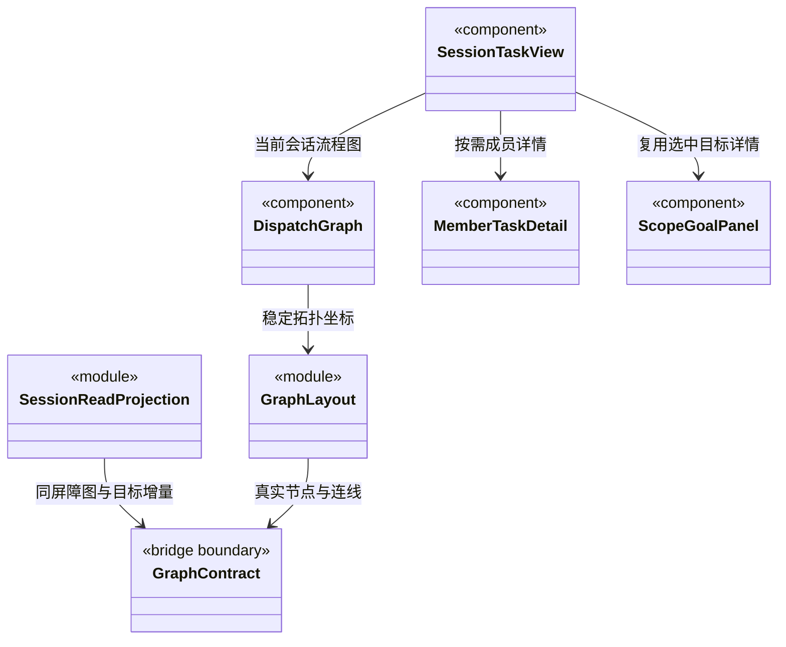

### 主会话任务派发图的增量消费契约

状态：`SessionTaskView` 默认显示真实主会话根与任务节点流程图；`DispatchGraph` 绘制可选择节点及有向派发/依赖连线，`graph-layout.ts` 计算稳定 DAG 布局。点击根后展开 `ScopeGoalPanel` 的真实周期目标、计划、审阅与受阻原因，以及队列和执行轮次；点击业务任务打开 `MemberTaskDetail`。运行轮次或普通问答不会被自动转换为派发任务。

#### 归属与显示内容

图只属于 `workspaceId + rootSessionId` 指定的主 Agent 会话，位于中间会话区的“任务视图”；右侧扩展页签中的团队/业务架构仍属于整个工作区。切换主会话必须换图，不把全工作区任务混到当前会话。

根显示主 Agent 与主会话标识；每个任务节点显示责任 Agent、模块列表、目标、执行状态及必要的等待/失败原因。根是 `SessionRootNode`（`kind: 'session-root'`），业务节点是 `TaskNode`（`kind: 'task'`）；同一个成员多次接单可对应多个节点。组织成员节点与任务节点不可混用。

不同主会话拥有独立主 Agent 实例。根详情显示图根的 `agentInstanceId` 和调度通道，以及运行摘要 `conversationBinding` 中已记录的对话通道。主 Agent 负责调度与受控知识治理，业务任务属于独立执行 Agent；图、成员动态卡和详情不提供主角色业务自执行标识，知识维护也不伪造业务节点。历史缺少绑定时明确提示未知，图与日志绑定冲突时提示重新同步，不用角色名推导身份。

没有派发图但已有主会话身份时，只显示从该会话运行记录提取的主 Agent 根，并说明尚未派发成员任务；新建草稿尚无会话时显示开始对话入口。没有任务时不画虚假的成员节点、连线或进度百分比。图加载失败保留已确认内容并报告同步中断，跨工作区/跨主会话快照不进入视图。

流程图采用从上到下分层：启用的派发边与依赖边共同决定拓扑层级；HTML 节点维持 248×192 像素的可读卡片，SVG 只承载有箭头的连线，实线是派发、虚线是依赖。跨层连线绕到卡片区外侧，不穿过中间正文。状态和文字更新不改变位置；拓扑层级不变时，同层新节点追加，不移动原节点，新依赖改变层级时允许必要移动。图内滚动查看大图，不把所有文字缩小到屏幕宽度。详情在较窄会话区域下移至图下方。

选中根的标识为 `session:<rootSessionId>`，选中任务使用 taskId，undefined 关闭详情。节点是可键盘操作的 button，选择只打开详情，不触发执行或授权；关闭详情不停止任务。主 Agent 原有队列、停止与完整计划保留在根详情，默认不在图下堆叠长文字流。

`ScopeGoalPanel` 在主对话使用 compact 摘要，在任务根默认展开；双方传入同一个 `ScopeGoalState`，不会独立建立第二条轮询。历史选择仅改变选中详情及图的突出周期，整张会话 DAG 和其他周期节点仍存在且可选择。未选择历史时跟随后端 active 周期，否则取最后首次创建的周期；不按客户端时间或随机 ID 猜测顺序。原始输入、附件数量、责任分配、逐项要求、审阅及证据引用均来自选中详情；240 字摘要之外的完整受阻原因可在展开后查看。

`scopeGoalView` 只从已提交摘要和当前图派生状态。active + review.complete 显示“完成申请待复核”；只有 closed + completed + hasPlan + review.complete 才显示“目标已完成”，缺审阅依据的历史保持警告。无业务计划的 completed 周期显示“本轮对话结束”；legacy 不补造原始目标，历史根不能借用当前运行的目标或标题。人工项只显示“尚未取得人工验收决定”，成员 result_ready 仍为候选。`currentGoalView` 始终对应当前/最新周期，不受历史选择改变；`selectedGoalView` 只控制浏览内容。活动周期根保留停止按钮，不能仅因最新主模型 run 已结束就隐藏；按钮明确停止当前周期，不重开正在浏览的历史。

成员详情以独立成员署名展示公开流式正文、最近工具状态、可选运行轮次，以及目标、模块、候选和证据。授权、问题回答与停止仍需显式操作；使用后端公开投影，不展示原生私有推理事件或原生会话路径字段。详情请求按 workspace/root/task/run 完整身份隔离；运行中按一秒增量补读，隐藏时降至五秒，终态须补齐 `hasMore` 后才停止轮询。主对话活动摘要最多显示三个任务，完整任务仍由流程图查看。

`useMemberRun` 的身份或 `enabled` 变化会重建投影；`active` 只调整观察频率，重新激活时补读。公开事件自身携带 workspace/task/run，主会话归属由后端请求核验与 Hook 的作用域代际共同保证。协议错误清空下次请求游标，保留界面上次正文及错误提示，随后请求权威 reset；卸载只丢弃迟到响应，不停止运行。`refresh` 合并到当前在途读取，不额外排队，和图 Hook 的“在途刷新后再补读一次”语义不同。

`MemberTaskDetail` 为四层身份设置独立组件 key；历史轮次只读，只有当前活动轮次读取审批/问题并提供操作按钮。提交失败分别保留读取错误和操作错误，卸载不撤回已提交的后端操作。`MemberRunTranscript` 只排版后端公开投影，compact 模式仅展示最近一项消息，不缩小日志读取范围，也不负责敏感内容识别。

实线派发从父 → 子，依赖线从前置 → 后续；父任务等待子结果以节点状态和关联详情展示，不画结果反向边。任务结果“可交接”与“已验收”分开，v1 只有候选、不绘制虚假的验收通过标记。Agent 状态来自后端事实，前端不凭聊天内容、文本长度或计时推算进度百分比。

#### 增量接口与本地状态

`Conversation` 用 `tab.taskId` 作为 rootSessionId，通过 `useSessionGraph` 读取 [Bridge 契约](../../bridge/contracts/CONTRACT.md) 的 `dispatch.sessionRead`；类型和 Core 的无 IO 图校验/归并函数只经 bridge/contracts 引入，不直接导入 backend。请求携带 graphCursor、scopeCursor、可选 selectedScopeId 和 detailStamp，响应在同一存储屏障返回图增量、目标摘要增量及选中详情。目标变化不推动用于验收的图游标。

```ts
// graph-state.ts 的公开接口；校验失败保持上一次可信投影。
class SessionGraphProjection {
  constructor(identity: GraphIdentity);
  readonly cursor?: GraphCursor;
  readonly snapshot?: GraphSnapshot;
  apply(response: GraphDelta): GraphSnapshot;
}
// Hook 返回 ScopeGoalState + refresh；当前周期状态与历史选择分开，不创建或派发任务。
useSessionGraph(workspaceId, rootSessionId, active);
```

1. 初次进入加载图和目标摘要 Snapshot；后续分别携带已成功应用的 cursor 读取 Delta。noop 保持原对象引用，组件不重复刷新全部节点和目标正文。详情 stamp 未变时不传完整输入、计划或审阅。
2. 一个 GraphEventBatch 的 changes 全部验证、一次应用；节点和连线可在同批创建。不先显示节点后补边，也不拆开更新 Agent 状态。
3. delta.from 必须与对应流的本地 cursor 相等；seq 连续、streamId 一致。同序号不同内容或断档报协议错误；保留原组合，下次不携带 cursor 获取权威 reset 快照，不接受跳号增量。`SessionReadProjection` 用 fork 验证图、目标与详情，全部通过才替换组合，任意一部分失败不能先发布另一部分。
4. reset 的 identity 必须与当前会话一致，cursor 必须等于 snapshot.cursor；一次替换投影。正常 delta 仅替换变化对象，保持未变节点和用户展开状态的引用。
5. 切换会话作废旧请求作用域并停止旧轮询；迟到结果即使成功也不能覆盖新会话。错误保留上次可用图并标记“同步中断”，不清空成无任务。
6. 每个图最多一个在途补读，手动刷新合并进同一请求序列，在途期间多次刷新只安排一次后续补读。当前采用轮询：活动页签一秒，后台页签或隐藏窗口五秒；每次响应最多读取 100 个完整提交批次，hasMore 时让出事件循环继续补读。界面暂停刷新不等于后端任务停止。
7. 不在每秒轮询中重新回读全部 RunJournal。图与成员事件各按自身游标增量读取；展开证据只显示已经收到的引用，不额外读取原始工具输出。保持主对话输入、消息队列和任务图相互独立。
8. 详情可能领先分页摘要；最多缓存 8 份详情，只在摘要和详情 stamp 一致时显示，追页期间不混用不同版本。两条流中任一仍有 hasMore 时仅推进内部投影；都追到同一读取屏障后一次发布给界面。分页失败保留上一完整 UI 组合，不发布半页图或目标。相同详情版本内容不同、跨会话详情、摘要/详情身份或版本冲突均拒绝；历史选择改变时，在途响应可以更新共同图和摘要，但不能覆盖新的选择。查看历史不会触发执行、审批、确认收件或目标恢复。

AgentGraphView 是当前图的局部状态和任务引用，不泄露其他根会话的工作内容。工作区组织图需要的全局成员状态走另一授权接口，不能复用此图的局部空闲状态当作全局空闲。

#### 当前图展示结构



布局测试覆盖有向关系、跨层、无重叠、禁用边、循环/缺失端点、状态变化稳定及新增同层节点不挤动旧节点。组件与增量测试覆盖默认流程图、真实根空态、按需根详情、不同工作区/会话隔离、noop 引用保持、完整批次和错误响应不改变已有投影。`test:members` 对打包程序、实际 Pi 与可控本机模型做实时流验证；不以假静态节点作为真实派发进度验收。
