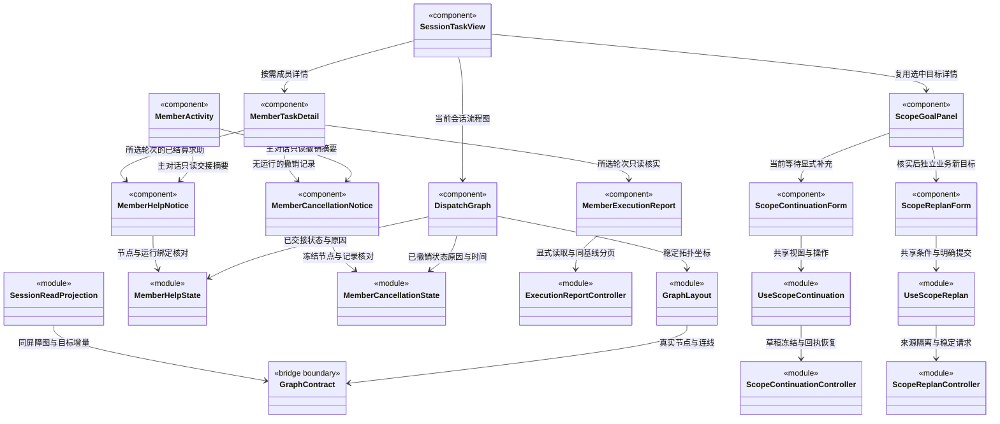

### 全局并发准入的只读提示

`AdmissionFeed` 在当前窗口合并订阅，串行每秒查询一次 `admission.read` 内存游标；无变化不替换对象，不重复读取日志。末订阅离开后停止计时，重挂载忽略旧代迟到响应；读取失败保留旧快照并显示过期风险。

`useAdmission` 与设置共用该订阅。`sessionAdmission` 按 workspace/root 严格筛选，只有本会话有等待票且没有真实占用才给出“等待执行资格”；`AdmissionNotice` 同时呈现在对话和任务视图。票据不是 TaskNode、scope waiting 或可恢复检查点，界面不创建、删除或重排票据，停止仍走原调度入口。

目标补充、只读核实和业务重规划的首次 `CAPACITY_BUSY` 是后端意图受理前拒绝，可修正后重发；一旦出现通信未知，后来的容量错误不能证明旧请求未执行，仍锁定原命令核实。

### 主会话任务派发图的增量消费契约

状态：`SessionTaskView` 默认显示真实主会话根与任务节点流程图；`DispatchGraph` 绘制可选择节点及有向派发/依赖连线，`graph-layout.ts` 计算稳定 DAG 布局。点击根后展开 `ScopeGoalPanel` 的真实周期目标、计划、审阅与受阻原因，以及队列和执行轮次；点击业务任务打开 `MemberTaskDetail`。运行轮次或普通问答不会被自动转换为派发任务。

#### 归属与显示内容

图只属于 `workspaceId + rootSessionId` 指定的主 Agent 会话，位于中间会话区的“任务视图”；右侧扩展页签中的团队/业务架构仍属于整个工作区。切换主会话必须换图，不把全工作区任务混到当前会话。

根显示主 Agent 与主会话标识；每个任务节点显示责任 Agent、模块列表、目标、执行状态及必要的等待/失败原因。根是 `SessionRootNode`（`kind: 'session-root'`），业务节点是 `TaskNode`（`kind: 'task'`）；同一个成员多次接单可对应多个节点。组织成员节点与任务节点不可混用。

不同主会话拥有独立主 Agent 实例。根详情显示图根的 `agentInstanceId` 和调度通道，以及运行摘要 `conversationBinding` 中已记录的对话通道。主 Agent 负责调度与受控知识治理，业务任务属于独立执行 Agent；图、成员动态卡和详情不提供主角色业务自执行标识，知识维护也不伪造业务节点。历史缺少绑定时明确提示未知，图与日志绑定冲突时提示重新同步，不用角色名推导身份。

没有派发图但已有主会话身份时，只显示从该会话运行记录提取的主 Agent 根，并说明尚未派发成员任务；新建草稿尚无会话时显示开始对话入口。没有任务时不画虚假的成员节点、连线或进度百分比。图加载失败保留已确认内容并报告同步中断，跨工作区/跨主会话快照不进入视图。

流程图采用从上到下分层：启用的派发边与依赖边共同决定拓扑层级；HTML 节点维持 248×192 像素的可读卡片，SVG 只承载有箭头的连线，实线是派发、虚线是依赖。跨层连线绕到卡片区外侧，不穿过中间正文。状态和文字更新不改变位置；拓扑层级不变时，同层新节点追加，不移动原节点，新依赖改变层级时允许必要移动。图内滚动查看大图，不把所有文字缩小到屏幕宽度。详情在较窄会话区域下移至图下方。

选中根的标识为 `session:<rootSessionId>`，选中任务使用 taskId，undefined 关闭详情。节点是可键盘操作的 button，选择只打开详情，不触发执行或授权；关闭详情不停止任务。主 Agent 原有队列、停止与完整计划保留在根详情，默认不在图下堆叠长文字流。

`ScopeGoalPanel` 在主对话使用 compact 摘要，在任务根默认展开；双方传入同一个 `ScopeGoalState`，不会独立建立第二条轮询。历史选择仅改变选中详情及图的突出周期，整张会话 DAG 和其他周期节点仍存在且可选择。未选择历史时跟随后端 active 周期，否则取最后首次创建的周期；不按客户端时间或随机 ID 猜测顺序。原始输入、附件数量、责任分配、逐项要求、审阅及证据引用均来自选中详情；240 字摘要之外的完整受阻原因可在展开后查看。

`scopeGoalView` 只从已提交摘要和当前图派生状态。active + review.complete 显示“完成申请待复核”；只有 closed + completed + hasPlan + review.complete 才显示“目标已完成”，缺审阅依据的历史保持警告。无业务计划的 completed 周期显示“本轮对话结束”；legacy 不补造原始目标，历史根不能借用当前运行的目标或标题。人工项只显示“尚未取得人工验收决定”，成员 result_ready 仍为候选。`currentGoalView` 始终对应当前/最新周期，不受历史选择改变；`selectedGoalView` 只控制浏览内容。活动周期根保留停止按钮，不能仅因最新主模型 run 已结束就隐藏；按钮明确停止当前周期，不重开正在浏览的历史。

持久等待必须来自 `scope.status=waiting`，显示“等待补充 · 执行已暂停”；模型 `review.awaiting_user` 仅显示“已请求补充 · 等待暂停确认”，不冒充检查点已提交。`openScope` 包含 active/waiting，`activeScope` 仅含 active，`waitingScope` 仅含 waiting；三者从完整摘要列表选取，独立于历史浏览。自动选择优先未关闭周期，后台等待不能被最近历史覆盖。

等待卡展示摘要原因，展开后读取完整 `scope.wait.reason` 与记录时间；关闭后保留等待历史，但取消状态优先于旧等待状态。等待根保留“取消当前任务”，浏览历史时说明当前另有待补充目标，按钮不会复活所选历史。显式纯文本补充通过下述专用表单提交，人工验收尚未接通；普通队列不能作为恢复入口，根队列也禁用“继续队列”。同版本详情必须匹配摘要中的等待身份、目标版本、输入版本与创建时间，旧等待详情不能拼到新摘要上。

#### 显式补充与通信未知

`ScopeContinuationForm` 仅显示 `useScopeContinuation` 提供的状态与操作，不自行生成命令。主对话和任务根接收同一 Hook 返回值；仅当前 waiting、选中详情和摘要身份/版本一致且同步正常时允许写入。历史选择只读，不能通过旧卡片恢复当前目标。接受补充后旧计划保留，但 `needsReplan` 显示“补充已受理 · 等待更新计划”；详情按记录展示补充正文和输入版本，不将旧审阅自动视为新输入已完成。

`ScopeContinuationController` 按 workspace/root 隔离本机索引，草稿按 scope/wait 保存。首次提交先持久化严格冻结的 `GoalContinuationRequest`，包括真实 waiting、两个预期版本、UUID 命令、未经裁剪的纯文本和实际模型/权限；保存失败不调用 IPC。仅在用户点击时调用 `loop.goalContinue`，不存在挂载、刷新或模型判断触发的自动提交。附件与人工批准不属于本步请求。

`ScopeContinuationPool` 在同一 renderer 中复用同会话控制器，避免切换工作区后旧回执覆盖重新打开的草稿；超过缓存目标数时只回收无订阅、无在途请求的历史对象。真正重开应用从本机记录恢复，不共享另一个 renderer 的内存状态；服务端仍以 wait/command 的持久化幂等保护处理多窗口重复请求。

回执须通过 bridge schema，并逐一核对 workspace/root/scope/command/wait、目标与输入版本、正文和 options。`scopeStatus` 仅是回执读取时的周期状态，`runId` 是持久化运行标识，二者不能用来宣称模型正在执行。明确的未受理错误保留草稿供修正；命令冲突、运行中止、通信超时或无法校验的响应一律保留冻结请求为未知。曾经结果未知的请求，即使同 ID 重试随后返回拒绝，也不能解除冻结换 ID 重发。

`loop.goalContinuation` 只读查询本次命令；返回 undefined 仍是未知，不证明服务器未执行。未知时可查询或在相同当前 waiting 下重试完全相同的请求；双击由控制器的同步 attempt 状态与在途集合拦截。重开将未结束的提交归为未知，只自动查询，不发送；损坏的本机记录显示错误并停止新提交，不覆盖可能已受理的未知记录。历史可查询既有命令，但不提供提交/重试按钮。迟到回执仍写入原会话记录，不刷新已切换的新会话。

成员详情以独立成员署名展示公开流式正文、最近工具状态、可选运行轮次，以及目标、模块、候选和证据。授权、问题回答与停止仍需显式操作；使用后端公开投影，不展示原生私有推理事件或原生会话路径字段。详情请求按 workspace/root/task/run 完整身份隔离；运行中按一秒增量补读，隐藏时降至五秒，终态须补齐 `hasMore` 后才停止轮询。主对话活动摘要最多显示三个任务，完整任务仍由流程图查看。

`useMemberRun` 的身份或 `enabled` 变化会重建投影；`active` 只调整观察频率，重新激活时补读。公开事件自身携带 workspace/task/run，主会话归属由后端请求核验与 Hook 的作用域代际共同保证。协议错误清空下次请求游标，保留界面上次正文及错误提示，随后请求权威 reset；卸载只丢弃迟到响应，不停止运行。`refresh` 合并到当前在途读取，不额外排队，和图 Hook 的“在途刷新后再补读一次”语义不同。

`MemberTaskDetail` 为四层身份设置独立组件 key；历史轮次只读，只有当前活动轮次读取审批/问题并提供操作按钮。提交失败分别保留读取错误和操作错误，卸载不撤回已提交的后端操作。`MemberRunTranscript` 只排版后端公开投影，compact 模式仅展示最近一项消息，不缩小日志读取范围，也不负责敏感内容识别。

#### 成员求助交接

`member-help-state` 只投影后端安全结算后保存的 `TaskNode.help`：节点必须 blocked、没有活动运行和交付候选，求助的 workspace/root/task/agent/instance/session/plan 必须匹配节点，run 必须已登记。普通受阻、取消、失败、结果未知或工具返回的 staged 文字不会被补造成求助交接。主对话 `MemberActivity` 和任务节点 `DispatchGraph` 共用该投影，显示“需要主调度协助”；图仍是原任务节点与既有派发连线，不添加结果反向边或假候选。

`MemberHelpNotice` 同时服务成员动态与 `MemberTaskDetail`，只读显示求助种类、原因、待主调度处理的问题、已尝试工具引用及记录时间。明确本轮成员执行已结束、求助已交接，后续由主调度重新安排；这是交接记录，不推断当前仍在等待、原成员已恢复、问题已解决或得到人工批准。工具引用不等于执行成功或验收证据。详情只展示所选 run 对应的求助，不能从另一轮借用；组件独立于成员正文读取，日志加载失败不会隐藏已提交交接。此组件没有执行、恢复旧成员、改变权限或批准按钮，也不新增轮询和后端请求。

#### 未启动任务撤销记录

`member-cancellation-state` 从已经核验身份的图节点读取 `TaskNode.cancelledBeforeStart`：仅 cancelled、没有 run/activeRun/result/help/待依赖，且 scope、撤销前版本及记录时间与当前冻结节点匹配时显示“已撤销（未启动）”。主对话成员卡、任务节点及详情共享这一投影；普通取消、周期关闭、空运行列表或模型文字不能补造未启动事实，无可信记录仍只显示“已停止”。

`MemberCancellationNotice` 在成员卡与详情中独立于执行日志呈现实际原因和后端时间；撤销不产生假的执行轮次，仍保留原目标、模块和节点。图节点保持真实 cancelled 状态与已有连线，只压缩摘要间距容纳原因和时间，不改变节点尺寸或拓扑。完整原因可在任务详情读取。记录说明原安排被撤销而不是目标完成，也不说明整个周期已关闭、成员实例已释放或后续已补做。

所有内容随既有图增量刷新，没有新增用户撤销、恢复、验收按钮、轮询或后端调用。无日志的详情仍可以按原入口只读核实登记事实，不能从没有登记轮次推出没有发生过操作。撤销 notice 的组件 key 与求助、报告、正文互相独立，避免状态提示插入时串用实时视图。

#### 异常执行记录核实

主会话标题、图根与根详情中的数量统一表示“已读 X 轮记录”，单独附加后端报告的“Y 轮待核实”。缺失或坏日志不会生成假的运行摘要，也不能把零条可读摘要解释为零次实际执行；逐条序号仅标为已读记录顺序，不冒充完整历史运行序号。

`MemberExecutionReport` 位于 `MemberTaskDetail` 的执行轮次选择器之后、实时正文之前；它与 `MemberRunDetail` 独立，缺失或损坏日志不会遮住报告入口。两个兄弟视图的 React key 分别带 `report:` 和 `transcript:` 前缀，在同一执行身份下仍保持独立实例，任务由运行转终态时新增提示不能导致报告订阅与正文相互替换。任务视图仍是节点 DAG，不把核实报告改成全会话文字流。任务原有候选也必须属于当前选中 `runId`，旧轮次不能显示后来的交付结果。

`useExecutionReport` 为 workspace/root/scope/task/run 选择创建独立 `ExecutionReportController`；构造、挂载、订阅、显示页签和图更新均不请求。只有“核实执行记录”“重新核实”“加载更多工具记录”显式调用只读 `dispatch.executionReport`，不调用模型、审批、问题回答、收件确认、启动、停止或恢复。没有运行轮次时只核实该任务的领取登记，不猜测最新日志。切换节点或轮次取消前端观察并忽略迟到结果，不撤销后端读取，也不改变任务。明确准备再次核实成功后，`invalidate` 清除旧报告、递增读取代次并忽略此前在途响应；它不会自动请求新报告。

报告须经过 bridge schema 和完整身份校验，检查候选/工具回执所属运行、工具分类数量、页大小和连续游标。工具列表按默认 50 条的有界页面显式追加；同一 basis 才合并，服务端 `paginationReset` 或 `changed_during_read` 替换旧页，不能拼接不同时间的证据。读失败保留已核实报告并明确提示；报告没有修改图、知识或日志的能力。

前端将 task revision、plan revision/status、实际所属 scope 的状态/goal revision 与图游标和报告基线比较。变化只标记报告版本不同，暂停继续加载旧页并等待用户重新核实；不自动回读全部日志。浏览历史周期不会为成员传入别的 scope：`SessionTaskView` 始终按选中任务的 `scopeId` 取真实摘要。

展示上分开“尚未领取执行”“有在途执行记录”“执行轮次已结算”“执行结果未知”。failed/cancelled/missing 日志不能显示成未执行；没有完整回执不代表没有副作用。工具 succeeded 只表示收到成功回执，候选始终“尚未验收”，输入/结果哈希明确不是业务产物指纹。原始工具参数/输出、冻结知识、凭据和原生会话路径不属于公开报告；报告本身不提供旧任务重试、改派或人工验收操作。

#### 显式新建只读核实周期

`ExecutionRecoveryForm` 位于报告之后，用户观察 `observation.text` 与新目标 `input.message` 分开，不修改旧任务。`useExecutionRecovery` 使用所选节点的真实 scope/task/run 与已验证报告 basis，只在来源周期 closed、会话没有 active/waiting、图已追齐且报告未过期时允许首次提交。已有运行必须明确选轮次；只有 task.runIds 为空、没有 activeRunId 且报告身份对应未选运行时才能省略 runId。已取消且未领取的节点允许保留 unknown/not_selected 报告后进入只读核实，不要求将其改判未执行。历史筛选不改变真实开放周期。未知/损坏日志可作为核实对象，不能当作未执行。

模型来自主输入区的实际 profile/provider/model，权限始终固定 `read`，不取输入区可写权限，也不包含附件。显式点击 `loop.recoveryStart` 才创建新周期；报告刷新、表单展示与编辑都不启动模型。受理后只刷新同一 root 的图与历史，“查看新目标”改变查看选择，不切换主会话或清空草稿、附件、队列。

`ExecutionRecoveryController` 按 workspace/root 保存独立本机 v2 索引，来源键包含 scope/task/run，不包含会变动的报告 basis。独立键 `cbim.execution-recovery.v2.*` 优先读取；不存在时可读 v1，后续保存写 v2 并保持 v1 原字节。损坏 v2 不回退旧 v1，以免隐藏新命令。发送前冻结 commandId、basis、观察、目标与模型选项；同 renderer 的池复用在途控制器。刷新报告、切换节点和重开不能隐藏未知命令并生成第二次请求。未知结果只查询 `loop.recoveryReceipt` 或原命令原正文重试；查询 undefined 仍为未知，一旦通信不确定，后续拒绝也不能解冻改发。仅首次明确预受理拒绝可保留草稿修正；持久化失败不发送，损坏本地记录不自动覆盖。

回执通过 Bridge Schema 后仍核对 workspace/root/command、source+basis、operation、观察、目标和 options；新 scopeId 必须等于稳定 commandId，且新 scope/run 不能借用来源。受理后 recovery 事实保持不可变，只允许周期状态演进，closed 不能回退为开放。矛盾查询保留原回执并提示错误。`accepted` 仅表示创建意图受理，不能当作正在运行或核实通过。未知请求的同 ID 查询/重试不套用首次提交的“当前空闲/报告新鲜”条件，后端先去重再决定是否需要执行。

“准备再次核实”只对 accepted 且 closed 的当前命令开放，当前主会话还必须没有开放目标。点击先按旧 commandId 重新查询；undefined、矛盾、通信失败、未关闭或正在查询均保持原锁定状态。只有完整旧请求及受理回执成功写入 history 后才清除当前 attempt，保留观察和目标作为新草稿。准备不生成 commandId、不调用模型，也不修改聊天草稿/附件/队列；最终“新建只读核实任务”才生成与当前索引所有命令都不同的 UUID。历史记录始终只读，不能选旧历史来绕过当前未知命令。

所有状态先保存后发布；容量超限或 localStorage 写入失败不能解锁原命令。单来源最多 32 条归档、单 root 最多 128 条归档，索引实际 UTF-8 字节与未决回执预留合计最多 2 MiB；不淘汰旧请求。每个尚无回执的 submitting/unknown 命令预留其冻结请求序列化大小加 8 KiB 元信息，避免先发送后无法保存复制正文的受理回执；其他草稿编辑同样遵守预留。重开时核对每条历史的 root/source、closed 回执与全索引命令唯一性，已有记录不会因容量上限被静默删减。

归档成功通过 source 订阅使所有同来源视图的报告同步失效，挂载之间遗漏的归档变化也补查；旧读取迟到不能重新填回可提交依据。报告为空时仍显示已保存历史、观察与目标，并提示“请重新核实来源报告”；用户须再次点击报告核实，再以新鲜 basis 提交。该过程不自动读取报告，最终后端仍核验来源版本及当前 root 是否空闲。

核实周期在 `ScopeSummary.readOnly` 明示只读约束；`useScopeContinuation` 对真实 openScope 的后续补充继续固定 read，不能借选择历史或修改 composer 权限提权。该标志不暴露原生上下文或旧运行排除清单。

#### 核实后的正式业务重规划

已受理但尚未登记计划的周期按后端 `origin` 显示身份：`business_replan` 显示“正在规划业务任务”，`inspection` 显示“正在规划只读核实”。目标卡和任务根使用同一状态投影及无计划说明；缺计划不代表退回普通问答，也不假造已派发任务。只有 origin 缺省的普通聊天保留轻量问答文案；取消、等待或失败仍以真实周期状态优先，不持续显示规划中。

`ScopeReplanForm` 是目标卡与任务根共享的独立入口。`Conversation` 只装配一次 `useScopeReplan`，两处卡片共享草稿、条件预览和提交锁。新来源只允许本会话最后提交的周期，并且明确 `origin=inspection`、closed/completed、摘要/完整目标计划/审阅版本一致；使用后端摘要保留的首次提交顺序，不按时间或随机 ID 排序。后续周期可能已改变产物，不能回选旧核实证据创建另一业务任务。只读标记、模型文字或旧业务周期不能替代来源身份。当前 root 仍有 active/waiting 时不允许核验/首次提交。历史选择只改变查看对象，不隐藏整个会话的开放状态；已有 accepted/unknown 命令仍可查询或原 ID 重试，不以最新来源条件改造原命令。

用户填写独立“新业务目标”，权限默认为 `ask`，只有明确选择才设为 `execute`，不会自动继承输入区完全访问。模型身份取输入区解析后的实际供应商 profile/provider/model。表单不消费聊天草稿、附件或队列，也不更改旧核实周期 readOnly。执行计划由新周期内的主 Agent 创建并分派成员，不在前端伪造。

“核验新任务条件”显式调用只读 `dispatch.replans.preview`，展示后端确认的必覆盖模块、继承人工条目、依据版本和具体问题；继承人工条目保留来源/ID/正文且不能由表单批准或删除。该预览是日志、来源和知识约束检查，不是已生成的业务执行计划，也不证明业务产物无未知影响。`eligible=false`、缺少依据或错身份均不能提交。

预览只驻留内存，绑定 selected inspectionScopeId、目标摘要 stamp、图游标、实际模型选择和草稿目标/权限。切换来源、编辑草稿或图/模型版本变化会使预览失效，已发读取即使迟到也不能启用另一目标的创建。重开只恢复草稿/冻结命令，不将缓存预览当作新鲜资格。知识变化未必推进图游标，最终受理必须由后端重新核验 expectedBasis；界面不是事务或权限边界。

“创建新业务任务”才生成 UUID，将严格 `ReplanRequest` 和已核验条件先写入独立 `cbim.scope-replan.v1.*` 索引再调用 `loop.replanStart`。索引按 workspace/root 固定，inspectionScopeId 是来源键；不复用只读 recovery 请求、存储键或权限。每 root 最多 128 个来源，读取与写入均限制 2 MiB UTF-8；写入时另为无回执的 submitting/unknown 请求预留冻结请求、预览事实大小及 16 KiB 元信息，避免受理后无处保存回执。超限、损坏或保存失败不覆盖原记录、不发送新命令、不解除已有锁定。

通信未知只允许 `loop.replanReceipt` 查询和原命令原正文重试，undefined 不等于未受理；曾未知后的领域拒绝仍不解冻。首次明确预受理拒绝可修正草稿，重新核验条件；新命令不得与当前索引已有命令重号。受理回执核对 workspace/root/command、来源 basis、目标、权限和已核验的知识/模块/人工约束；新 scope 等于 commandId，新 run 不借来源或审阅运行。后续查询仅更新周期状态，不能改写受理事实或使 closed 回退为开放。accepted 仅表示意图已受理，提供查看新目标和查询状态，不自动重派，也不在本步提供再次创建业务周期的历史操作。

实线派发从父 → 子，依赖线从前置 → 后续；父任务等待子结果以节点状态和关联详情展示，不画结果反向边。任务结果“可交接”与“已验收”分开，v1 只有候选、不绘制虚假的验收通过标记。Agent 状态来自后端事实，前端不凭聊天内容、文本长度或计时推算进度百分比。

#### 增量接口与本地状态

`Conversation` 用 `tab.taskId` 作为 rootSessionId，通过 `useSessionGraph` 读取 [Bridge 契约](../../bridge/contracts/CONTRACT.md) 的 `dispatch.sessionRead`；类型和 Core 的无 IO 图校验/归并函数只经 bridge/contracts 引入，不直接导入 backend。请求携带 graphCursor、scopeCursor、可选 selectedScopeId 和 detailStamp，响应在同一存储屏障返回图增量、目标摘要增量及选中详情。目标变化不推动用于验收的图游标。

```ts
// graph-state.ts 的公开接口；校验失败保持上一次可信投影。
class SessionGraphProjection {
  constructor(identity: GraphIdentity);
  readonly cursor?: GraphCursor;
  readonly snapshot?: GraphSnapshot;
  apply(response: GraphDelta): GraphSnapshot;
}
// Hook 返回 ScopeGoalState + refresh；当前周期状态与历史选择分开，不创建或派发任务。
useSessionGraph(workspaceId, rootSessionId, active);
```

1. 初次进入加载图和目标摘要 Snapshot；后续分别携带已成功应用的 cursor 读取 Delta。noop 保持原对象引用，组件不重复刷新全部节点和目标正文。详情 stamp 未变时不传完整输入、计划或审阅。
2. 一个 GraphEventBatch 的 changes 全部验证、一次应用；节点和连线可在同批创建。不先显示节点后补边，也不拆开更新 Agent 状态。
3. delta.from 必须与对应流的本地 cursor 相等；seq 连续、streamId 一致。同序号不同内容或断档报协议错误；保留原组合，下次不携带 cursor 获取权威 reset 快照，不接受跳号增量。`SessionReadProjection` 用 fork 验证图、目标与详情，全部通过才替换组合，任意一部分失败不能先发布另一部分。
4. reset 的 identity 必须与当前会话一致，cursor 必须等于 snapshot.cursor；一次替换投影。正常 delta 仅替换变化对象，保持未变节点和用户展开状态的引用。
5. 切换会话作废旧请求作用域并停止旧轮询；迟到结果即使成功也不能覆盖新会话。错误保留上次可用图并标记“同步中断”，不清空成无任务。
6. 每个图最多一个在途补读，手动刷新合并进同一请求序列，在途期间多次刷新只安排一次后续补读。当前采用轮询：活动页签一秒，后台页签或隐藏窗口五秒；每次响应最多读取 100 个完整提交批次，hasMore 时让出事件循环继续补读。界面暂停刷新不等于后端任务停止。
7. 不在每秒轮询中重新回读全部 RunJournal。图与成员事件各按自身游标增量读取；展开证据只显示已经收到的引用，不额外读取原始工具输出。保持主对话输入、消息队列和任务图相互独立。
8. 详情可能领先分页摘要；最多缓存 8 份详情，只在摘要和详情 stamp 一致时显示，追页期间不混用不同版本。两条流中任一仍有 hasMore 时仅推进内部投影；都追到同一读取屏障后一次发布给界面。分页失败保留上一完整 UI 组合，不发布半页图或目标。相同详情版本内容不同、跨会话详情、摘要/详情身份或版本冲突均拒绝；历史选择改变时，在途响应可以更新共同图和摘要，但不能覆盖新的选择。查看历史不会触发执行、审批、确认收件或目标恢复。

AgentGraphView 是当前图的局部状态和任务引用，不泄露其他根会话的工作内容。工作区组织图需要的全局成员状态走另一授权接口，不能复用此图的局部空闲状态当作全局空闲。

#### 当前图展示结构



布局测试覆盖有向关系、跨层、无重叠、禁用边、循环/缺失端点、状态变化稳定及新增同层节点不挤动旧节点。组件与增量测试覆盖默认流程图、真实根空态、按需根详情、不同工作区/会话隔离、noop 引用保持、完整批次和错误响应不改变已有投影。`test:members` 对打包程序、实际 Pi 与可控本机模型做实时流验证；不以假静态节点作为真实派发进度验收。
