# src/frontend/team 架构

## 目录定位

工作区唯一的静态 Team/组/Agent 图及角色维护、继承与人才复用。Agent 节点可按 Session 查看只读执行履历；历史角色独立导航，删定义不回填团队树。详情按需分页，不轮询全量历史或启动执行。

本文描述当前实现。通过分析目录边界后维护的 [源码架构脚本](../../../scripts/source-architecture.mjs) 同步清单和声明；代码变更时仍须核对职责、关键成员与关系。

## 代码清单

| 文件 | 当前职责 |
| --- | --- |
| [agent-history-state.ts](agent-history-state.ts) | 校验并合并角色执行历史的会话/轮次分页，生成完整身份观察键。 |
| [agent-history.css](agent-history.css) | 对应界面的布局与视觉样式。 |
| [AgentSessionHistory.tsx](AgentSessionHistory.tsx) | 在静态 Agent 下浏览长期 Session 履历，按独立会话和运行展示公开消息、工具过程与计划证据。 |
| [team-model.ts](team-model.ts) | 从工作区知识快照构建静态 Team、分组、Agent 与 Skill 视图模型。 |
| [team-view.css](team-view.css) | 对应界面的布局与视觉样式。 |
| [TeamView.tsx](TeamView.tsx) | 静态团队架构浏览、知识编辑与人才市场入口，并按静态角色打开只读 Session 履历。 |
| [useAgentHistory.ts](useAgentHistory.ts) | 为只读角色历史面板提供按需分页与单轮公开事件读取。 |

## 架构类图

### agent-history-state.ts

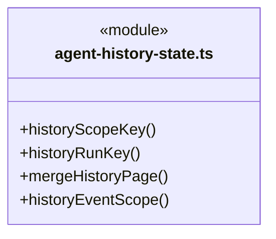

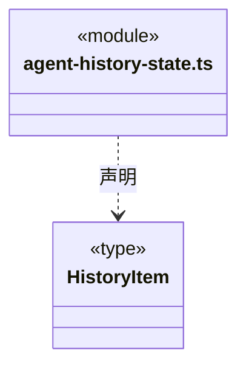

直接依赖：[../../bridge/contracts/agent-history.ts](../../bridge/contracts/agent-history.ts)、[../tasks/member-event-state.ts](../tasks/member-event-state.ts)。

### agent-history.css

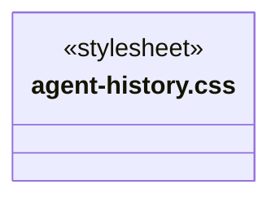

### AgentSessionHistory.tsx

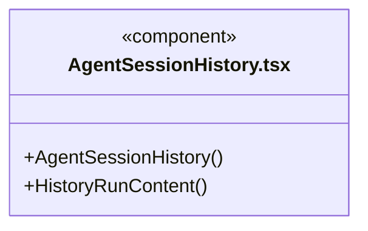

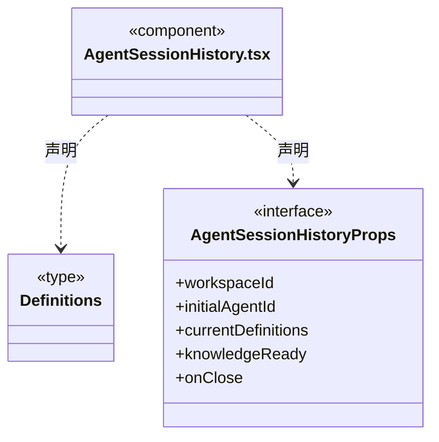

直接依赖：[../../bridge/contracts/agent-history.ts](../../bridge/contracts/agent-history.ts)、[../../bridge/contracts/execution.ts](../../bridge/contracts/execution.ts)、[../tasks/MemberRunTranscript.tsx](../tasks/MemberRunTranscript.tsx)、[../conversation/transcript.ts](../conversation/transcript.ts)、[../conversation/MarkdownMessage.tsx](../conversation/MarkdownMessage.tsx)、[agent-history-state.ts](agent-history-state.ts)、[useAgentHistory.ts](useAgentHistory.ts)、[agent-history.css](agent-history.css)、[../tasks/member-activity.css](../tasks/member-activity.css)。

### team-model.ts

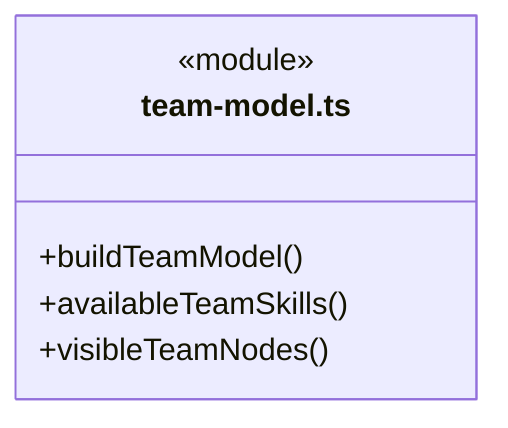

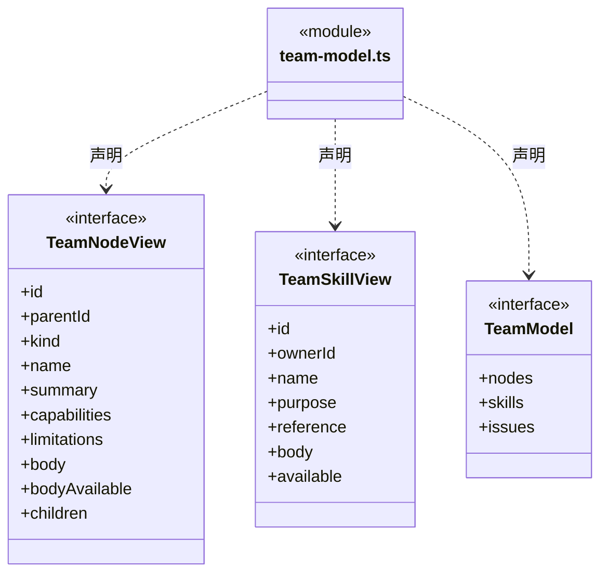

直接依赖：[../../bridge/contracts/workspace.ts](../../bridge/contracts/workspace.ts)、[../knowledge/static-owners.ts](../knowledge/static-owners.ts)。

### team-view.css

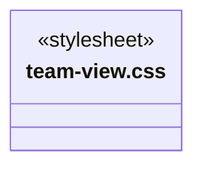

### TeamView.tsx

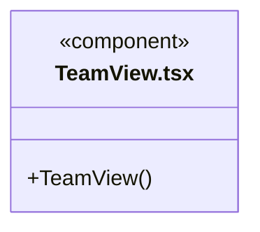

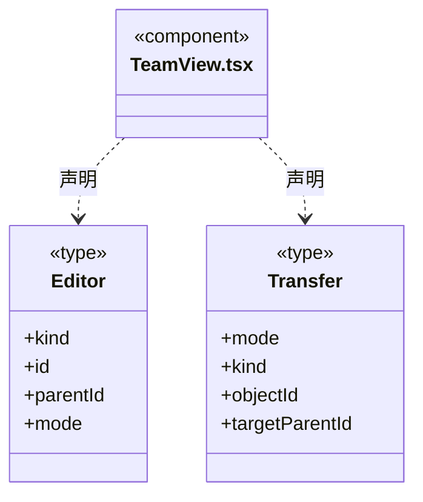

直接依赖：[../../bridge/contracts/workspace.ts](../../bridge/contracts/workspace.ts)、[../components/Icon.tsx](../components/Icon.tsx)、[../conversation/MarkdownMessage.tsx](../conversation/MarkdownMessage.tsx)、[../knowledge/ArchitectureEditor.tsx](../knowledge/ArchitectureEditor.tsx)、[../resources/WorkspaceResourceTransfer.tsx](../resources/WorkspaceResourceTransfer.tsx)、[AgentSessionHistory.tsx](AgentSessionHistory.tsx)、[team-model.ts](team-model.ts)、[team-view.css](team-view.css)。

### useAgentHistory.ts

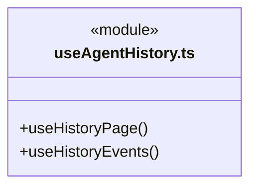

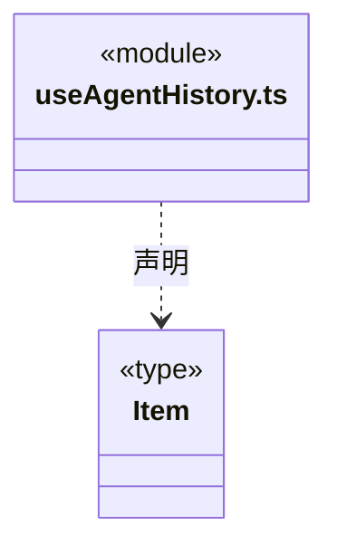

直接依赖：[../../bridge/contracts/agent-history.ts](../../bridge/contracts/agent-history.ts)、[../tasks/member-event-state.ts](../tasks/member-event-state.ts)、[agent-history-state.ts](agent-history-state.ts)。

### 本目录调用边界

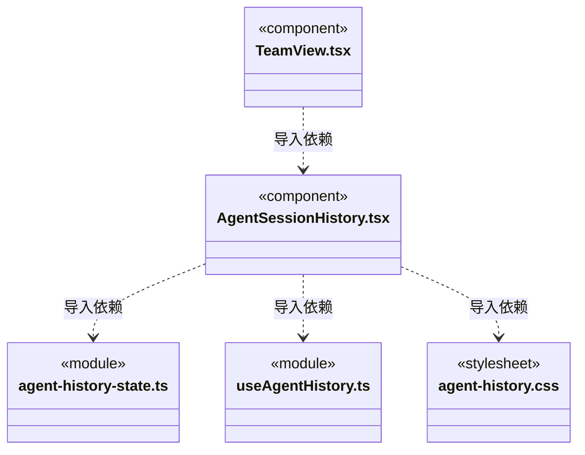

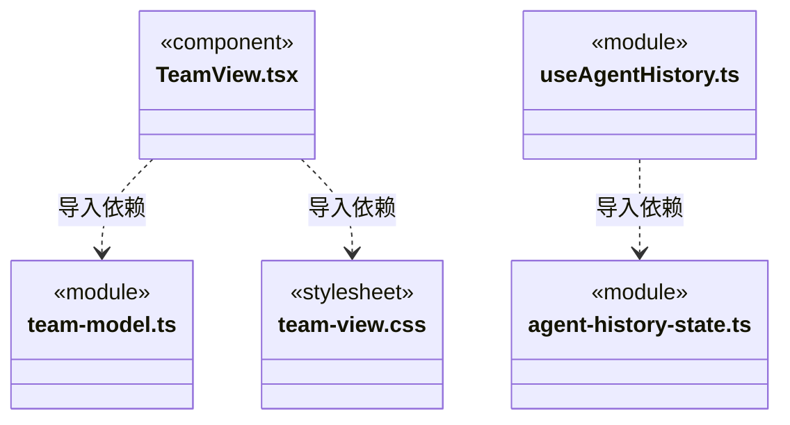

## 子目录导航

无子目录。

[返回上层](../ARCHITECTURE.md)。

每次修改本目录代码，同步维护文件头、关键契约说明及本图。未实现的治理、证据验收和自动编排能力不列入当前类图。

## 设计契约 v1 与落地范围

以下内容区分已接通能力与后续设计；以各节的实现状态为准，不将目标图当作现状图。维护源：[CONTRACT.md](CONTRACT.md)；生成类图时同步附加，勿直接修改本附录。

# 静态团队架构契约

- `TeamView` 的组织树仅展示工作区正式 Team、分组、Agent 和 Skill 定义，不把 AgentInstance、在线状态、执行活动或任务图混入树。动态派工仍属于当前会话任务视图；静态 Agent 详情可单独打开只读执行履历。
- `team-model.ts` 只读同一 `Snapshot`，节点身份从知识路径派生，不能被 `agent.json` 内额外的 `id` 覆盖。空 Team 根与 `cbim:main`、`cbim:executor` 两个只读内置角色始终可见；解析失败单独提示。
- 自定义 Agent 可创建、读取、编辑、删除；Team 根和两个内置角色不可删除或编辑。内置角色使用应用配置，与其他成员同核，但不在正式知识中伪造可编辑定义。默认执行角色显示 Team 根共享 Skill；静态能力展示不能声称已加载进某次模型上下文。
- 每个组织节点维护自己的 Skill。Agent/分组可用 Skill 由自身至 Team 根逐级合并，界面明确显示所属节点。继承 Skill 只允许跳转原 owner 维护，不能在当前节点上误删继承内容。
- 所有知识修改交给 `ArchitectureEditor`：基于打开时的快照先校验/预览，再显式提交。Agent 新建需填写归属、目录标识、名称、100–250 非空白字符单行摘要、能力、限制和工作原则正文。
- 发布整个团队从 Team 根发起，单 Agent 和自有 Skill 可分别发布。`WorkspaceResourceTransfer` 仅传输静态知识，使用共享人才仓库；导入由弹窗绑定目标 owner，预览后提交，不加载运行实例、会话或权限。
- 知识提交成功后调用注入的 `refresh` 更新快照；刷新失败提示重试，不将本地草稿伪装为已经加载的正式知识。切换工作区关闭旧编辑窗口并重置选择。
- 编辑与读取不授予执行权限；工具授权仍由可信工作区执行入口处理。

## 静态角色的独立 Session 历史

- Agent/内置角色详情的“执行历史”打开 `AgentSessionHistory`；工具栏“历史角色”读取归档索引，可查询当前已删除或不再登记的角色。历史角色不回填到正式团队树，不影响知识编辑草稿或主对话草稿。
- 读取只使用 `agentHistory.roles / sessions / runs / events`。角色按 `workspaceId + agentId`，Session 按服务端 `sessionId`，正文按 `workspaceId + agentId + sessionId + taskId + runId` 固定。模型原生上下文不合并，不从名称、当前选中会话或当前静态配置推导旧身份。
- 历史名称、执行时 `configurationRevision`、实例 ID、通道 ID、主会话 ID 与当前静态定义分开显示。旧 `legacy:<taskId>` 仅为分组键，缺失的实例/通道明确标为未绑定；不补造主会话引用。历史仍保留已释放执行实例的真实引用。
- `useAgentHistory` 在打开角色/Session 后按需读取元数据，只有选中一轮才请求公开事件；手动刷新与加载更多共享串行请求，切换或卸载丢弃迟到响应。没有每秒全量轮询，终态历史不会持续请求。单次事件补读最多 100 页（每页 200 条），更长记录保留游标供继续加载。
- `agent-history-state.ts` 校验分页的工作区、角色和 Session 归属，以独立会话/任务/运行 ID 去重；刷新替换列表，加载更多保留既有顺序。身份错误或分页不前进要提示并保留已读取内容，不能静默混入其他角色数据。
- `HistoryRunContent` 展示经后端筛选的公开输入、回复、工具状态、计划步骤与证据引用。主用户输入与成员回注来源区分；交付候选始终标为尚未验收。`MemberRunTranscript` 仅复用显示，不带审批、停止、恢复、启动或发送消息的能力。
- 当前模型私有推理、冻结知识全文、密钥、`sessionFile` 和原生会话存储不属于此页面协议。脱敏由后端公开投影负责，前端不能以拿到原始日志后隐藏字段替代该边界。
- 角色、Session、运行读取失败与后端 `diagnostics` 单独展示，不能用“暂无历史”掩盖故障；切换工作区关闭旧历史视图，返回团队定义保留静态节点选择。
