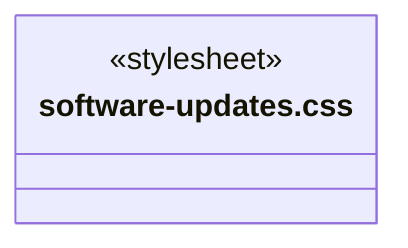
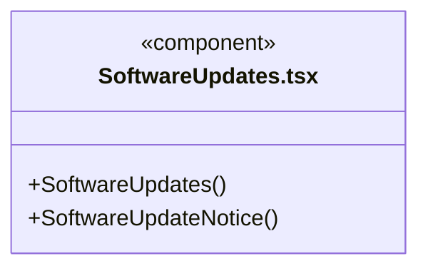
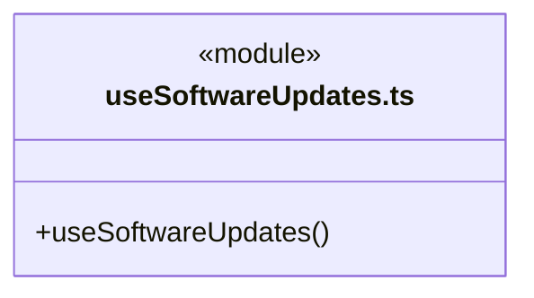
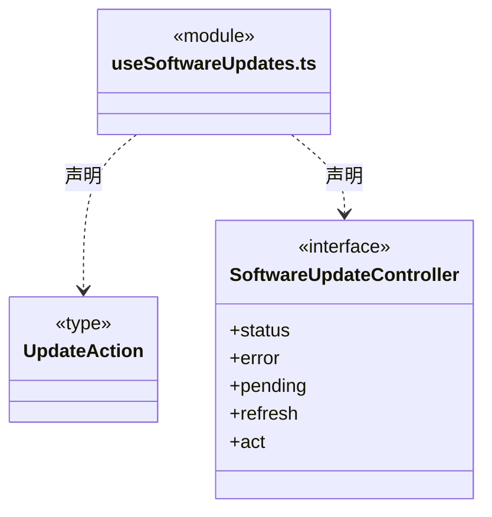
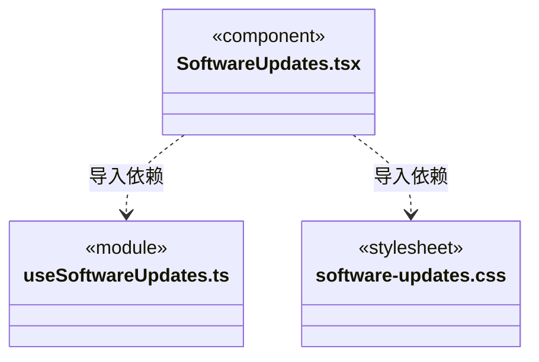

# src/frontend/updates 架构

## 目录定位

账号入口的版本与更新弹窗、最近发布说明及新版提醒。共享窗口级本机更新快照；查看日志保留原页面与草稿，检查、下载和重启安装分别显式操作。只依赖公开 IPC，不导入后端更新实现。

本文描述当前实现。通过分析目录边界后维护的 [源码架构脚本](../../../scripts/source-architecture.mjs) 同步清单和声明；代码变更时仍须核对职责、关键成员与关系。

## 代码清单

| 文件 | 当前职责 |
| --- | --- |
| [software-updates.css](software-updates.css) | 更新弹窗与提醒；原生 dialog 的顶层显示不受侧栏或工作区裁切。 |
| [SoftwareUpdates.tsx](SoftwareUpdates.tsx) | 账号菜单的统一版本与更新弹窗，以及新版和自动重启进度提醒。 |
| [useSoftwareUpdates.ts](useSoftwareUpdates.ts) | 由桌面外壳持有的一份更新状态，供账号菜单、提醒与更新弹窗共同消费。 |

## 架构类图

### software-updates.css

### SoftwareUpdates.tsx

直接依赖：[../../bridge/contracts/desktop-updates.ts](../../bridge/contracts/desktop-updates.ts)、[../components/Icon.tsx](../components/Icon.tsx)、[useSoftwareUpdates.ts](useSoftwareUpdates.ts)、[software-updates.css](software-updates.css)。

### useSoftwareUpdates.ts

直接依赖：[../../bridge/contracts/desktop-updates.ts](../../bridge/contracts/desktop-updates.ts)。

### 本目录调用边界

## 子目录导航

无子目录。

[返回上层](../ARCHITECTURE.md)。

每次修改本目录代码，同步维护文件头、关键契约说明及本图。未实现的治理、证据验收和自动编排能力不列入当前类图。

## 设计契约 v1 与落地范围

以下内容区分已接通能力与后续设计；以各节的实现状态为准，不将目标图当作现状图。维护源：[CONTRACT.md](CONTRACT.md)；生成类图时同步附加，勿直接修改本附录。

# 账号入口的版本与更新

本目录拥有版本入口后的展示和窗口级 IPC 读取，后端状态机仍在独立 `backend/updater`。`shell/App` 每个窗口只挂载一次 `useSoftwareUpdates`，账号菜单、新版提醒和弹窗共享同一快照；账户登录不是查看版本／日志的前提。`settings` 不再装配更新 UI。

`SoftwareUpdateController` 只公开状态、错误、在途标志和固定 check／download／install 动作。每秒轮询的 status 仅为本机读取；后台定时 GitHub 检查继续属于后端。操作前后推进读取代际，丢弃较旧的在途快照；同一窗口不重复派发操作，下载期间仍读取进度。读取失败有可见提示和重读入口，关闭弹窗不取消后端下载，卸载 App 后不更新 React 状态。

`SoftwareUpdates` 使用原生 dialog 的焦点约束，Escape／关闭后返回原入口。查看日志只打开弹窗，不切换外壳页面，不丢弃聊天、附件、知识或设置草稿。没有已知新版时直接展示当前安装版内置日志；有新版时明确区分可用版本的发布说明与当前版本日志。远端正文按纯文本渲染，不执行 HTML、链接或脚本；没有日志显示明确空态。

统一“版本与更新”弹窗展示日志、状态和手动检查，后台每分钟检查仍归后端。点击下载前明确说明会停止任务、安装并自动重启，提醒保存未提交编辑；关闭弹窗不取消这次已经授权的流程。下载进度与 installing 提示来自同一后端快照，前端不根据 ready 自动派发第二条 install。ready 只表示缓存包已校验但上次安装未完成，显示显式重试；只有重启后的真实 currentVersion 才证明升级成功。

离线等检查错误只在弹窗内显示，未打开弹窗时不主动弹窗或显示全局错误。横幅“稍后”仅隐藏当前版本提醒，不取消检查或移除菜单高亮和绿点；已授权流程进入 installing 时重新显示进度且没有“稍后”，避免应用退出看起来像崩溃。普通退出取消仍由 Main/backend 处理。

菜单与弹窗呈现受用户交互需求驱动；本次自动安装策略归 backend/updater 的状态机，界面只提交一次用户意图并读取进度。没有足够历史数据量化变化频率；后续调整日志排版修改此目录，调整账号菜单只改 shell，安装策略修改 updater 和契约。固定源、制品校验及业务排空机制继续复用，不引入跨功能全局状态或通用基类。
