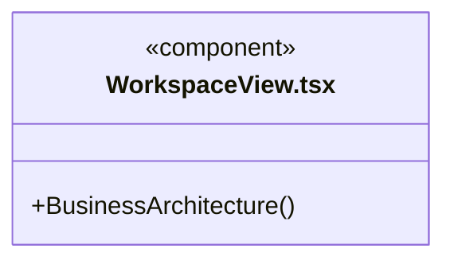

# src/frontend/workspace 架构

## 目录定位

当前工作区业务模块架构展示；知识编辑仍委托 knowledge 的维护组件。

本文描述当前实现。通过分析目录边界后维护的 [源码架构脚本](../../../scripts/source-architecture.mjs) 同步清单和声明；代码变更时仍须核对职责、关键成员与关系。

## 代码清单

| 文件 | 当前职责 |
| --- | --- |
| [WorkspaceView.tsx](WorkspaceView.tsx) | 模块知识图与知识编辑面板的组合视图。 |

## 架构类图

### WorkspaceView.tsx

直接依赖：[../../bridge/contracts/workspace.ts](../../bridge/contracts/workspace.ts)、[../components/Icon.tsx](../components/Icon.tsx)、[../components/Empty.tsx](../components/Empty.tsx)、[../knowledge/KnowledgeTools.tsx](../knowledge/KnowledgeTools.tsx)。

## 子目录导航

无子目录。

[返回上层](../ARCHITECTURE.md)。

每次修改本目录代码，同步维护文件头、关键契约说明及本图。未实现的治理、证据验收和自动编排能力不列入当前类图。
