# src/frontend/workspace 架构

## 目录定位

工作区唯一的领域工程/模块图及自身Workflow；知识编辑和整架构复用分别委托knowledge/resources。独立负责人面板提供模块列表、岗位反查、预览和原命令核实，责任历史与来源观察明确有界；登记不移交旧任务，多个主会话共享静态定义。

本文描述当前实现。通过分析目录边界后维护的 [源码架构脚本](../../../scripts/source-architecture.mjs) 同步清单和声明；代码变更时仍须核对职责、关键成员与关系。

## 代码清单

| 文件 | 当前职责 |
| --- | --- |
| [module-ownership-state.ts](module-ownership-state.ts) | 模块负责人面板的回包核对和持久原命令状态，跨业务架构与项目岗位视图共享。 |
| [module-ownership.css](module-ownership.css) | 对应界面的布局与视觉样式。 |
| [ModuleOwnershipDetail.tsx](ModuleOwnershipDetail.tsx) | 显示模块当前负责人、来源观察与有界审计，供责任面板单独审阅。 |
| [ModuleOwnershipPanel.tsx](ModuleOwnershipPanel.tsx) | 业务架构和项目岗位共用的模块责任控制面，提供查询、预览、明确提交和原命令核实。 |
| [workspace-view.css](workspace-view.css) | 对应界面的布局与视觉样式。 |
| [WorkspaceView.tsx](WorkspaceView.tsx) | 工作区唯一的静态业务架构，维护模块和 Workflow、复用完整业务模板，并进入独立模块负责人控制面。 |

## 架构类图

### module-ownership-state.ts

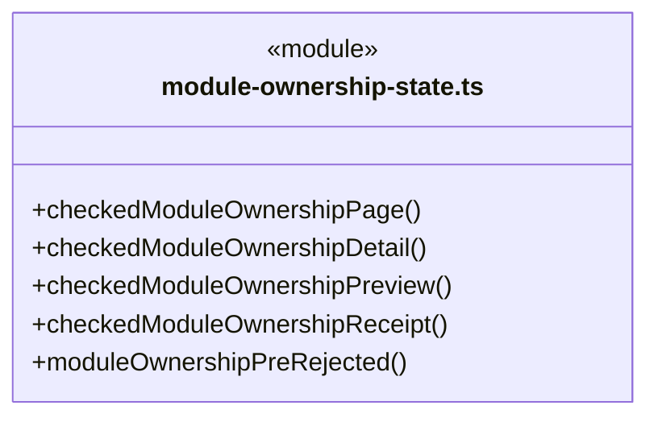

成员 1/2（同名节点为同一声明，跨图合并阅读）。

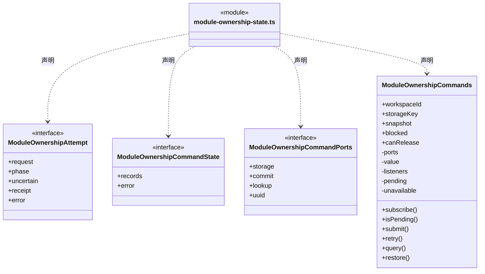

成员 2/2（同名节点为同一声明，跨图合并阅读）。

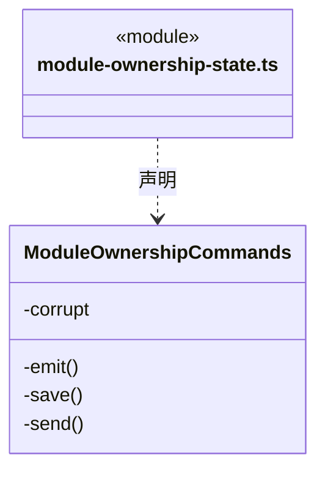

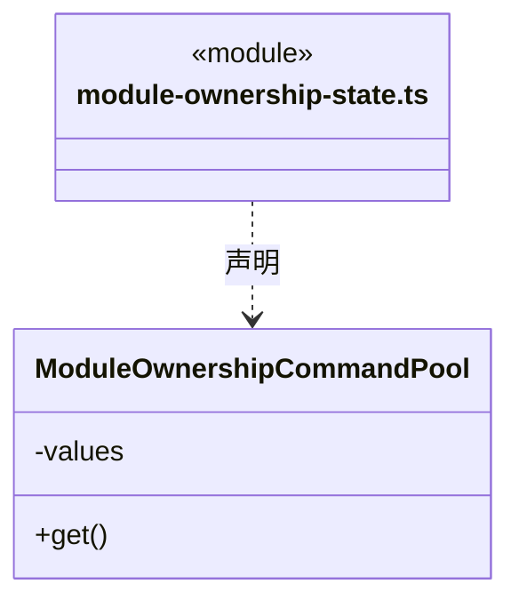

直接依赖：[../../bridge/contracts/module-ownership.ts](../../bridge/contracts/module-ownership.ts)。

### module-ownership.css

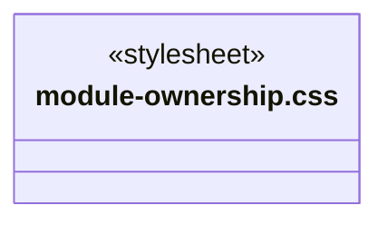

### ModuleOwnershipDetail.tsx

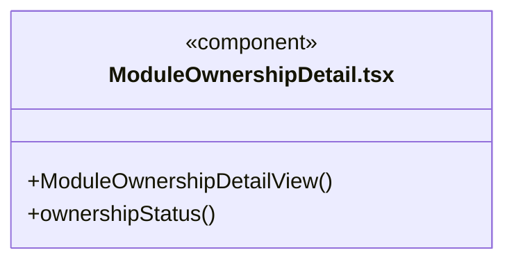

直接依赖：[../../bridge/contracts/module-ownership.ts](../../bridge/contracts/module-ownership.ts)。

### ModuleOwnershipPanel.tsx

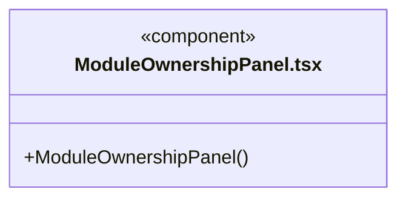

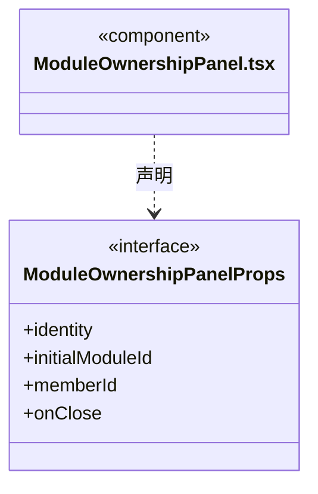

直接依赖：[../../bridge/contracts/module-ownership.ts](../../bridge/contracts/module-ownership.ts)、[../../bridge/contracts/workspace-members.ts](../../bridge/contracts/workspace-members.ts)、[../team/workspace-member-state.ts](../team/workspace-member-state.ts)、[module-ownership-state.ts](module-ownership-state.ts)、[ModuleOwnershipDetail.tsx](ModuleOwnershipDetail.tsx)、[module-ownership.css](module-ownership.css)。

### workspace-view.css

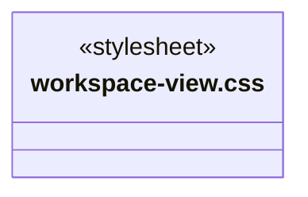

### WorkspaceView.tsx

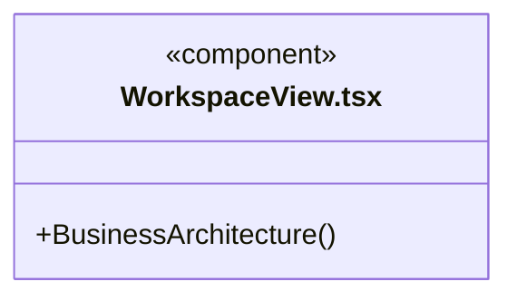

直接依赖：[../../bridge/contracts/workspace.ts](../../bridge/contracts/workspace.ts)、[../components/Icon.tsx](../components/Icon.tsx)、[../components/Empty.tsx](../components/Empty.tsx)、[../knowledge/KnowledgeTools.tsx](../knowledge/KnowledgeTools.tsx)、[../knowledge/ArchitectureEditor.tsx](../knowledge/ArchitectureEditor.tsx)、[../resources/WorkspaceResourceTransfer.tsx](../resources/WorkspaceResourceTransfer.tsx)、[../governance/ModuleGovernancePanel.tsx](../governance/ModuleGovernancePanel.tsx)、[ModuleOwnershipPanel.tsx](ModuleOwnershipPanel.tsx)、[workspace-view.css](workspace-view.css)。

### 本目录调用边界

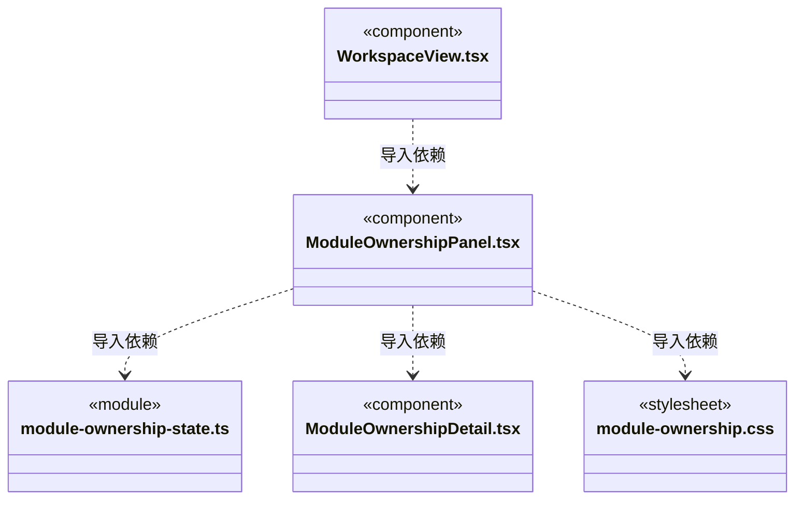

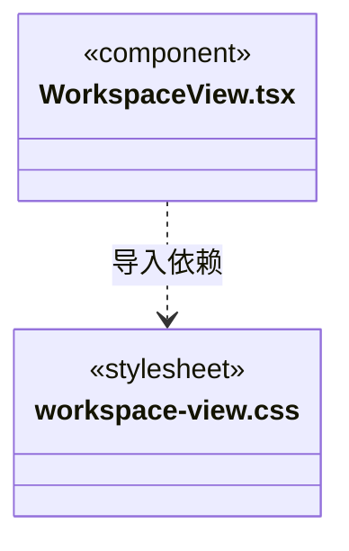

## 子目录导航

无子目录。

[返回上层](../ARCHITECTURE.md)。

每次修改本目录代码，同步维护文件头、关键契约说明及本图。未实现的治理、证据验收和自动编排能力不列入当前类图。

## 设计契约 v1 与落地范围

以下内容区分已接通能力与后续设计；以各节的实现状态为准，不将目标图当作现状图。维护源：[CONTRACT.md](CONTRACT.md)；生成类图时同步附加，勿直接修改本附录。

# 工作区静态业务图

`WorkspaceView` 展示唯一业务定义树，根为 Workspace，第一层为领域工程节点，下层为模块。模块详情显示自身正文、源目录、真人维护人和自身 Workflow，不继承父模块 Workflow。

增删改操作委托共享 `ArchitectureEditor`，通过预览、校验和人工提交更新工作区知识，并显式刷新快照。资源发布/使用委托 `WorkspaceResourceTransfer`；业务模板始终是整套业务架构，不提供单独应用模块或 Workflow 的入口。

业务图不显示动态任务节点。多个主会话共用此静态定义；每个主会话自己的任务派发图由 tasks 目录展示，已派发的运行上下文仍由后端知识版本规则管理。

模块详情的“知识治理”打开独立 `ModuleGovernancePanel`，固定模块及工作区实例。登记保护、记录观察、精确提案、本机决定和独立实施都委托治理服务；普通编辑入口不能绕过后端知识事务门禁。知识提交后显式刷新静态图，不创建或改变会话任务图。

## 单模块负责人控制面

`ModuleOwnershipPanel` 由业务架构工具栏/模块详情进入，也供项目岗位反查当前负责的模块。负责人使用稳定 memberId，与真人维护人分开；一个模块只有一个关系头，解除保留关系和历史，重新设置沿原 bindingId 升版。此界面只登记责任，未接实际派发、旧任务移交或来源代次，不把 active 岗位称为可执行。

列表按 ownershipCursor、岗位 registryCursor、knowledgeRevision 三项依据分页；来源无法读取不假报空架构。详情展示当前岗位、真实来源观察和近20条明确有界历史；main_agent 与 local_desktop 来源分开，不把主工具审批伪造成人工责任决定。元信息、当前来源差异每次显式核实，不周期回读。

`module-ownership-state` 严格核对原模块、前后岗位、版本、游标、预览依据和不可变回执。每工作区共享本机128条/2MiB命令记录；发送前保存，双击或另一个页面不能重复提交，未知冻结原请求。重开只查原命令，明确重送仍保持原ID和实例；结果已受理后本机保存失败保留事实、可查询修复，不当作回滚。读取记录损坏或达到容量上限时停止新写，不丢弃旧记录。

业务架构选择与岗位反查均固定工作区实例；异步代次隔离迟到列表/详情，表单编辑立即废弃旧预览。缺失模块仍可解除已有关系。关系修改与岗位退休的冲突由同一个后端 Store 裁决，前端不主动解除或替用户退休。
