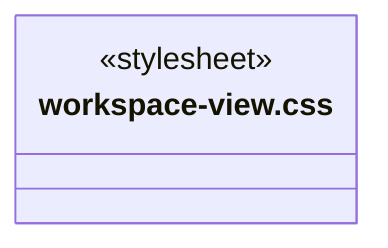
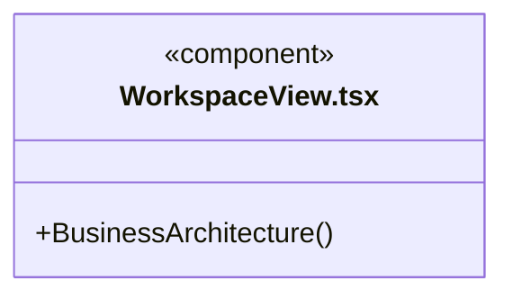
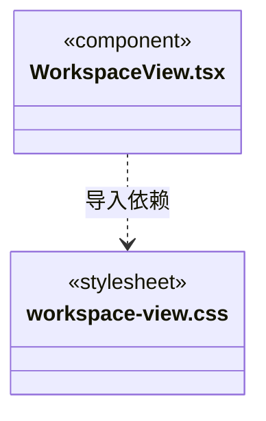

# src/frontend/workspace 架构

## 目录定位

工作区唯一的静态领域工程/模块图及自身 Workflow。语义编辑委托 knowledge，完整业务模板复用委托 resources；多个主会话共享定义、动态任务各自独立。

本文描述当前实现。通过分析目录边界后维护的 [源码架构脚本](../../../scripts/source-architecture.mjs) 同步清单和声明；代码变更时仍须核对职责、关键成员与关系。

## 代码清单

| 文件 | 当前职责 |
| --- | --- |
| [workspace-view.css](workspace-view.css) | 对应界面的布局与视觉样式。 |
| [WorkspaceView.tsx](WorkspaceView.tsx) | 工作区唯一的静态业务架构，浏览工程/模块关系，维护模块和专属 Workflow，并发布或应用完整业务模板。 |

## 架构类图

### workspace-view.css

### WorkspaceView.tsx

直接依赖：[../../bridge/contracts/workspace.ts](../../bridge/contracts/workspace.ts)、[../components/Icon.tsx](../components/Icon.tsx)、[../components/Empty.tsx](../components/Empty.tsx)、[../knowledge/KnowledgeTools.tsx](../knowledge/KnowledgeTools.tsx)、[../knowledge/ArchitectureEditor.tsx](../knowledge/ArchitectureEditor.tsx)、[../resources/WorkspaceResourceTransfer.tsx](../resources/WorkspaceResourceTransfer.tsx)、[workspace-view.css](workspace-view.css)。

### 本目录调用边界

## 子目录导航

无子目录。

[返回上层](../ARCHITECTURE.md)。

每次修改本目录代码，同步维护文件头、关键契约说明及本图。未实现的治理、证据验收和自动编排能力不列入当前类图。

## 设计契约 v1 与落地范围

以下内容区分已接通能力与后续设计；以各节的实现状态为准，不将目标图当作现状图。维护源：[CONTRACT.md](CONTRACT.md)；生成类图时同步附加，勿直接修改本附录。

# 工作区静态业务图

`WorkspaceView` 展示唯一业务定义树，根为 Workspace，第一层为领域工程节点，下层为模块。模块详情显示自身正文、源目录、真人维护人和自身 Workflow，不继承父模块 Workflow。

增删改操作委托共享 `ArchitectureEditor`，通过预览、校验和人工提交更新工作区知识，并显式刷新快照。资源发布/使用委托 `WorkspaceResourceTransfer`；业务模板始终是整套业务架构，不提供单独应用模块或 Workflow 的入口。

业务图不显示动态任务节点。多个主会话共用此静态定义；每个主会话自己的任务派发图由 tasks 目录展示，已派发的运行上下文仍由后端知识版本规则管理。
