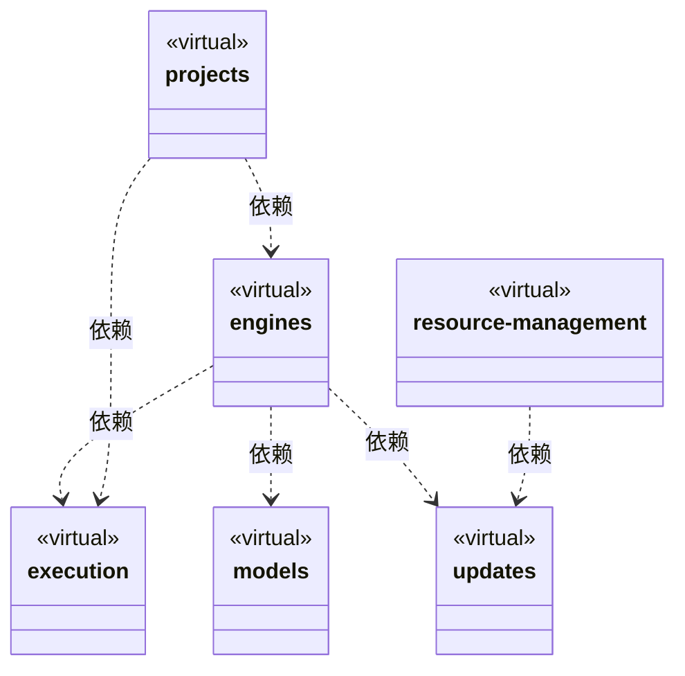
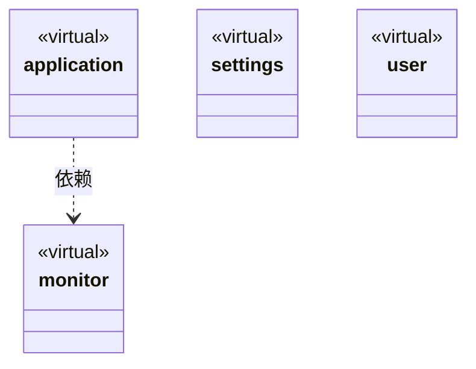

# 新版业务层

## 设计意图

为当前桌面视图提供业务用例。迁移范围沿新版入口追踪到具体调用和所需契约；历史功能留在旧目录，待产品接入时逐项迁移。

## 主要组成

Application 负责生命周期。项目、设置、用户、更新、资源管理和运行监控面向桌面功能。Office 对话使用已安装的引擎包和用户选择的模型；引擎包管理、模型配置和下载队列为这些入口提供服务。

<!-- architecture:generated:start -->

## 架构关系

标注为 `virtual` 的节点是直接子模块的虚拟类封装；内部设计沿下方入口阅读。

### 关系组 1：engines

### 关系组 2：application

### 跨图协作

按引用方归并目标，保留全部跨图关系；分图只用于阅读，不表示新增模块或依赖边界。

| 引用方 | 关系 | 目标 |
| --- | --- | --- |
| [application](application/ARCHITECTURE.md)（图 2） | 依赖 | [projects](projects/ARCHITECTURE.md)（图 1）、[resource-management](resource-management/ARCHITECTURE.md)（图 1） |

## 子模块

| 虚拟封装 | 整体职责 |
| --- | --- |
| [application](application/ARCHITECTURE.md) | 负责应用生命周期。 |
| [engines](engines/ARCHITECTURE.md) | 将引擎声明、公开状态与可信运行服务分开。上层通过清单校验身份与模型需求，包服务负责固定可执行制品，模型服务负责捕获选型；纯入口不启动引擎或加载凭据。 |
| [execution](execution/ARCHITECTURE.md) | 为可信宿主与引擎制品管理之间提供运行包边界。当前目录只定义规则契约，不持有任务调度、下载或引擎生命周期。 |
| [models](models/ARCHITECTURE.md) | 将模型配置、连接选择与公开快照作为纯协议入口，凭据解析、持久化和显式探测由 service 提供。模型协议不依赖引擎身份，选型的引擎策略由 engines 承担。 |
| [monitor](monitor/ARCHITECTURE.md) | 负责运行监控。 |
| [projects](projects/ARCHITECTURE.md) | 负责项目列表和各项目的 Office 会话。 |
| [resource-management](resource-management/ARCHITECTURE.md) | 负责主菜单资源管理。 |
| [settings](settings/ARCHITECTURE.md) | 负责应用设置。 |
| [updates](updates/ARCHITECTURE.md) | 负责应用内的更新操作。 |
| [user](user/ARCHITECTURE.md) | 负责用户账号。 |

[上层设计](../ARCHITECTURE.md)

<!-- architecture:generated:end -->
