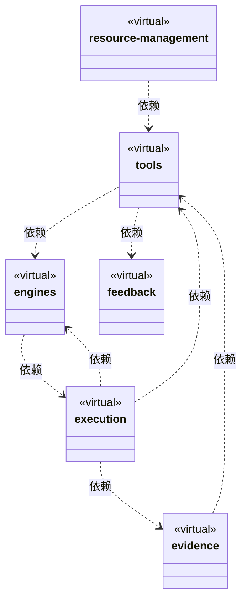
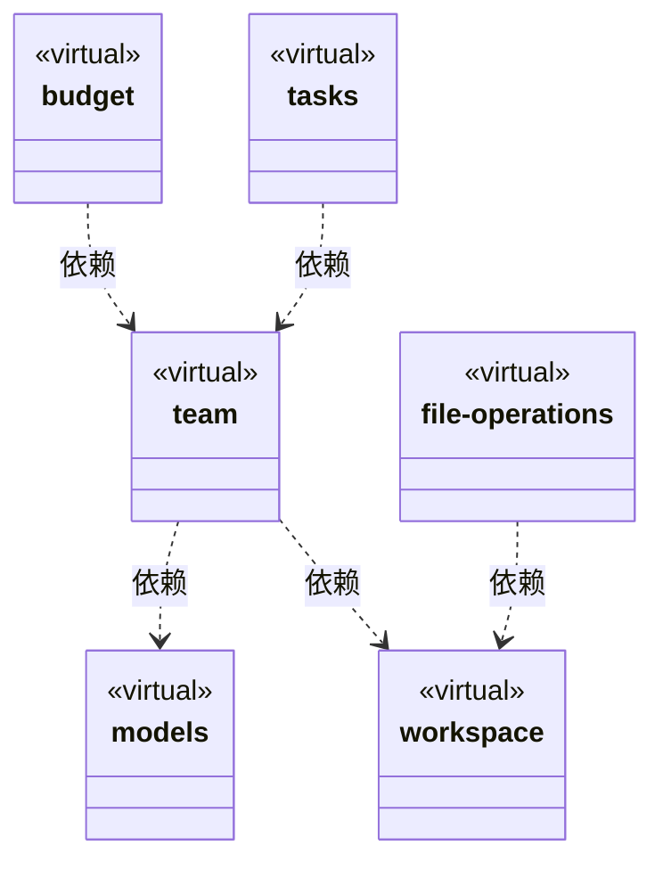
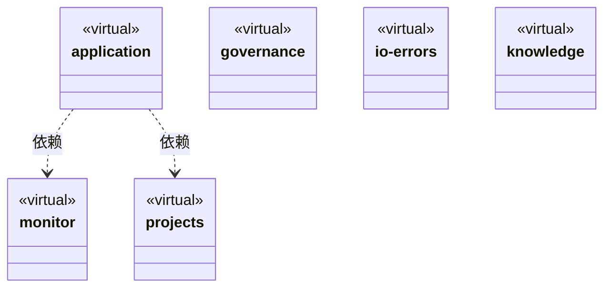
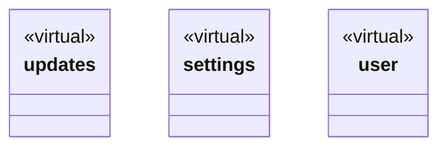

# 新版业务层

## 设计意图

为当前桌面视图提供业务用例。旧 src/logic 已移除。当前调用仍需的连接器生命周期和引擎协议迁入本层，旧调度、存储及未接入的服务不再保留。协议目录中的类型与纯规则用于兼容独立引擎包，不表示旧产品能力仍在运行。

## 主要组成

Application 负责生命周期。项目、设置、用户、更新、资源管理和运行监控面向桌面功能。Office 对话使用已安装的引擎包和用户选择的模型；引擎包管理、模型配置和下载队列为这些入口提供服务。

<!-- architecture:generated:start -->

## 架构关系

标注为 `virtual` 的节点是直接子模块的虚拟类封装；内部设计沿下方入口阅读。

### 关系组 1：tools

### 关系组 2：team

### 关系组 3：application

### 关系组 4：updates

### 跨图协作

按引用方归并目标，保留全部跨图关系；分图只用于阅读，不表示新增模块或依赖边界。

| 引用方 | 关系 | 目标 |
| --- | --- | --- |
| [application](application/ARCHITECTURE.md)（图 3） | 依赖 | [resource-management](resource-management/ARCHITECTURE.md)（图 1） |
| [budget](budget/ARCHITECTURE.md)（图 2） | 依赖 | [engines](engines/ARCHITECTURE.md)（图 1） |
| [engines](engines/ARCHITECTURE.md)（图 1） | 依赖 | [models](models/ARCHITECTURE.md)（图 2）、[updates](updates/ARCHITECTURE.md)（图 4） |
| [evidence](evidence/ARCHITECTURE.md)（图 1） | 依赖 | [file-operations](file-operations/ARCHITECTURE.md)（图 2）、[workspace](workspace/ARCHITECTURE.md)（图 2） |
| [execution](execution/ARCHITECTURE.md)（图 1） | 依赖 | [budget](budget/ARCHITECTURE.md)（图 2）、[tasks](tasks/ARCHITECTURE.md)（图 2）、[team](team/ARCHITECTURE.md)（图 2） |
| [file-operations](file-operations/ARCHITECTURE.md)（图 2） | 依赖 | [evidence](evidence/ARCHITECTURE.md)（图 1） |
| [projects](projects/ARCHITECTURE.md)（图 3） | 依赖 | [engines](engines/ARCHITECTURE.md)（图 1）、[execution](execution/ARCHITECTURE.md)（图 1） |
| [resource-management](resource-management/ARCHITECTURE.md)（图 1） | 依赖 | [updates](updates/ARCHITECTURE.md)（图 4） |
| [team](team/ARCHITECTURE.md)（图 2） | 依赖 | [engines](engines/ARCHITECTURE.md)（图 1） |
| [tools](tools/ARCHITECTURE.md)（图 1） | 依赖 | [governance](governance/ARCHITECTURE.md)（图 3）、[team](team/ARCHITECTURE.md)（图 2）、[workspace](workspace/ARCHITECTURE.md)（图 2） |
| [workspace](workspace/ARCHITECTURE.md)（图 2） | 依赖 | [io-errors](io-errors/ARCHITECTURE.md)（图 3）、[tools](tools/ARCHITECTURE.md)（图 1） |

## 子模块

| 虚拟封装 | 整体职责 |
| --- | --- |
| [application](application/ARCHITECTURE.md) | 负责应用生命周期。 |
| [budget](budget/ARCHITECTURE.md) | 保存引擎请求预算的协议与纯计算规则。引擎包通过窄端口报告用量；本目录不恢复旧账本服务或调度器。 |
| [engines](engines/ARCHITECTURE.md) | 将引擎声明、公开状态与可信运行服务分开。上层通过清单校验身份与模型需求，包服务负责固定可执行制品，模型服务负责捕获选型；纯入口不启动引擎或加载凭据。 |
| [evidence](evidence/ARCHITECTURE.md) | 保存引擎事件与产物证明的序列化协议及确定性核验。回执与模型描述不能替代真实采集，也不代表 Office 业务验收通过。 |
| [execution](execution/ARCHITECTURE.md) | 为可信宿主与引擎制品管理之间提供运行包边界。当前目录只定义规则契约，不持有任务调度、下载或引擎生命周期。 |
| [feedback](feedback/ARCHITECTURE.md) | 保存工具范围使用的反馈数据契约。旧反馈提交服务已退役，本目录不发起 GitHub 请求。 |
| [file-operations](file-operations/ARCHITECTURE.md) | 保存工具协议引用的文件操作与受控执行声明。实际 Office 文件和命令入口位于 Bridge 桌面工具，声明本身不授予权限。 |
| [governance](governance/ARCHITECTURE.md) | 保存引擎工具所需的治理声明与纯规则。组织架构的实时修改和通知由 projects 模块负责，旧治理服务不再保留。 |
| [io-errors](io-errors/ARCHITECTURE.md) | 将 JSON 解析失败映射为业务错误。这里只提供解析边界，不拥有文件、业务状态或旧应用生命周期。 |
| [knowledge](knowledge/ARCHITECTURE.md) | 保存引擎记忆和工具输出使用的纯数据协议。旧知识存储、事务和索引服务已移除；本目录不加载工作区文件。 |
| [models](models/ARCHITECTURE.md) | 将模型配置、连接选择与公开快照作为纯协议入口，凭据解析、持久化和显式探测由 service 提供。模型协议不依赖引擎身份，选型的引擎策略由 engines 承担。 |
| [monitor](monitor/ARCHITECTURE.md) | 负责运行监控。 |
| [projects](projects/ARCHITECTURE.md) | 负责项目列表和各项目的 Office 会话。 |
| [resource-management](resource-management/ARCHITECTURE.md) | 负责插件目录、安装意图和连接器会话生命周期。运行时按签名制品加载连接器；升级保留在途租约，释放后再清理旧版本。 |
| [settings](settings/ARCHITECTURE.md) | 负责应用设置。 |
| [tasks](tasks/ARCHITECTURE.md) | 保存独立引擎包需要的任务与事件数据契约。当前 Office 派发和队列由 projects 模块持有，本目录不包含旧任务调度服务。 |
| [team](team/ARCHITECTURE.md) | 保存引擎调用所需的成员快照、自动执行与工具名称规则。当前组织目录与 Agent 设置由 projects 管理，不运行旧成员服务。 |
| [tools](tools/ARCHITECTURE.md) | 保存引擎共用的工具描述、结果和权限策略。权限由可信运行配置提供，模型参数不能提升权限；Office 桌面工具还会检查 read / ask / execute。 |
| [updates](updates/ARCHITECTURE.md) | 负责应用内的更新操作。 |
| [user](user/ARCHITECTURE.md) | 负责用户账号。 |
| [workspace](workspace/ARCHITECTURE.md) | 保存引擎协议引用的执行范围、知识身份和产物校验规则。这里只计算声明与字节约束，真实文件和命令副作用由当前宿主负责。 |

[上层设计](../ARCHITECTURE.md)

<!-- architecture:generated:end -->
