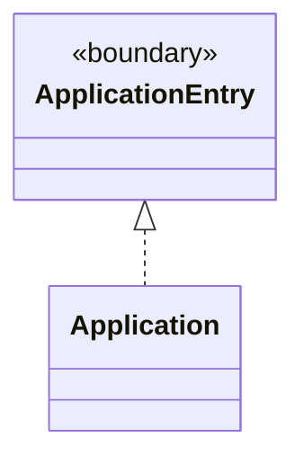

# 应用生命周期

## 设计意图

负责应用生命周期。

## 主要组成

| ?? | ?? |
| --- | --- |
| [Application](index.ts) | Application 持有资源仓库和运行时实例。 |

<!-- architecture:generated:start -->

## 架构关系

外部继承／实现边界：[ApplicationEntry](index.ts)。

[上层设计](../ARCHITECTURE.md)

<!-- architecture:generated:end -->
