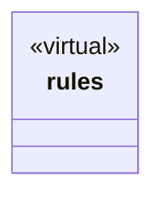

# src/logic-new/budget 架构

## 设计意图

保存引擎请求预算的协议与纯计算规则。引擎包通过窄端口报告用量；本目录不恢复旧账本服务或调度器。

## 主要组成

本层只划分子模块；规则与运行边界沿下方子模块阅读。

<!-- architecture:generated:start -->

## 架构关系

标注为 `virtual` 的节点是直接子模块的虚拟类封装；内部设计沿下方入口阅读。

## 子模块

| 虚拟封装 | 整体职责 |
| --- | --- |
| [rules](rules/ARCHITECTURE.md) | 保存引擎请求预算的协议与纯计算规则。引擎包通过窄端口报告用量；本目录不恢复旧账本服务或调度器。 |

[上层设计](../ARCHITECTURE.md)

<!-- architecture:generated:end -->
