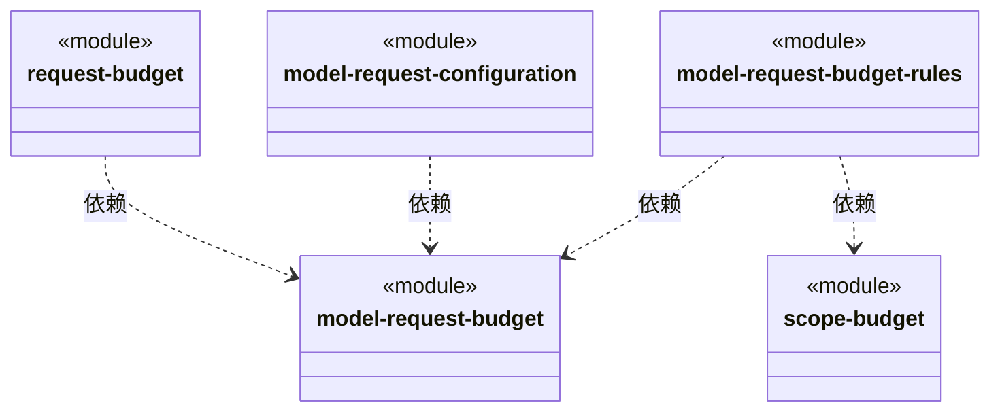

# src/logic-new/budget/rules 架构

## 设计意图

保存引擎请求预算的协议与纯计算规则。引擎包通过窄端口报告用量；本目录不恢复旧账本服务或调度器。

## 主要组成

| 组成 | 定位 |
| --- | --- |
| [model-request-budget-rules](model-request-budget-rules.ts) | 从不可变请求阶段计算预留、真实用量和后续请求的准入，供服务及 Store 独立核对。 |
| [model-request-budget](model-request-budget.ts) | 定义逐模型请求预留、发送意图和结算的不可变事实，以及只读预算摘要。 |
| [model-request-configuration](model-request-configuration.ts) | 从已冻结的执行快照派生单角色的请求计量参数，供预算服务与审计共同核对。 |
| [request-budget](request-budget.ts) | 定义各引擎共用传输与工作区请求账本之间的可信窄端口。 |
| [scope-budget](scope-budget.ts) | 定义周期冻结额度、可信计量观察和启动证明；显式 request 模式另由请求账本控制每次发送。 |

<!-- architecture:generated:start -->

## 架构关系

[上层设计](../ARCHITECTURE.md)

<!-- architecture:generated:end -->
