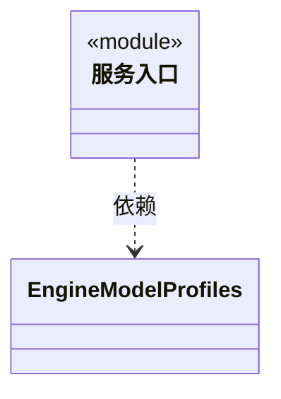

# 引擎模型配置服务

## 设计意图

将 Agent 的引擎选型转换为模型服务的连接需求，复用模型服务的配置队列捕获主模型与额外角色。公开快照不包含凭据，延迟解析受回调生命周期约束；不管理安装或自动重试。

## 主要组成

| 组成 | 定位 |
| --- | --- |
| [服务入口](index.ts) | 仅供可信装配访问引擎模型解析。 |
| [EngineModelProfiles](model-profiles.ts) | 组合 LlmProfiles，冻结显式引擎身份和有序模型角色。 |

<!-- architecture:generated:start -->

## 架构关系

[上层设计](../ARCHITECTURE.md)

<!-- architecture:generated:end -->
