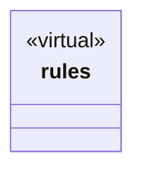

# 执行装配契约

## 设计意图

为可信宿主与引擎制品管理之间提供运行包边界。当前目录只定义规则契约，不持有任务调度、下载或引擎生命周期。

## 主要组成

本层没有直接实现，由 rules 子模块维护运行包契约。

<!-- architecture:generated:start -->

## 架构关系

标注为 `virtual` 的节点是直接子模块的虚拟类封装；内部设计沿下方入口阅读。

## 子模块

| 虚拟封装 | 整体职责 |
| --- | --- |
| [rules](rules/ARCHITECTURE.md) | 以固定制品身份、SDK 与适配器入口描述单次装配结果。运行包由可信宿主解析，不能由模型或公开任务参数指定路径；引用只在引擎真正关闭后释放。 |

[上层设计](../ARCHITECTURE.md)

<!-- architecture:generated:end -->
