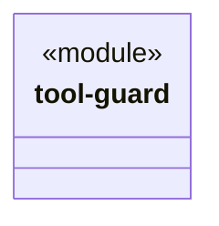

# src/logic-new/execution/platform 架构

## 设计意图

保存引擎运行端口及协议适配。平台进程退出和工具回执保持原有契约，Office 生命周期由 projects 的实例编排负责。

## 主要组成

| 组成 | 定位 |
| --- | --- |
| [tool-guard](tool-guard.ts) | 对显式知识库访问和部分路径别名做前置拒绝；属于防误操作策略而非 OS 沙箱。 |

<!-- architecture:generated:start -->

## 架构关系

[上层设计](../ARCHITECTURE.md)

<!-- architecture:generated:end -->
