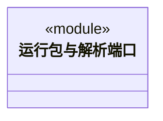

# 引擎运行包契约

## 设计意图

以固定制品身份、SDK 与适配器入口描述单次装配结果。运行包由可信宿主解析，不能由模型或公开任务参数指定路径；引用只在引擎真正关闭后释放。

## 主要组成

| 组成 | 定位 |
| --- | --- |
| [运行包与解析端口](engine-runtime.ts) | 定义 EngineRuntimePackage、依赖快照及 EngineRuntimeResolver；retain 释放幂等但不代表停止请求已完成。 |

<!-- architecture:generated:start -->

## 架构关系

[上层设计](../ARCHITECTURE.md)

<!-- architecture:generated:end -->
