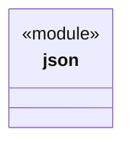

# src/logic-new/io-errors 架构

## 设计意图

将 JSON 解析失败映射为业务错误。这里只提供解析边界，不拥有文件、业务状态或旧应用生命周期。

## 主要组成

| 组成 | 定位 |
| --- | --- |
| [json](json.ts) | 为本目录消费者提供明确的协议边界。 |

<!-- architecture:generated:start -->

## 架构关系

[上层设计](../ARCHITECTURE.md)

<!-- architecture:generated:end -->
