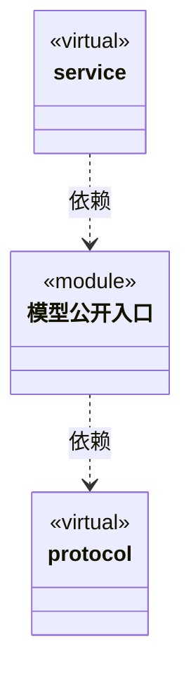

# 模型协议与服务边界

## 设计意图

将模型配置、连接选择与公开快照作为纯协议入口，凭据解析、持久化和显式探测由 service 提供。模型协议不依赖引擎身份，选型的引擎策略由 engines 承担。

## 主要组成

| 组成 | 定位 |
| --- | --- |
| [模型公开入口](index.ts) | 导出协议、目录解析、快照和加密端口类型，不加载配置服务。 |

<!-- architecture:generated:start -->

## 架构关系

标注为 `virtual` 的节点是直接子模块的虚拟类封装；内部设计沿下方入口阅读。

## 子模块

| 虚拟封装 | 整体职责 |
| --- | --- |
| [protocol](protocol/ARCHITECTURE.md) | 统一模型定义、供应商连接选择和运行快照校验。配置允许整理输入，历史快照保持缺省字段和原始语义；目录能力来自明确声明，缺失能力保持未知，不按模型名称推断。 |
| [service](service/ARCHITECTURE.md) | 由本机配置服务持有供应商设置与捕获顺序，运行准备在同一配置队列固定公开参数并延迟解密。显式发现和探测可以联网，列表读取不探测；诊断不暴露密钥或供应商响应正文。 |

[上层设计](../ARCHITECTURE.md)

<!-- architecture:generated:end -->
