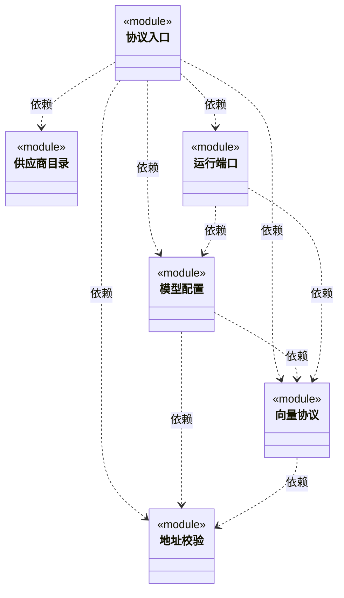
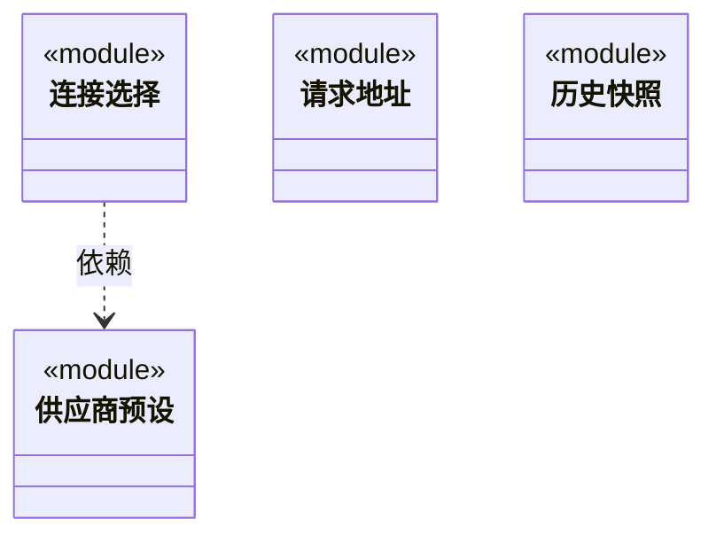

# 模型连接与快照协议

## 设计意图

统一模型定义、供应商连接选择和运行快照校验。配置允许整理输入，历史快照保持缺省字段和原始语义；目录能力来自明确声明，缺失能力保持未知，不按模型名称推断。

## 主要组成

| 组成 | 定位 |
| --- | --- |
| [协议入口](index.ts) | 公开各类配置与纯规则。 |
| [模型配置](config.ts) | 校验连接、模型目录和用户预算。 |
| [供应商目录](catalog.ts) | 解析有限的型号、容量和输入能力。 |
| [地址校验](endpoint.ts) | 限制安全基址，拒绝内嵌凭据、查询及片段。 |
| [向量协议](embedding.ts) | 独立描述向量连接、型号和运行快照。 |
| [运行端口](ports.ts) | 区分公开快照与仅装配期间可用的凭据。 |
| [连接选择](provider-connections.ts) | 按操作需求从显式连接中选择兼容接口。 |
| [供应商预设](provider-presets.ts) | 维护地址预设与来源，不执行网络识别。 |
| [请求地址](request-url.ts) | 按协议拼接推理路径并保留自定义前缀。 |
| [历史快照](snapshot.ts) | 严格校验生成能力与预算，不补写历史默认字段。 |

<!-- architecture:generated:start -->

## 架构关系

### 关系组 1：协议入口

### 关系组 2：供应商预设

### 跨图协作

按引用方归并目标，保留全部跨图关系；分图只用于阅读，不表示新增模块或依赖边界。

| 引用方 | 关系 | 目标 |
| --- | --- | --- |
| [协议入口](index.ts)（图 1） | 依赖 | [连接选择](provider-connections.ts)（图 2）、[供应商预设](provider-presets.ts)（图 2）、[请求地址](request-url.ts)（图 2）、[历史快照](snapshot.ts)（图 2） |
| [连接选择](provider-connections.ts)（图 2） | 依赖 | [模型配置](config.ts)（图 1） |
| [供应商预设](provider-presets.ts)（图 2） | 依赖 | [模型配置](config.ts)（图 1） |
| [请求地址](request-url.ts)（图 2） | 依赖 | [模型配置](config.ts)（图 1） |

[上层设计](../ARCHITECTURE.md)

<!-- architecture:generated:end -->
