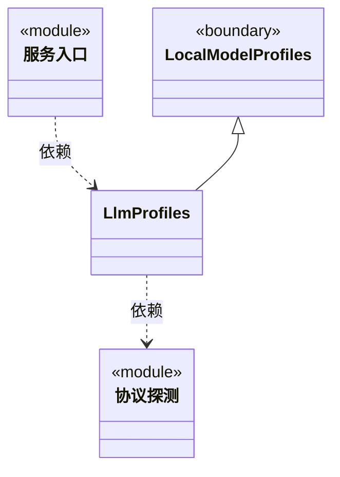

# 模型配置与连接探测

## 设计意图

由本机配置服务持有供应商设置与捕获顺序，运行准备在同一配置队列固定公开参数并延迟解密。显式发现和探测可以联网，列表读取不探测；诊断不暴露密钥或供应商响应正文。

## 主要组成

| 组成 | 定位 |
| --- | --- |
| [服务入口](index.ts) | 公开可信装配使用的 LlmProfiles 和锁定配置类型。 |
| [LlmProfiles](llm-profiles.ts) | 扩展 LocalModelProfiles，负责生成与向量模型解析、原子捕获及显式测试。 |
| [协议探测](protocol-probe.ts) | 执行模型目录和最小推理请求，仅返回受限诊断。 |

<!-- architecture:generated:start -->

## 架构关系

外部继承／实现边界：[LocalModelProfiles](../../../resource/models/local-profiles.ts)。

[上层设计](../ARCHITECTURE.md)

<!-- architecture:generated:end -->
