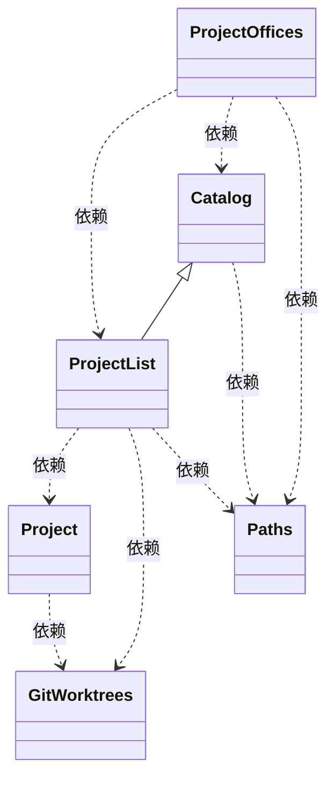
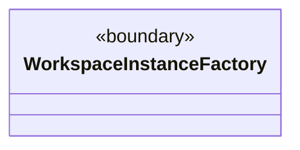

# 项目列表和各项目的 Office 会话

## 设计意图

负责项目列表和各项目的 Office 会话。

## 主要组成

| 组成 | 定位 |
| --- | --- |
| [Project](project.ts) | 持有项目资源和该项目独立的运行时。 |
| [ProjectList](project.ts) | 按登记身份加载项目，聚合 Office 监控事件。 |
| [GitWorktrees](git-worktrees.ts) | Opens a separate Git worktree for each Office and repository. |
| [Catalog](index.ts) | 读取项目列表，按本地目录身份登记工作区。 |
| [Paths](paths.ts) | 解析项目目录身份与用户数据位置。 |
| [ProjectOffices](offices.ts) | 将登记项目的持久会话绑定到运行时 Office。 |

<!-- architecture:generated:start -->

## 架构关系

### 关系组 1：ProjectList

### 关系组 2：WorkspaceInstanceFactory

### 跨图协作

按引用方归并目标，保留全部跨图关系；分图只用于阅读，不表示新增模块或依赖边界。

| 引用方 | 关系 | 目标 |
| --- | --- | --- |
| [GitWorktrees](git-worktrees.ts)（图 1） | 实现 | [WorkspaceInstanceFactory](../../framework/business/workspace-instance.ts)（图 2） |

外部继承／实现边界：[WorkspaceInstanceFactory](../../framework/business/workspace-instance.ts)。

[上层设计](../ARCHITECTURE.md)

<!-- architecture:generated:end -->
