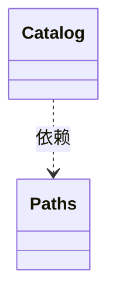

# 项目列表和各项目的 Office 会话

## 设计意图

负责项目列表和各项目的 Office 会话。

## 主要组成

| 组成 | 定位 |
| --- | --- |
| [Catalog](index.ts) | 读取项目列表，按本地目录身份登记工作区。 |
| [Paths](paths.ts) | 解析项目目录身份与用户数据位置。 |

<!-- architecture:generated:start -->

## 架构关系

[上层设计](../ARCHITECTURE.md)

<!-- architecture:generated:end -->
