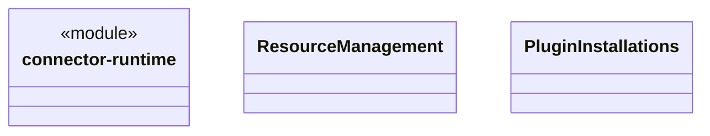

# 主菜单资源管理

## 设计意图

负责插件目录、安装意图和连接器会话生命周期。运行时按签名制品加载连接器；升级保留在途租约，释放后再清理旧版本。

## 主要组成

| 组成 | 定位 |
| --- | --- |
| [ResourceManagement](index.ts) | 为发现页查询已签名插件目录，按人才与业务分类读取仓库。 |

| [PluginInstallations](plugin-installations.ts) | 保存用户安装意图，重启后按签名目录核验并恢复插件。 |

| [connector-runtime](connector-runtime.ts) | 将已验证制品装配为受管连接器；会话引用、升级和回滚由管理器持有。 |

<!-- architecture:generated:start -->

## 架构关系

[上层设计](../ARCHITECTURE.md)

<!-- architecture:generated:end -->
