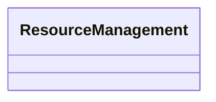

# 主菜单资源管理

## 设计意图

负责主菜单资源管理。

## 主要组成

| 组成 | 定位 |
| --- | --- |
| [ResourceManagement](index.ts) | 为发现页查询已签名插件目录，按人才与业务分类读取仓库。 |

<!-- architecture:generated:start -->

## 架构关系

[上层设计](../ARCHITECTURE.md)

<!-- architecture:generated:end -->
