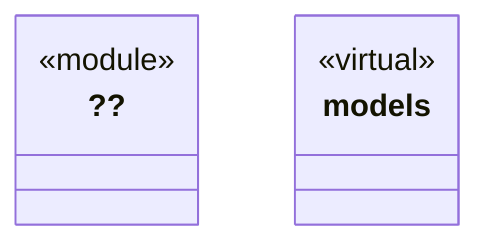

# 应用设置

## 设计意图

负责应用设置。

## 主要组成

| ?? | ?? |
| --- | --- |
| [??](index.ts) | index.ts 预留模块的公共入口。 |

<!-- architecture:generated:start -->

## 架构关系

标注为 `virtual` 的节点是直接子模块的虚拟类封装；内部设计沿下方入口阅读。

## 子模块

| 虚拟封装 | 整体职责 |
| --- | --- |
| [models](models/ARCHITECTURE.md) | 为新桌面的供应商配置表单与主 Agent 模型选择提供统一的配置校验和连接选择规则。 |

[上层设计](../ARCHITECTURE.md)

<!-- architecture:generated:end -->
