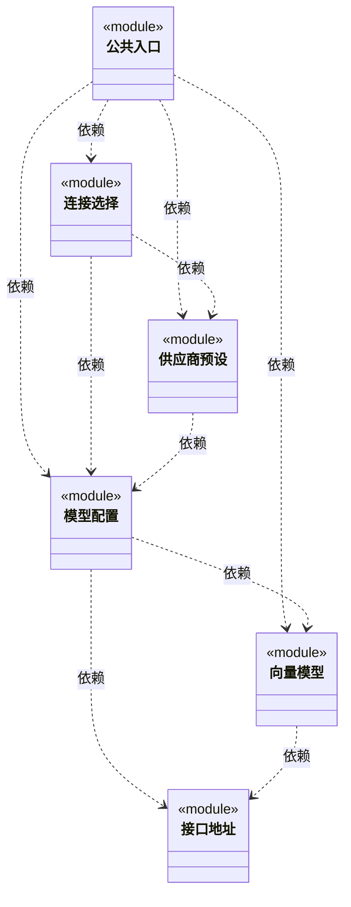

# 模型设置

## 设计意图

为新桌面的供应商配置表单与主 Agent 模型选择提供统一的配置校验和连接选择规则。

## 主要组成

| 文件 | 职责 |
| --- | --- |
| [公共入口](index.ts) | 导出桌面配置类型和兼容性查询。 |
| [模型配置](config.ts) | 校验生成模型和供应商设置。 |
| [接口地址](endpoint.ts) | 校验模型服务地址。 |
| [向量模型](embedding.ts) | 定义向量模型和连接配置。 |
| [连接选择](provider-connections.ts) | 按模型和引擎要求选择连接。 |
| [供应商预设](provider-presets.ts) | 按服务地址识别预设。 |

<!-- architecture:generated:start -->

## 架构关系

[上层设计](../ARCHITECTURE.md)

<!-- architecture:generated:end -->
