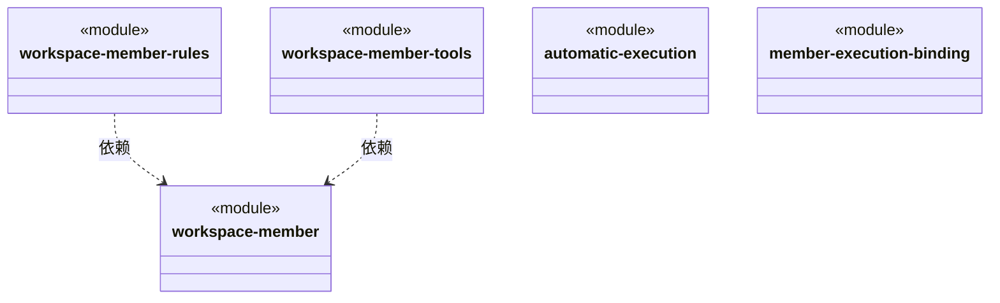

# src/logic-new/team/rules 架构

## 设计意图

保存引擎调用所需的成员快照、自动执行与工具名称规则。当前组织目录与 Agent 设置由 projects 管理，不运行旧成员服务。

## 主要组成

| 组成 | 定位 |
| --- | --- |
| [automatic-execution](automatic-execution.ts) | 定义用户选择的协作模式和自动兜底的冻结身份，供计划、任务与运行共用。 |
| [member-execution-binding](member-execution-binding.ts) | 岗位负责人派发的纯选择与冻结身份契约，供目标、任务、运行和公开视图共用。 |
| [workspace-member-rules](workspace-member-rules.ts) | 岗位登记的规范指纹、预览依据、不可变审计与单条事件投影；由可信服务与 Store 重放共同调用。 |
| [workspace-member-tools](workspace-member-tools.ts) | 主 Agent 岗位治理的窄输入、回执和装配端口，独立于 UI 与存储。 |
| [workspace-member](workspace-member.ts) | 定义工作区长期岗位、采纳快照、版本化登记命令与公开查询协议，供 Main、Store 和桌面共用。 |

<!-- architecture:generated:start -->

## 架构关系

[上层设计](../ARCHITECTURE.md)

<!-- architecture:generated:end -->
