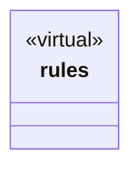

# src/logic-new/tools 架构

## 设计意图

保存引擎共用的工具描述、结果和权限策略。权限由可信运行配置提供，模型参数不能提升权限；Office 桌面工具还会检查 read / ask / execute。

## 主要组成

本层只划分子模块；规则与运行边界沿下方子模块阅读。

<!-- architecture:generated:start -->

## 架构关系

标注为 `virtual` 的节点是直接子模块的虚拟类封装；内部设计沿下方入口阅读。

## 子模块

| 虚拟封装 | 整体职责 |
| --- | --- |
| [rules](rules/ARCHITECTURE.md) | 保存引擎共用的工具描述、结果和权限策略。权限由可信运行配置提供，模型参数不能提升权限；Office 桌面工具还会检查 read / ask / execute。 |

[上层设计](../ARCHITECTURE.md)

<!-- architecture:generated:end -->
