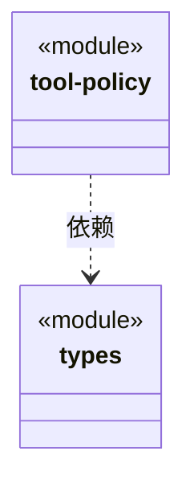

# src/logic-new/tools/rules/policy 架构

## 设计意图

保存引擎共用的工具描述、结果和权限策略。权限由可信运行配置提供，模型参数不能提升权限；Office 桌面工具还会检查 read / ask / execute。

## 主要组成

| 组成 | 定位 |
| --- | --- |
| [tool-policy](tool-policy.ts) | 内部 Loop 的统一工具授权策略，同时处理业务文件与正式知识写入。 |
| [types](types.ts) | 对话权限模式和单次人工确认契约。 |

<!-- architecture:generated:start -->

## 架构关系

[上层设计](../ARCHITECTURE.md)

<!-- architecture:generated:end -->
