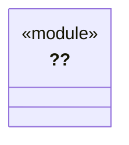

# 应用内的更新操作

## 设计意图

负责应用内的更新操作。

## 主要组成

| ?? | ?? |
| --- | --- |
| [??](index.ts) | index.ts 预留模块的公共入口。 |

<!-- architecture:generated:start -->

## 架构关系

[上层设计](../ARCHITECTURE.md)

<!-- architecture:generated:end -->
