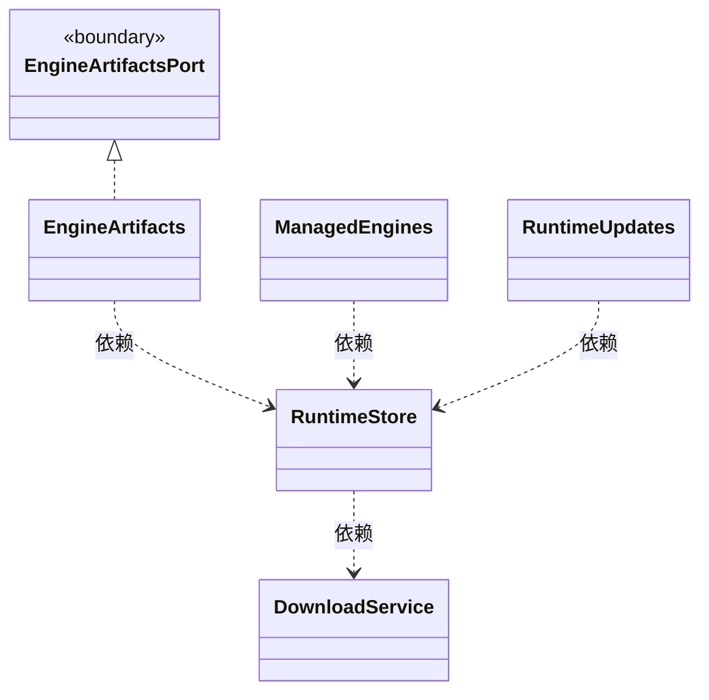
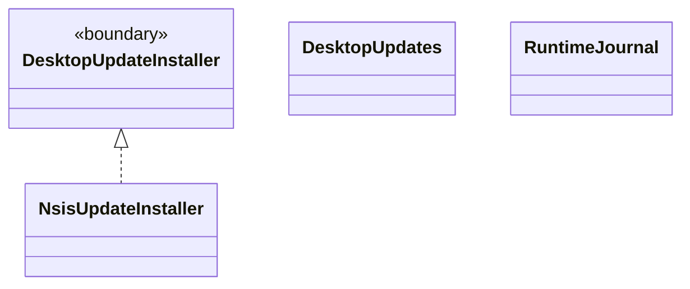

# src/logic-new/updates/service 架构

## 设计意图

实现独立于普通业务的版本发现、制品准备、激活与恢复，保护用户数据和原运行选择。

`DesktopUpdates` 与 `NsisUpdateInstaller` 管理安装通道，`RuntimeUpdates` 组合资源存储和激活日志，`EngineArtifacts` 与 `ManagedEngines` 提供签名引擎制品及固定版本解析。后台准备不改变活动版本；明确应用后等待业务关闭，恢复依据原日志与数据访问阶段。

## 主要组成

| 组成 | 定位 |
| --- | --- |
| [DesktopUpdates](desktop-updates.ts) | 桌面更新的单实例状态机，后台检查并预下载，用户确认后才排空业务和重启安装。 |
| [EngineArtifacts](engine-artifacts.ts) | 冷壳持有的通用 E 制品服务，保存独立签名索引历史并准备准确摘要的包。 |
| [ManagedEngines](managed-engines.ts) | 受管引擎目录、准备进度及固定版本解析；由冷壳注入已验签的清单和缓存。 |
| [NsisUpdateInstaller](../../../updater/index.ts) | electron-updater 的 Windows NSIS 适配，固定发布源并优先差分下载、校验安装包。 |
| [RuntimeJournal](runtime-journal.ts) | 冷壳拥有的资源激活日志；区分准备缓存、用户授权、原数据访问和已确认启动。 |
| [RuntimeStore](runtime-store.ts) | 管理资源 / 引擎不可变版本目录及其签名清单；后台准备不修改活动选择。 |
| [RuntimeUpdates](runtime-updates.ts) | 连接 C 安装通道与同 C 的 R 资源通道，准备候选并在业务排空后记录显式切换。 |

| [DownloadService](download-service.ts) | 队列由桌面宿主持有；清单选择、解包和激活由上层管理。 |

<!-- architecture:generated:start -->

## 架构关系

### 关系组 1：RuntimeStore

### 关系组 2：DesktopUpdateInstaller

### 跨图协作

按引用方归并目标，保留全部跨图关系；分图只用于阅读，不表示新增模块或依赖边界。

| 引用方 | 关系 | 目标 |
| --- | --- | --- |
| [RuntimeUpdates](runtime-updates.ts)（图 1） | 依赖 | [RuntimeJournal](runtime-journal.ts)（图 2） |
| [RuntimeUpdates](runtime-updates.ts)（图 1） | 实现 | [DesktopUpdateInstaller](desktop-updates.ts)（图 2） |

外部继承／实现边界：[EngineArtifactsPort](../engine-artifacts.ts)、[DesktopUpdateInstaller](desktop-updates.ts)。

[上层设计](../ARCHITECTURE.md)

<!-- architecture:generated:end -->
