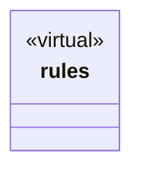

# src/logic-new/workspace 架构

## 设计意图

保存引擎协议引用的执行范围、知识身份和产物校验规则。这里只计算声明与字节约束，真实文件和命令副作用由当前宿主负责。

## 主要组成

本层只划分子模块；规则与运行边界沿下方子模块阅读。

<!-- architecture:generated:start -->

## 架构关系

标注为 `virtual` 的节点是直接子模块的虚拟类封装；内部设计沿下方入口阅读。

## 子模块

| 虚拟封装 | 整体职责 |
| --- | --- |
| [rules](rules/ARCHITECTURE.md) | 保存引擎协议引用的执行范围、知识身份和产物校验规则。这里只计算声明与字节约束，真实文件和命令副作用由当前宿主负责。 |

[上层设计](../ARCHITECTURE.md)

<!-- architecture:generated:end -->
