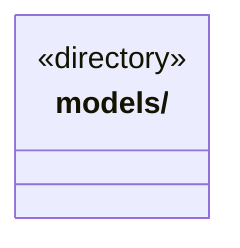

# src/logic 架构

## 目录定位

Logic 业务层；当前模型目录、供应商连接、选型和配置服务已迁入，其他业务仍在旧 backend。业务状态与策略不放入共享 Core，通信和宿主装配不进入本层。

本文描述当前实现。通过分析目录边界后维护的 [源码架构脚本](../../scripts/source-architecture.mjs) 同步清单和声明；代码变更时仍须核对职责、关键成员与关系。

## 代码清单

本层无直接代码文件。

## 架构类图

各图中的同名节点表示同一目录边界；跨组及完整直接依赖如下（无边不代表继承）：

本层无目录间直接导入关系。

## 子目录导航

- [models/](models/ARCHITECTURE.md)：模型目录、公开配置 Schema、供应商预设与引擎接口选择；index.ts 是纯公共入口，不加载 Node 或服务。配置服务位于 service，旧预算端口和主 Agent 设置不属于本片。

[返回上层](../ARCHITECTURE.md)。

每次修改本目录代码，同步维护文件头、关键契约说明及本图。未实现的治理、证据验收和自动编排能力不列入当前类图。

## 设计契约 v1 与落地范围

以下内容区分已接通能力与后续设计；以各节的实现状态为准，不将目标图当作现状图。维护源：[CONTRACT.md](CONTRACT.md)；生成类图时同步附加，勿直接修改本附录。

# Logic 当前迁移范围

Logic 拥有业务规则、服务和状态，单向组合共享 Core；不得依赖 Bridge、View 或旧 backend 的实现。当前仅模型目录、供应商连接、引擎选型及配置服务已迁入 [models](models/CONTRACT.md)，其他业务仍在旧目录。

模型纯规则入口与有副作用的服务入口分别维护，不能通过纯入口导出存储。旧宿主仅在登记的入口装配服务；旧执行模块只能使用纯模型契约。依赖检查同时核实公开入口、运行环境与类型引用，未对旧后端开放整个 Logic。
