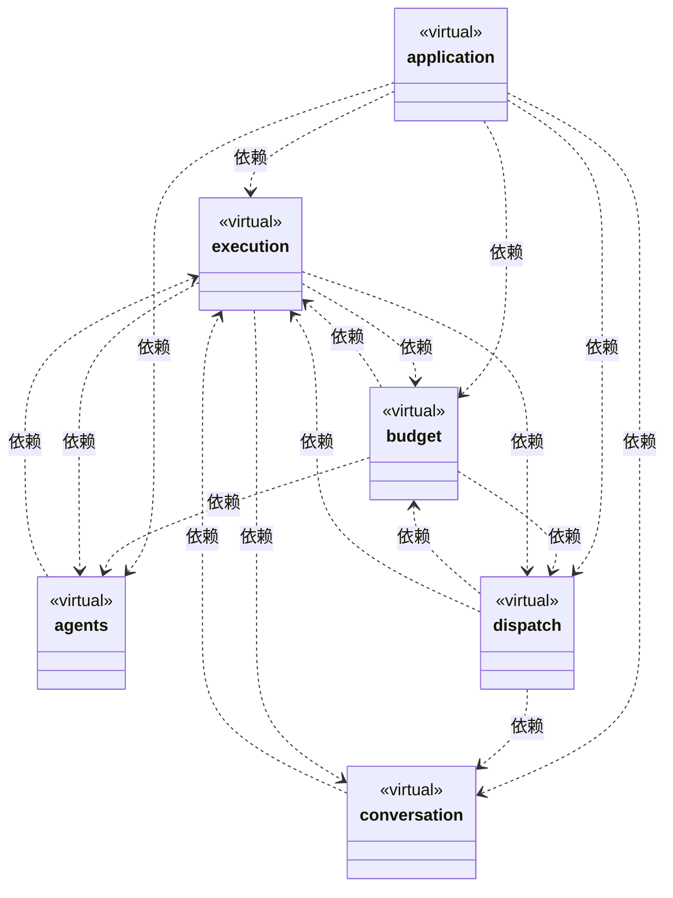
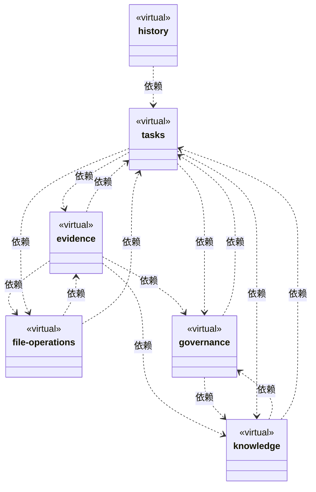
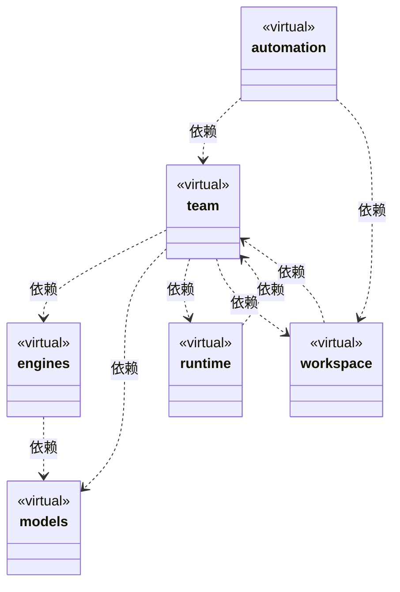
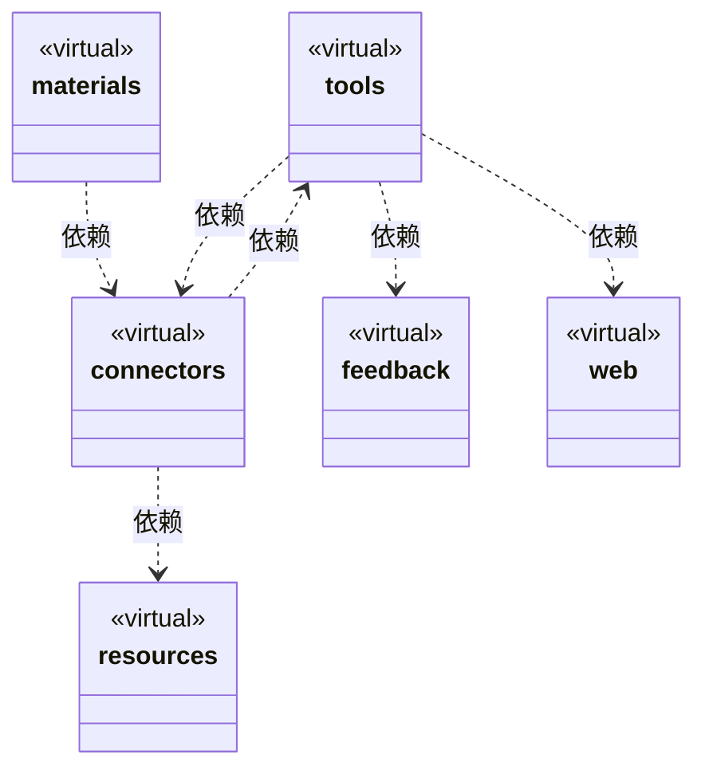
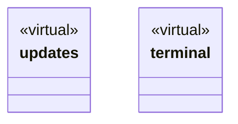

# src/logic 架构

## 设计意图

按领域组合业务规则、运行编排和存储服务，由 Application 统一装配和持有生命周期。各领域通过明确契约协作，业务不反向依赖 Bridge、View 或 Electron。

## 主要组成

本层由下列子模块组合，每个子模块作为独立的虚拟类封装参与本层协作。

<!-- architecture:generated:start -->

## 架构关系

标注为 `virtual` 的节点是直接子模块的虚拟类封装；内部设计沿下方入口阅读。

### 关系组 1

### 关系组 2

### 关系组 3

### 关系组 4

### 关系组 5

### 跨图协作

- [agents](agents/ARCHITECTURE.md)（图 1）→ [tasks](tasks/ARCHITECTURE.md)（图 2）：依赖。
- [agents](agents/ARCHITECTURE.md)（图 1）→ [tools](tools/ARCHITECTURE.md)（图 4）：依赖。
- [application](application/ARCHITECTURE.md)（图 1）→ [automation](automation/ARCHITECTURE.md)（图 3）：依赖。
- [application](application/ARCHITECTURE.md)（图 1）→ [connectors](connectors/ARCHITECTURE.md)（图 4）：依赖。
- [application](application/ARCHITECTURE.md)（图 1）→ [engines](engines/ARCHITECTURE.md)（图 3）：依赖。
- [application](application/ARCHITECTURE.md)（图 1）→ [evidence](evidence/ARCHITECTURE.md)（图 2）：依赖。
- [application](application/ARCHITECTURE.md)（图 1）→ [feedback](feedback/ARCHITECTURE.md)（图 4）：依赖。
- [application](application/ARCHITECTURE.md)（图 1）→ [file-operations](file-operations/ARCHITECTURE.md)（图 2）：依赖。
- [application](application/ARCHITECTURE.md)（图 1）→ [governance](governance/ARCHITECTURE.md)（图 2）：依赖。
- [application](application/ARCHITECTURE.md)（图 1）→ [history](history/ARCHITECTURE.md)（图 2）：依赖。
- [application](application/ARCHITECTURE.md)（图 1）→ [knowledge](knowledge/ARCHITECTURE.md)（图 2）：依赖。
- [application](application/ARCHITECTURE.md)（图 1）→ [materials](materials/ARCHITECTURE.md)（图 4）：依赖。
- [application](application/ARCHITECTURE.md)（图 1）→ [models](models/ARCHITECTURE.md)（图 3）：依赖。
- [application](application/ARCHITECTURE.md)（图 1）→ [resources](resources/ARCHITECTURE.md)（图 4）：依赖。
- [application](application/ARCHITECTURE.md)（图 1）→ [runtime](runtime/ARCHITECTURE.md)（图 3）：依赖。
- [application](application/ARCHITECTURE.md)（图 1）→ [tasks](tasks/ARCHITECTURE.md)（图 2）：依赖。
- [application](application/ARCHITECTURE.md)（图 1）→ [team](team/ARCHITECTURE.md)（图 3）：依赖。
- [application](application/ARCHITECTURE.md)（图 1）→ [tools](tools/ARCHITECTURE.md)（图 4）：依赖。
- [application](application/ARCHITECTURE.md)（图 1）→ [updates](updates/ARCHITECTURE.md)（图 5）：依赖。
- [application](application/ARCHITECTURE.md)（图 1）→ [web](web/ARCHITECTURE.md)（图 4）：依赖。
- [application](application/ARCHITECTURE.md)（图 1）→ [workspace](workspace/ARCHITECTURE.md)（图 3）：依赖。
- [automation](automation/ARCHITECTURE.md)（图 3）→ [conversation](conversation/ARCHITECTURE.md)（图 1）：依赖。
- [automation](automation/ARCHITECTURE.md)（图 3）→ [dispatch](dispatch/ARCHITECTURE.md)（图 1）：依赖。
- [automation](automation/ARCHITECTURE.md)（图 3）→ [knowledge](knowledge/ARCHITECTURE.md)（图 2）：依赖。
- [budget](budget/ARCHITECTURE.md)（图 1）→ [engines](engines/ARCHITECTURE.md)（图 3）：依赖。
- [budget](budget/ARCHITECTURE.md)（图 1）→ [knowledge](knowledge/ARCHITECTURE.md)（图 2）：依赖。
- [budget](budget/ARCHITECTURE.md)（图 1）→ [tasks](tasks/ARCHITECTURE.md)（图 2）：依赖。
- [budget](budget/ARCHITECTURE.md)（图 1）→ [team](team/ARCHITECTURE.md)（图 3）：依赖。
- [connectors](connectors/ARCHITECTURE.md)（图 4）→ [knowledge](knowledge/ARCHITECTURE.md)（图 2）：依赖。
- [conversation](conversation/ARCHITECTURE.md)（图 1）→ [engines](engines/ARCHITECTURE.md)（图 3）：依赖。
- [conversation](conversation/ARCHITECTURE.md)（图 1）→ [knowledge](knowledge/ARCHITECTURE.md)（图 2）：依赖。
- [conversation](conversation/ARCHITECTURE.md)（图 1）→ [tasks](tasks/ARCHITECTURE.md)（图 2）：依赖。
- [conversation](conversation/ARCHITECTURE.md)（图 1）→ [tools](tools/ARCHITECTURE.md)（图 4）：依赖。
- [dispatch](dispatch/ARCHITECTURE.md)（图 1）→ [engines](engines/ARCHITECTURE.md)（图 3）：依赖。
- [dispatch](dispatch/ARCHITECTURE.md)（图 1）→ [evidence](evidence/ARCHITECTURE.md)（图 2）：依赖。
- [dispatch](dispatch/ARCHITECTURE.md)（图 1）→ [file-operations](file-operations/ARCHITECTURE.md)（图 2）：依赖。
- [dispatch](dispatch/ARCHITECTURE.md)（图 1）→ [knowledge](knowledge/ARCHITECTURE.md)（图 2）：依赖。
- [dispatch](dispatch/ARCHITECTURE.md)（图 1）→ [tasks](tasks/ARCHITECTURE.md)（图 2）：依赖。
- [dispatch](dispatch/ARCHITECTURE.md)（图 1）→ [team](team/ARCHITECTURE.md)（图 3）：依赖。
- [dispatch](dispatch/ARCHITECTURE.md)（图 1）→ [tools](tools/ARCHITECTURE.md)（图 4）：依赖。
- [dispatch](dispatch/ARCHITECTURE.md)（图 1）→ [workspace](workspace/ARCHITECTURE.md)（图 3）：依赖。
- [engines](engines/ARCHITECTURE.md)（图 3）→ [execution](execution/ARCHITECTURE.md)（图 1）：依赖。
- [engines](engines/ARCHITECTURE.md)（图 3）→ [updates](updates/ARCHITECTURE.md)（图 5）：依赖。
- [evidence](evidence/ARCHITECTURE.md)（图 2）→ [agents](agents/ARCHITECTURE.md)（图 1）：依赖。
- [evidence](evidence/ARCHITECTURE.md)（图 2）→ [dispatch](dispatch/ARCHITECTURE.md)（图 1）：依赖。
- [evidence](evidence/ARCHITECTURE.md)（图 2）→ [execution](execution/ARCHITECTURE.md)（图 1）：依赖。
- [evidence](evidence/ARCHITECTURE.md)（图 2）→ [runtime](runtime/ARCHITECTURE.md)（图 3）：依赖。
- [evidence](evidence/ARCHITECTURE.md)（图 2）→ [team](team/ARCHITECTURE.md)（图 3）：依赖。
- [evidence](evidence/ARCHITECTURE.md)（图 2）→ [tools](tools/ARCHITECTURE.md)（图 4）：依赖。
- [evidence](evidence/ARCHITECTURE.md)（图 2）→ [workspace](workspace/ARCHITECTURE.md)（图 3）：依赖。
- [execution](execution/ARCHITECTURE.md)（图 1）→ [connectors](connectors/ARCHITECTURE.md)（图 4）：依赖。
- [execution](execution/ARCHITECTURE.md)（图 1）→ [engines](engines/ARCHITECTURE.md)（图 3）：依赖。
- [execution](execution/ARCHITECTURE.md)（图 1）→ [evidence](evidence/ARCHITECTURE.md)（图 2）：依赖。
- [execution](execution/ARCHITECTURE.md)（图 1）→ [feedback](feedback/ARCHITECTURE.md)（图 4）：依赖。
- [execution](execution/ARCHITECTURE.md)（图 1）→ [file-operations](file-operations/ARCHITECTURE.md)（图 2）：依赖。
- [execution](execution/ARCHITECTURE.md)（图 1）→ [governance](governance/ARCHITECTURE.md)（图 2）：依赖。
- [execution](execution/ARCHITECTURE.md)（图 1）→ [knowledge](knowledge/ARCHITECTURE.md)（图 2）：依赖。
- [execution](execution/ARCHITECTURE.md)（图 1）→ [models](models/ARCHITECTURE.md)（图 3）：依赖。
- [execution](execution/ARCHITECTURE.md)（图 1）→ [runtime](runtime/ARCHITECTURE.md)（图 3）：依赖。
- [execution](execution/ARCHITECTURE.md)（图 1）→ [tasks](tasks/ARCHITECTURE.md)（图 2）：依赖。
- [execution](execution/ARCHITECTURE.md)（图 1）→ [team](team/ARCHITECTURE.md)（图 3）：依赖。
- [execution](execution/ARCHITECTURE.md)（图 1）→ [tools](tools/ARCHITECTURE.md)（图 4）：依赖。
- [execution](execution/ARCHITECTURE.md)（图 1）→ [web](web/ARCHITECTURE.md)（图 4）：依赖。
- [execution](execution/ARCHITECTURE.md)（图 1）→ [workspace](workspace/ARCHITECTURE.md)（图 3）：依赖。
- [file-operations](file-operations/ARCHITECTURE.md)（图 2）→ [dispatch](dispatch/ARCHITECTURE.md)（图 1）：依赖。
- [file-operations](file-operations/ARCHITECTURE.md)（图 2）→ [execution](execution/ARCHITECTURE.md)（图 1）：依赖。
- [file-operations](file-operations/ARCHITECTURE.md)（图 2）→ [team](team/ARCHITECTURE.md)（图 3）：依赖。
- [file-operations](file-operations/ARCHITECTURE.md)（图 2）→ [workspace](workspace/ARCHITECTURE.md)（图 3）：依赖。
- [governance](governance/ARCHITECTURE.md)（图 2）→ [execution](execution/ARCHITECTURE.md)（图 1）：依赖。
- [governance](governance/ARCHITECTURE.md)（图 2）→ [workspace](workspace/ARCHITECTURE.md)（图 3）：依赖。
- [history](history/ARCHITECTURE.md)（图 2）→ [agents](agents/ARCHITECTURE.md)（图 1）：依赖。
- [history](history/ARCHITECTURE.md)（图 2）→ [dispatch](dispatch/ARCHITECTURE.md)（图 1）：依赖。
- [history](history/ARCHITECTURE.md)（图 2）→ [execution](execution/ARCHITECTURE.md)（图 1）：依赖。
- [history](history/ARCHITECTURE.md)（图 2）→ [runtime](runtime/ARCHITECTURE.md)（图 3）：依赖。
- [history](history/ARCHITECTURE.md)（图 2）→ [team](team/ARCHITECTURE.md)（图 3）：依赖。
- [knowledge](knowledge/ARCHITECTURE.md)（图 2）→ [connectors](connectors/ARCHITECTURE.md)（图 4）：依赖。
- [knowledge](knowledge/ARCHITECTURE.md)（图 2）→ [dispatch](dispatch/ARCHITECTURE.md)（图 1）：依赖。
- [knowledge](knowledge/ARCHITECTURE.md)（图 2）→ [feedback](feedback/ARCHITECTURE.md)（图 4）：依赖。
- [knowledge](knowledge/ARCHITECTURE.md)（图 2）→ [team](team/ARCHITECTURE.md)（图 3）：依赖。
- [knowledge](knowledge/ARCHITECTURE.md)（图 2）→ [workspace](workspace/ARCHITECTURE.md)（图 3）：依赖。
- [materials](materials/ARCHITECTURE.md)（图 4）→ [execution](execution/ARCHITECTURE.md)（图 1）：依赖。
- [materials](materials/ARCHITECTURE.md)（图 4）→ [knowledge](knowledge/ARCHITECTURE.md)（图 2）：依赖。
- [materials](materials/ARCHITECTURE.md)（图 4）→ [tasks](tasks/ARCHITECTURE.md)（图 2）：依赖。
- [resources](resources/ARCHITECTURE.md)（图 4）→ [knowledge](knowledge/ARCHITECTURE.md)（图 2）：依赖。
- [runtime](runtime/ARCHITECTURE.md)（图 3）→ [dispatch](dispatch/ARCHITECTURE.md)（图 1）：依赖。
- [runtime](runtime/ARCHITECTURE.md)（图 3）→ [evidence](evidence/ARCHITECTURE.md)（图 2）：依赖。
- [runtime](runtime/ARCHITECTURE.md)（图 3）→ [execution](execution/ARCHITECTURE.md)（图 1）：依赖。
- [runtime](runtime/ARCHITECTURE.md)（图 3）→ [tasks](tasks/ARCHITECTURE.md)（图 2）：依赖。
- [runtime](runtime/ARCHITECTURE.md)（图 3）→ [tools](tools/ARCHITECTURE.md)（图 4）：依赖。
- [tasks](tasks/ARCHITECTURE.md)（图 2）→ [budget](budget/ARCHITECTURE.md)（图 1）：依赖。
- [tasks](tasks/ARCHITECTURE.md)（图 2）→ [dispatch](dispatch/ARCHITECTURE.md)（图 1）：依赖。
- [tasks](tasks/ARCHITECTURE.md)（图 2）→ [engines](engines/ARCHITECTURE.md)（图 3）：依赖。
- [tasks](tasks/ARCHITECTURE.md)（图 2）→ [execution](execution/ARCHITECTURE.md)（图 1）：依赖。
- [tasks](tasks/ARCHITECTURE.md)（图 2）→ [models](models/ARCHITECTURE.md)（图 3）：依赖。
- [tasks](tasks/ARCHITECTURE.md)（图 2）→ [runtime](runtime/ARCHITECTURE.md)（图 3）：依赖。
- [tasks](tasks/ARCHITECTURE.md)（图 2）→ [team](team/ARCHITECTURE.md)（图 3）：依赖。
- [tasks](tasks/ARCHITECTURE.md)（图 2）→ [tools](tools/ARCHITECTURE.md)（图 4）：依赖。
- [tasks](tasks/ARCHITECTURE.md)（图 2）→ [workspace](workspace/ARCHITECTURE.md)（图 3）：依赖。
- [team](team/ARCHITECTURE.md)（图 3）→ [agents](agents/ARCHITECTURE.md)（图 1）：依赖。
- [team](team/ARCHITECTURE.md)（图 3）→ [budget](budget/ARCHITECTURE.md)（图 1）：依赖。
- [team](team/ARCHITECTURE.md)（图 3）→ [conversation](conversation/ARCHITECTURE.md)（图 1）：依赖。
- [team](team/ARCHITECTURE.md)（图 3）→ [dispatch](dispatch/ARCHITECTURE.md)（图 1）：依赖。
- [team](team/ARCHITECTURE.md)（图 3）→ [evidence](evidence/ARCHITECTURE.md)（图 2）：依赖。
- [team](team/ARCHITECTURE.md)（图 3）→ [execution](execution/ARCHITECTURE.md)（图 1）：依赖。
- [team](team/ARCHITECTURE.md)（图 3）→ [knowledge](knowledge/ARCHITECTURE.md)（图 2）：依赖。
- [team](team/ARCHITECTURE.md)（图 3）→ [tasks](tasks/ARCHITECTURE.md)（图 2）：依赖。
- [tools](tools/ARCHITECTURE.md)（图 4）→ [engines](engines/ARCHITECTURE.md)（图 3）：依赖。
- [tools](tools/ARCHITECTURE.md)（图 4）→ [execution](execution/ARCHITECTURE.md)（图 1）：依赖。
- [tools](tools/ARCHITECTURE.md)（图 4）→ [governance](governance/ARCHITECTURE.md)（图 2）：依赖。
- [tools](tools/ARCHITECTURE.md)（图 4）→ [knowledge](knowledge/ARCHITECTURE.md)（图 2）：依赖。
- [tools](tools/ARCHITECTURE.md)（图 4）→ [tasks](tasks/ARCHITECTURE.md)（图 2）：依赖。
- [tools](tools/ARCHITECTURE.md)（图 4）→ [team](team/ARCHITECTURE.md)（图 3）：依赖。
- [tools](tools/ARCHITECTURE.md)（图 4）→ [workspace](workspace/ARCHITECTURE.md)（图 3）：依赖。
- [workspace](workspace/ARCHITECTURE.md)（图 3）→ [dispatch](dispatch/ARCHITECTURE.md)（图 1）：依赖。
- [workspace](workspace/ARCHITECTURE.md)（图 3）→ [execution](execution/ARCHITECTURE.md)（图 1）：依赖。
- [workspace](workspace/ARCHITECTURE.md)（图 3）→ [governance](governance/ARCHITECTURE.md)（图 2）：依赖。
- [workspace](workspace/ARCHITECTURE.md)（图 3）→ [knowledge](knowledge/ARCHITECTURE.md)（图 2）：依赖。
- [workspace](workspace/ARCHITECTURE.md)（图 3）→ [tasks](tasks/ARCHITECTURE.md)（图 2）：依赖。
- [workspace](workspace/ARCHITECTURE.md)（图 3）→ [tools](tools/ARCHITECTURE.md)（图 4）：依赖。

## 子模块

| 虚拟封装 | 整体职责 |
| --- | --- |
| [agents](agents/ARCHITECTURE.md) | 独立 Agent 对象、单次执行循环和调用调度：纯契约与实现分离，调度通过注入端口执行，不依赖 Application 或具体引擎。 |
| [application](application/ARCHITECTURE.md) | 唯一应用生命周期：装配业务服务，按工作区实例打开、撤票、取消、排空与关闭；不导入 IPC 或 Electron。 |
| [automation](automation/ARCHITECTURE.md) | 封装自动化计划从定义到定时执行的业务流程。规则描述计划和触发时间，运行层裁决调度，服务层连接工作区与持久化。 |
| [budget](budget/ARCHITECTURE.md) | 封装目标周期与模型请求的预算管理。规则定义额度和计量事实，运行服务协调预占与结算，设置服务维护后续周期的默认策略。 |
| [connectors](connectors/ARCHITECTURE.md) | 封装资源仓库连接的定义、登记、授权与读取。规则维护身份和协议，服务管理授权状态及真实连接；连接登记本身不授予业务执行权。 |
| [conversation](conversation/ARCHITECTURE.md) | 主 Agent 对话与消息队列业务；问题、审批和运行生命周期由 runtime 协作，不依赖界面。 |
| [dispatch](dispatch/ARCHITECTURE.md) | 封装工作区内的任务派发与协作回传。规则提供存储契约，运行层协调任务和执行绑定，存储层保持统一事务边界。 |
| [engines](engines/ARCHITECTURE.md) | 官方引擎的静态身份、业务专长、协议兼容和执行模型快照；便携入口不加载 SDK，模型设置与引擎服务单向组合。 |
| [evidence](evidence/ARCHITECTURE.md) | 封装执行事实的采集、核实与报告。规则界定证据含义，运行服务组织复核，读取适配接入真实工程；保存证据与业务验收保持分离。 |
| [execution](execution/ARCHITECTURE.md) | 封装 Agent 调用如何成为真实执行。准入、上下文、循环规则、引擎和存储各自承担一部分责任，由 assembly 组合；任务业务策略通过端口接入。 |
| [feedback](feedback/ARCHITECTURE.md) | 反馈输入、确定性正文、可信范围与公开连接契约；纯入口不加载持久化、网络或原生锁。 |
| [file-operations](file-operations/ARCHITECTURE.md) | 封装有业务授权的文件操作与隔离执行。规则表达冻结范围和操作事实，服务组织可信流程，平台实现持有原生资源；底层完成不替代业务验收。 |
| [governance](governance/ARCHITECTURE.md) | 封装业务模块正式知识的观察、提案、决定与实施。规则约束记录和门禁，服务协调可信来源及持久化；人工决定与模型建议保持独立。 |
| [history](history/ARCHITECTURE.md) | 按主会话与角色读取运行履历的业务服务；日志事实与文件索引通过端口提供。 |
| [knowledge](knowledge/ARCHITECTURE.md) | 封装正式知识的读取、校验、变更与存储。规则与只读模型表达领域含义，服务连接来源，存储实现事务与恢复；查询和修改走不同责任入口。 |
| [materials](materials/ARCHITECTURE.md) | 聊天资料的身份、预览契约与采集保存服务；来源证明由业务持有，桥接仅传输受限数据。 |
| [models](models/ARCHITECTURE.md) | 定义模型目录、供应商连接和公开配置协议。便携入口负责选择与快照表达，service 封装配置持久化及凭据处理；请求预算由独立预算模块管理。 |
| [resources](resources/ARCHITECTURE.md) | 资源定义、分类、仓库快照与公开状态的纯业务契约；仓库存储和共享由 service 负责。 |
| [runtime](runtime/ARCHITECTURE.md) | 提供应用级运行观察与准入设置。规则定义可公开的运行事实，monitoring 聚合只读状态，settings 保存配置；观察状态不签发执行或恢复权限。 |
| [tasks](tasks/ARCHITECTURE.md) | 封装任务依赖、目标周期与人工处置的业务语义。规则描述可接受的状态变化，运行服务协调续执行、恢复与重规划，派发存储通过契约协作。 |
| [team](team/ARCHITECTURE.md) | 封装团队角色、稳定岗位与成员执行。规则维护身份和绑定，service 管理岗位登记，runtime 管理运行过程，settings 保存主 Agent 的选型。 |
| [terminal](terminal/ARCHITECTURE.md) | 桌面手动命令终端业务；按工作区与页签持有进程和有界输出，不向界面暴露 Node。 |
| [tools](tools/ARCHITECTURE.md) | 把业务能力组织为可发现、可校验的模型工具。规则定义工具协议和授权策略，runtime 包装实际服务；注册工具不等于授予执行权限。 |
| [updates](updates/ARCHITECTURE.md) | 桌面资源与安装更新状态和服务；校验签名、原子选择、失败恢复与业务应用生命周期分离。 |
| [web](web/ARCHITECTURE.md) | 网页工具与设置纯契约；service 提供网络业务适配和配置持久化，工具权限与宿主装配在外层。 |
| [workspace](workspace/ARCHITECTURE.md) | 封装工作区身份、领域模块、Workflow 和本机服务。规则定义范围与责任关系，路径端口隔离存储布局，服务连接知识与运行所需的可信资源。 |

[上层设计](../ARCHITECTURE.md)

<!-- architecture:generated:end -->
