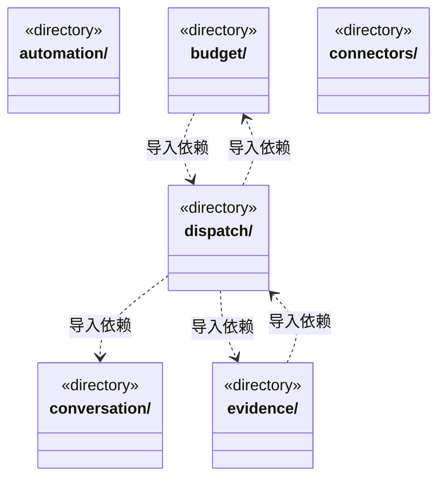
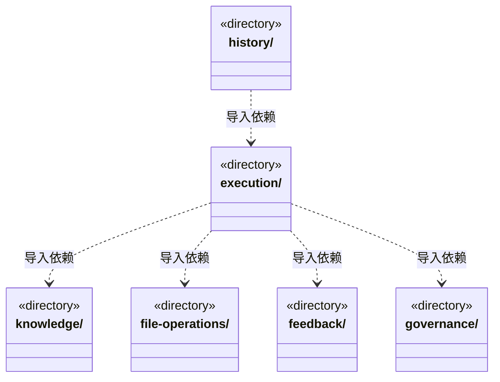
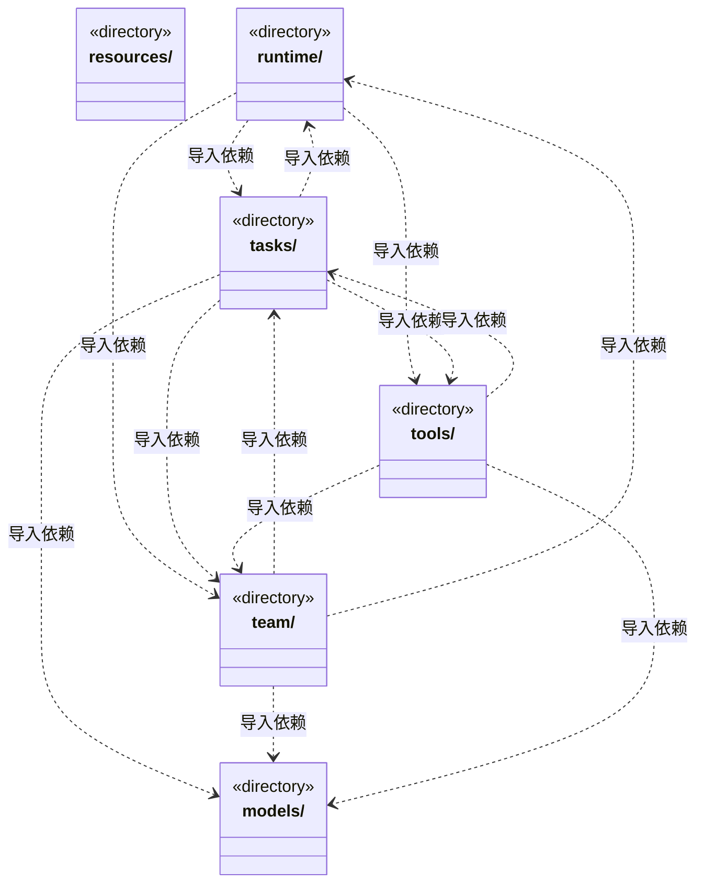
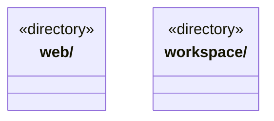

# src/logic 架构

## 目录定位

Logic 已迁入领域规则、端口，以及模型、Web、反馈和资源仓库服务；各模块继续拥有原状态和失败语义。其余服务、调度及引擎正在分批迁入。

本文描述当前实现。通过分析目录边界后维护的 [源码架构脚本](../../scripts/source-architecture.mjs) 同步清单和声明；代码变更时仍须核对职责、关键成员与关系。

## 代码清单

本层无直接代码文件。

## 架构类图

各图中的同名节点表示同一目录边界；跨组及完整直接依赖如下（无边不代表继承）：

- `budget` → `team`：导入。
- `budget` → `dispatch`：导入。
- `budget` → `tasks`：导入。
- `budget` → `models`：导入。
- `budget` → `execution`：导入。
- `budget` → `knowledge`：导入。
- `connectors` → `tools`：导入。
- `conversation` → `tools`：导入。
- `conversation` → `models`：导入。
- `conversation` → `knowledge`：导入。
- `conversation` → `execution`：导入。
- `conversation` → `tasks`：导入。
- `dispatch` → `team`：导入。
- `dispatch` → `tasks`：导入。
- `dispatch` → `workspace`：导入。
- `dispatch` → `file-operations`：导入。
- `dispatch` → `budget`：导入。
- `dispatch` → `execution`：导入。
- `dispatch` → `knowledge`：导入。
- `dispatch` → `tools`：导入。
- `dispatch` → `conversation`：导入。
- `dispatch` → `models`：导入。
- `dispatch` → `evidence`：导入。
- `evidence` → `file-operations`：导入。
- `evidence` → `tools`：导入。
- `evidence` → `tasks`：导入。
- `evidence` → `workspace`：导入。
- `evidence` → `dispatch`：导入。
- `evidence` → `knowledge`：导入。
- `evidence` → `execution`：导入。
- `evidence` → `runtime`：导入。
- `evidence` → `team`：导入。
- `execution` → `runtime`：导入。
- `execution` → `tools`：导入。
- `execution` → `web`：导入。
- `execution` → `workspace`：导入。
- `execution` → `knowledge`：导入。
- `execution` → `conversation`：导入。
- `execution` → `models`：导入。
- `execution` → `evidence`：导入。
- `execution` → `tasks`：导入。
- `execution` → `file-operations`：导入。
- `execution` → `connectors`：导入。
- `execution` → `feedback`：导入。
- `execution` → `governance`：导入。
- `execution` → `team`：导入。
- `execution` → `budget`：导入。
- `file-operations` → `workspace`：导入。
- `file-operations` → `evidence`：导入。
- `file-operations` → `dispatch`：导入。
- `file-operations` → `team`：导入。
- `history` → `execution`：导入。
- `history` → `dispatch`：导入。
- `history` → `tasks`：导入。
- `history` → `team`：导入。
- `history` → `runtime`：导入。
- `knowledge` → `connectors`：导入。
- `knowledge` → `workspace`：导入。
- `knowledge` → `models`：导入。
- `runtime` → `execution`：导入。
- `runtime` → `dispatch`：导入。
- `runtime` → `tasks`：导入。
- `runtime` → `team`：导入。
- `runtime` → `evidence`：导入。
- `runtime` → `tools`：导入。
- `tasks` → `team`：导入。
- `tasks` → `dispatch`：导入。
- `tasks` → `models`：导入。
- `tasks` → `execution`：导入。
- `tasks` → `tools`：导入。
- `tasks` → `budget`：导入。
- `tasks` → `evidence`：导入。
- `tasks` → `knowledge`：导入。
- `tasks` → `file-operations`：导入。
- `tasks` → `workspace`：导入。
- `tasks` → `governance`：导入。
- `tasks` → `runtime`：导入。
- `team` → `models`：导入。
- `team` → `workspace`：导入。
- `team` → `tasks`：导入。
- `team` → `execution`：导入。
- `team` → `dispatch`：导入。
- `team` → `knowledge`：导入。
- `team` → `evidence`：导入。
- `team` → `runtime`：导入。
- `team` → `conversation`：导入。
- `team` → `budget`：导入。
- `tools` → `models`：导入。
- `tools` → `governance`：导入。
- `tools` → `workspace`：导入。
- `tools` → `team`：导入。
- `tools` → `feedback`：导入。
- `tools` → `connectors`：导入。
- `tools` → `tasks`：导入。
- `tools` → `execution`：导入。
- `tools` → `knowledge`：导入。
- `tools` → `web`：导入。
- `workspace` → `team`：导入。
- `workspace` → `tools`：导入。

## 子目录导航

- [automation/](automation/ARCHITECTURE.md)：自动化计划、触发条件及计划契约；服务与规则分开归属，实际依赖通过明确入口验证。
- [budget/](budget/ARCHITECTURE.md)：模型请求额度与作用域预算规则；服务与规则分开归属，实际依赖通过明确入口验证。
- [connectors/](connectors/ARCHITECTURE.md)：连接器定义、登记和能力契约；服务与规则分开归属，实际依赖通过明确入口验证。
- [conversation/](conversation/ARCHITECTURE.md)：主 Agent 对话与消息队列业务；问题、审批和运行生命周期由 runtime 协作，不依赖界面。
- [dispatch/](dispatch/ARCHITECTURE.md)：派发存储端口及任务状态约束；服务与规则分开归属，实际依赖通过明确入口验证。
- [evidence/](evidence/ARCHITECTURE.md)：产物验证、进度证据及核实规则；服务与规则分开归属，实际依赖通过明确入口验证。
- [execution/](execution/ARCHITECTURE.md)：执行会话、工具能力、运行恢复与身份契约；服务与规则分开归属，实际依赖通过明确入口验证。
- [feedback/](feedback/ARCHITECTURE.md)：反馈输入、确定性正文、可信范围与公开连接契约；纯入口不加载持久化、网络或原生锁。
- [file-operations/](file-operations/ARCHITECTURE.md)：受控文件效果、操作凭据和补偿规则；服务与规则分开归属，实际依赖通过明确入口验证。
- [governance/](governance/ARCHITECTURE.md)：模块治理、反馈及责任规则；服务与规则分开归属，实际依赖通过明确入口验证。
- [history/](history/ARCHITECTURE.md)：按主会话与角色读取运行履历的业务服务；日志事实与文件索引通过端口提供。
- [knowledge/](knowledge/ARCHITECTURE.md)：知识数据、只读视图、查询和写入端口；服务与规则分开归属，实际依赖通过明确入口验证。
- [models/](models/ARCHITECTURE.md)：模型目录、公开配置 Schema、供应商预设与引擎接口选择；index.ts 是纯公共入口，不加载 Node 或服务。配置服务位于 service，旧预算端口和主 Agent 设置不属于本片。
- [resources/](resources/ARCHITECTURE.md)：资源定义、分类、仓库快照与公开状态的纯业务契约；仓库存储和共享由 service 负责。
- [runtime/](runtime/ARCHITECTURE.md)：运行状态及终态事实规则；服务与规则分开归属，实际依赖通过明确入口验证。
- [tasks/](tasks/ARCHITECTURE.md)：目标、任务依赖、人工决策及协作状态规则；服务与规则分开归属，实际依赖通过明确入口验证。
- [team/](team/ARCHITECTURE.md)：团队成员、岗位与履历契约；服务与规则分开归属，实际依赖通过明确入口验证。
- [tools/](tools/ARCHITECTURE.md)：工具登记、结果协议及业务工具输入规则；服务与规则分开归属，实际依赖通过明确入口验证。
- [web/](web/ARCHITECTURE.md)：网页工具与设置纯契约；service 提供网络业务适配和配置持久化，工具权限与宿主装配在外层。
- [workspace/](workspace/ARCHITECTURE.md)：工作区定义、工作流和执行范围规则；服务与规则分开归属，实际依赖通过明确入口验证。

[返回上层](../ARCHITECTURE.md)。

每次修改本目录代码，同步维护文件头、关键契约说明及本图。未实现的治理、证据验收和自动编排能力不列入当前类图。

## 设计契约 v1 与落地范围

以下内容区分已接通能力与后续设计；以各节的实现状态为准，不将目标图当作现状图。维护源：[CONTRACT.md](CONTRACT.md)；生成类图时同步附加，勿直接修改本附录。

# Logic 业务层

Logic 拥有业务规则、服务与状态，单向组合 Core，不依赖 Bridge、View 或旧 backend。模型、Web、反馈与资源仓库服务已经迁入；其余领域规则由旧 backend/core 迁入对应业务的 rules 目录，执行身份和工作区路径归 ports。具体引擎已迁入 execution/engines，准入和引擎装配归 execution，其他编排归各业务 runtime/monitoring。宿主服务与桌面入口仍在迁移中。

公开入口按真实消费者登记在 scripts/logic-domain-entries.mjs。规则保留细粒度入口，不通过一个领域总 barrel 同时加载纯契约、运行规则和平台实现；类型依赖同样受无环检查约束。读模型、预算存储端口、引擎工具注册等较窄边界仍限制私有文件访问。

规则不导入应用服务，已有跨领域规则协作仍保留明确契约。迁移没有改变状态所有权：任务版本和原子提交、知识写入授权、运行未知结果与恢复判断仍由原模块负责。当前文件无环不代表领域聚合已经全部解耦。

模型/Web/反馈/资源的纯入口与 service 入口分开。Bridge 只暴露需要传输的类型；宿主通过公开服务入口装配，浏览器不能加载 Node/Electron。目录导航见 [类图](ARCHITECTURE.md)。

编排协作与失败恢复约束集中见 [调度契约](SCHEDULING.md)。规则不能加载运行服务；具体引擎只由 execution/assembly 选择，其他编排依赖引擎契约。公开文件登记在 scripts/logic-runtime-entries.mjs，原私有预算边界仍有效。
