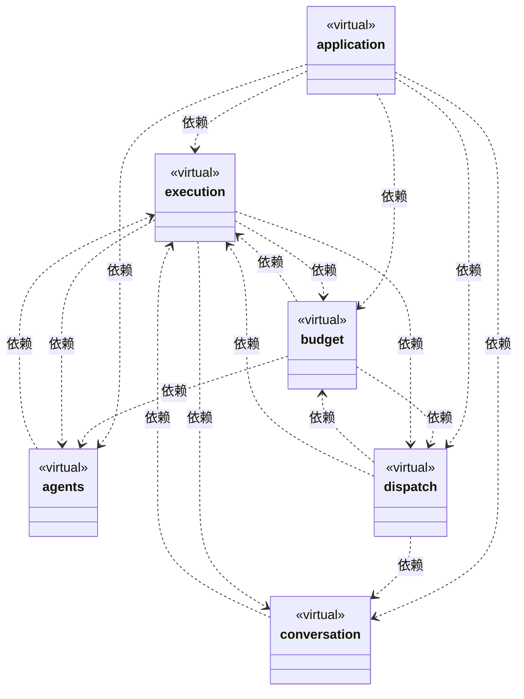
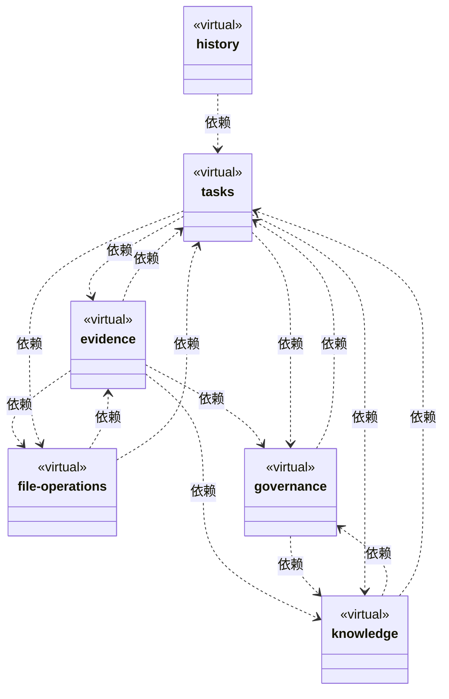
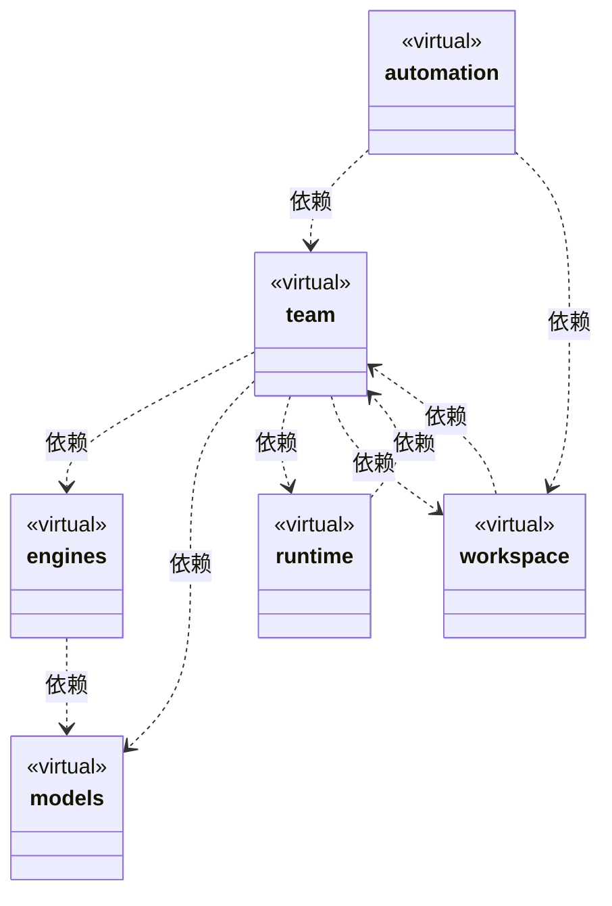
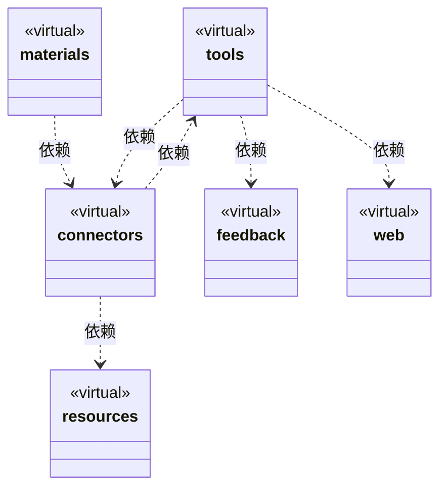
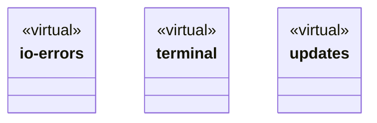

# src/logic 架构

## 设计意图

按领域组织业务事实、规则和运行服务，以统一应用生命周期连接各领域，使业务不依赖窗口、IPC 或 Electron。

`application` 装配并关闭应用；`workspace`、`knowledge`、`team` 管理工作对象和能力来源；`conversation`、`dispatch`、`tasks` 协调用户目标；`execution` 执行已核实调用。`budget`、`evidence`、`file-operations` 分别约束用量、证据和真实副作用，其余领域提供配置、资源及辅助服务。各子模块只以整体封装参与本层模型。

共同存储不等于共同写权限：跨任务与岗位的原子事实通过 dispatch 的存储边界维护，执行日志、正式知识、配置和派生监管分别有自己的所有者。下图是源码引用的目录聚合，包含类型与适配关系；聚合双向边需要向下核实，不能直接当作运行循环或已经完成的逻辑解耦。

## 主要组成

本层没有直接产品实现，由下方子模块组成；每个直接子模块作为一个虚拟封装，只在本层呈现整体职责与协作。

<!-- architecture:generated:start -->

## 架构关系

标注为 `virtual` 的节点是直接子模块的虚拟类封装；内部设计沿下方入口阅读。

### 关系组 1：execution

### 关系组 2：tasks

### 关系组 3：team

### 关系组 4：tools

### 关系组 5：io-errors

### 跨图协作

按引用方归并目标，保留全部跨图关系；分图只用于阅读，不表示新增模块或依赖边界。

| 引用方 | 关系 | 目标 |
| --- | --- | --- |
| [agents](agents/ARCHITECTURE.md)（图 1） | 依赖 | [tasks](tasks/ARCHITECTURE.md)（图 2）、[tools](tools/ARCHITECTURE.md)（图 4） |
| [application](application/ARCHITECTURE.md)（图 1） | 依赖 | [automation](automation/ARCHITECTURE.md)（图 3）、[connectors](connectors/ARCHITECTURE.md)（图 4）、[engines](engines/ARCHITECTURE.md)（图 3）、[evidence](evidence/ARCHITECTURE.md)（图 2）、[feedback](feedback/ARCHITECTURE.md)（图 4）、[file-operations](file-operations/ARCHITECTURE.md)（图 2）、[governance](governance/ARCHITECTURE.md)（图 2）、[history](history/ARCHITECTURE.md)（图 2）、[io-errors](io-errors/ARCHITECTURE.md)（图 5）、[knowledge](knowledge/ARCHITECTURE.md)（图 2）、[materials](materials/ARCHITECTURE.md)（图 4）、[models](models/ARCHITECTURE.md)（图 3）、[resources](resources/ARCHITECTURE.md)（图 4）、[runtime](runtime/ARCHITECTURE.md)（图 3）、[tasks](tasks/ARCHITECTURE.md)（图 2）、[team](team/ARCHITECTURE.md)（图 3）、[tools](tools/ARCHITECTURE.md)（图 4）、[updates](updates/ARCHITECTURE.md)（图 5）、[web](web/ARCHITECTURE.md)（图 4）、[workspace](workspace/ARCHITECTURE.md)（图 3） |
| [automation](automation/ARCHITECTURE.md)（图 3） | 依赖 | [conversation](conversation/ARCHITECTURE.md)（图 1）、[dispatch](dispatch/ARCHITECTURE.md)（图 1）、[knowledge](knowledge/ARCHITECTURE.md)（图 2） |
| [budget](budget/ARCHITECTURE.md)（图 1） | 依赖 | [engines](engines/ARCHITECTURE.md)（图 3）、[knowledge](knowledge/ARCHITECTURE.md)（图 2）、[tasks](tasks/ARCHITECTURE.md)（图 2）、[team](team/ARCHITECTURE.md)（图 3） |
| [connectors](connectors/ARCHITECTURE.md)（图 4） | 依赖 | [knowledge](knowledge/ARCHITECTURE.md)（图 2） |
| [conversation](conversation/ARCHITECTURE.md)（图 1） | 依赖 | [engines](engines/ARCHITECTURE.md)（图 3）、[knowledge](knowledge/ARCHITECTURE.md)（图 2）、[tasks](tasks/ARCHITECTURE.md)（图 2）、[tools](tools/ARCHITECTURE.md)（图 4） |
| [dispatch](dispatch/ARCHITECTURE.md)（图 1） | 依赖 | [engines](engines/ARCHITECTURE.md)（图 3）、[evidence](evidence/ARCHITECTURE.md)（图 2）、[file-operations](file-operations/ARCHITECTURE.md)（图 2）、[knowledge](knowledge/ARCHITECTURE.md)（图 2）、[tasks](tasks/ARCHITECTURE.md)（图 2）、[team](team/ARCHITECTURE.md)（图 3）、[tools](tools/ARCHITECTURE.md)（图 4）、[workspace](workspace/ARCHITECTURE.md)（图 3） |
| [engines](engines/ARCHITECTURE.md)（图 3） | 依赖 | [execution](execution/ARCHITECTURE.md)（图 1）、[updates](updates/ARCHITECTURE.md)（图 5） |
| [evidence](evidence/ARCHITECTURE.md)（图 2） | 依赖 | [agents](agents/ARCHITECTURE.md)（图 1）、[dispatch](dispatch/ARCHITECTURE.md)（图 1）、[execution](execution/ARCHITECTURE.md)（图 1）、[runtime](runtime/ARCHITECTURE.md)（图 3）、[team](team/ARCHITECTURE.md)（图 3）、[tools](tools/ARCHITECTURE.md)（图 4）、[workspace](workspace/ARCHITECTURE.md)（图 3） |
| [execution](execution/ARCHITECTURE.md)（图 1） | 依赖 | [connectors](connectors/ARCHITECTURE.md)（图 4）、[engines](engines/ARCHITECTURE.md)（图 3）、[evidence](evidence/ARCHITECTURE.md)（图 2）、[feedback](feedback/ARCHITECTURE.md)（图 4）、[file-operations](file-operations/ARCHITECTURE.md)（图 2）、[governance](governance/ARCHITECTURE.md)（图 2）、[knowledge](knowledge/ARCHITECTURE.md)（图 2）、[models](models/ARCHITECTURE.md)（图 3）、[runtime](runtime/ARCHITECTURE.md)（图 3）、[tasks](tasks/ARCHITECTURE.md)（图 2）、[team](team/ARCHITECTURE.md)（图 3）、[tools](tools/ARCHITECTURE.md)（图 4）、[web](web/ARCHITECTURE.md)（图 4）、[workspace](workspace/ARCHITECTURE.md)（图 3） |
| [feedback](feedback/ARCHITECTURE.md)（图 4） | 依赖 | [io-errors](io-errors/ARCHITECTURE.md)（图 5） |
| [file-operations](file-operations/ARCHITECTURE.md)（图 2） | 依赖 | [dispatch](dispatch/ARCHITECTURE.md)（图 1）、[execution](execution/ARCHITECTURE.md)（图 1）、[team](team/ARCHITECTURE.md)（图 3）、[workspace](workspace/ARCHITECTURE.md)（图 3） |
| [governance](governance/ARCHITECTURE.md)（图 2） | 依赖 | [execution](execution/ARCHITECTURE.md)（图 1）、[workspace](workspace/ARCHITECTURE.md)（图 3） |
| [history](history/ARCHITECTURE.md)（图 2） | 依赖 | [agents](agents/ARCHITECTURE.md)（图 1）、[dispatch](dispatch/ARCHITECTURE.md)（图 1）、[execution](execution/ARCHITECTURE.md)（图 1）、[runtime](runtime/ARCHITECTURE.md)（图 3）、[team](team/ARCHITECTURE.md)（图 3） |
| [knowledge](knowledge/ARCHITECTURE.md)（图 2） | 依赖 | [connectors](connectors/ARCHITECTURE.md)（图 4）、[dispatch](dispatch/ARCHITECTURE.md)（图 1）、[feedback](feedback/ARCHITECTURE.md)（图 4）、[io-errors](io-errors/ARCHITECTURE.md)（图 5）、[team](team/ARCHITECTURE.md)（图 3）、[workspace](workspace/ARCHITECTURE.md)（图 3） |
| [materials](materials/ARCHITECTURE.md)（图 4） | 依赖 | [execution](execution/ARCHITECTURE.md)（图 1）、[knowledge](knowledge/ARCHITECTURE.md)（图 2）、[tasks](tasks/ARCHITECTURE.md)（图 2） |
| [resources](resources/ARCHITECTURE.md)（图 4） | 依赖 | [io-errors](io-errors/ARCHITECTURE.md)（图 5）、[knowledge](knowledge/ARCHITECTURE.md)（图 2） |
| [runtime](runtime/ARCHITECTURE.md)（图 3） | 依赖 | [dispatch](dispatch/ARCHITECTURE.md)（图 1）、[evidence](evidence/ARCHITECTURE.md)（图 2）、[execution](execution/ARCHITECTURE.md)（图 1）、[tasks](tasks/ARCHITECTURE.md)（图 2）、[tools](tools/ARCHITECTURE.md)（图 4） |
| [tasks](tasks/ARCHITECTURE.md)（图 2） | 依赖 | [budget](budget/ARCHITECTURE.md)（图 1）、[dispatch](dispatch/ARCHITECTURE.md)（图 1）、[engines](engines/ARCHITECTURE.md)（图 3）、[execution](execution/ARCHITECTURE.md)（图 1）、[models](models/ARCHITECTURE.md)（图 3）、[runtime](runtime/ARCHITECTURE.md)（图 3）、[team](team/ARCHITECTURE.md)（图 3）、[tools](tools/ARCHITECTURE.md)（图 4）、[workspace](workspace/ARCHITECTURE.md)（图 3） |
| [team](team/ARCHITECTURE.md)（图 3） | 依赖 | [agents](agents/ARCHITECTURE.md)（图 1）、[budget](budget/ARCHITECTURE.md)（图 1）、[conversation](conversation/ARCHITECTURE.md)（图 1）、[dispatch](dispatch/ARCHITECTURE.md)（图 1）、[evidence](evidence/ARCHITECTURE.md)（图 2）、[execution](execution/ARCHITECTURE.md)（图 1）、[knowledge](knowledge/ARCHITECTURE.md)（图 2）、[tasks](tasks/ARCHITECTURE.md)（图 2） |
| [tools](tools/ARCHITECTURE.md)（图 4） | 依赖 | [engines](engines/ARCHITECTURE.md)（图 3）、[execution](execution/ARCHITECTURE.md)（图 1）、[governance](governance/ARCHITECTURE.md)（图 2）、[knowledge](knowledge/ARCHITECTURE.md)（图 2）、[tasks](tasks/ARCHITECTURE.md)（图 2）、[team](team/ARCHITECTURE.md)（图 3）、[workspace](workspace/ARCHITECTURE.md)（图 3） |
| [workspace](workspace/ARCHITECTURE.md)（图 3） | 依赖 | [dispatch](dispatch/ARCHITECTURE.md)（图 1）、[execution](execution/ARCHITECTURE.md)（图 1）、[governance](governance/ARCHITECTURE.md)（图 2）、[io-errors](io-errors/ARCHITECTURE.md)（图 5）、[knowledge](knowledge/ARCHITECTURE.md)（图 2）、[tasks](tasks/ARCHITECTURE.md)（图 2）、[tools](tools/ARCHITECTURE.md)（图 4） |

## 子模块

| 虚拟封装 | 整体职责 |
| --- | --- |
| [agents](agents/ARCHITECTURE.md) | 表达一次 Agent 调用的冻结身份、约束和往返交流，使调用对象与执行循环、资源调度分离。 |
| [application](application/ARCHITECTURE.md) | 拥有应用级服务与工作区实例的唯一业务生命周期，统一处理初始化、打开、退役和排空。 |
| [automation](automation/ARCHITECTURE.md) | 组织工作区自动化的定义、触发与运行记录，把日程规则和真实执行分开。 |
| [budget](budget/ARCHITECTURE.md) | 分别管理目标周期额度与逐模型请求的用量约束，保留预占、已报告消耗和未知成本的区别。 |
| [connectors](connectors/ARCHITECTURE.md) | 把资源仓库连接的静态定义、工作区授权和真实读取分开，避免登记连接即获得访问权限。 |
| [conversation](conversation/ARCHITECTURE.md) | 维护工作区主会话的交互与执行入口，把用户消息、审批和结构化提问连接到业务运行。 |
| [dispatch](dispatch/ARCHITECTURE.md) | 协调工作区内的任务派发、执行绑定和成果回传，保持相关事实在共同事务边界内一致。 |
| [engines](engines/ARCHITECTURE.md) | 管理官方引擎身份、能力声明、模型选型和本机包选择，使引擎目录不等于 SDK 加载或运行状态。 |
| [evidence](evidence/ARCHITECTURE.md) | 组织执行证据的表达、可信采集与独立复核，区分已有记录、当前观察和业务验收。 |
| [execution](execution/ARCHITECTURE.md) | 把已核实的 Agent 调用转化为真实执行，分离准入、上下文、循环机制、引擎适配与运行持久化。 |
| [feedback](feedback/ARCHITECTURE.md) | 定义结构化反馈、可信目标与公开连接状态，把内置流程说明和真实外部提交分开。 |
| [file-operations](file-operations/ARCHITECTURE.md) | 对有明确业务授权的文件写入、删除移动和隔离执行提供完整的可信操作边界。 |
| [governance](governance/ARCHITECTURE.md) | 组织正式模块知识的观察、提案、人工决定与实施，防止建议直接变成权威知识。 |
| [history](history/ARCHITECTURE.md) | 按静态角色和逻辑会话提供运行履历，保留实例退役之后仍可读取的历史事实。 |
| [io-errors](io-errors/ARCHITECTURE.md) | Logic 按业务错误协议解释严格 JSON 解析与原生锁失败。JSON 与锁分别导入，解析数据时无需加载原生库。 |
| [knowledge](knowledge/ARCHITECTURE.md) | 管理正式知识的快照、校验、查询与受控修改，使权威正文和派生读取各有责任边界。 |
| [materials](materials/ARCHITECTURE.md) | 管理聊天与目标补充所引用资料的身份和采集快照，使输入正文具有可核对来源。 |
| [models](models/ARCHITECTURE.md) | 管理供应商连接、生成与向量模型目录及公开快照，使模型能力独立于具体 Agent 引擎。 |
| [resources](resources/ARCHITECTURE.md) | 统一资源种类、仓库身份与静态包交换，隔离仓库管理和工作区知识应用。 |
| [runtime](runtime/ARCHITECTURE.md) | 提供应用级运行事实的只读观察与并发策略配置，使监管不成为第二套调度系统。 |
| [tasks](tasks/ARCHITECTURE.md) | 定义任务依赖、目标周期、等待与人工处置的业务语义，避免把模型运行状态当作任务完成。 |
| [team](team/ARCHITECTURE.md) | 区分静态角色、长期岗位与真实执行，让能力配置、来源采纳和运行身份各自清楚。 |
| [terminal](terminal/ARCHITECTURE.md) | 提供工作区内显式手动命令的终端能力，按页签隔离输出和进程生命周期。 |
| [tools](tools/ARCHITECTURE.md) | 把业务能力转换为可发现、可校验的模型工具，同时保持注册与授权分离。 |
| [updates](updates/ARCHITECTURE.md) | 管理桌面冷基础、运行资源和引擎制品的更新边界，使准备候选与明确激活分离。 |
| [web](web/ARCHITECTURE.md) | 定义网页读取、搜索及设置的业务边界，把公开工具协议与网络实现隔开。 |
| [workspace](workspace/ARCHITECTURE.md) | 管理工作区身份、业务模块、Workflow 和本机资源边界，为知识与执行提供可信工作对象。 |

[上层设计](../ARCHITECTURE.md)

<!-- architecture:generated:end -->
