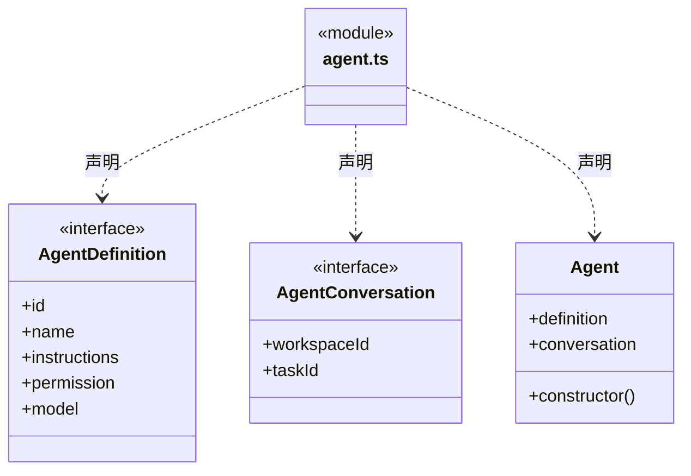
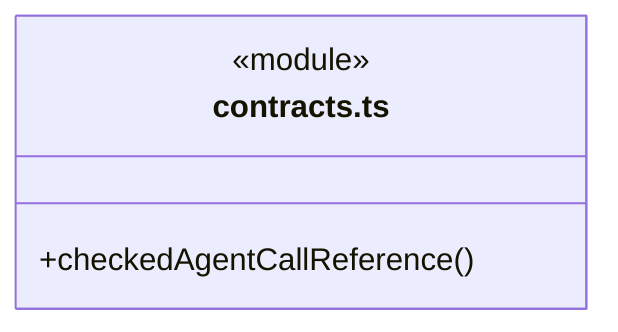
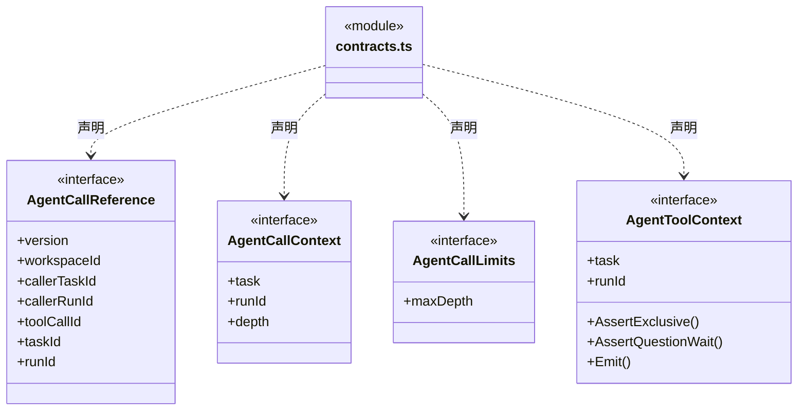
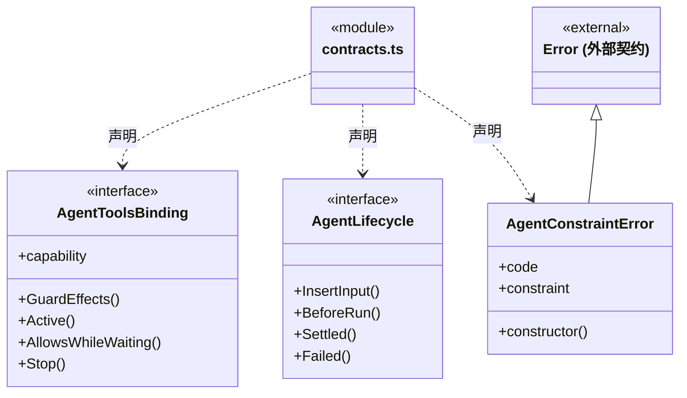
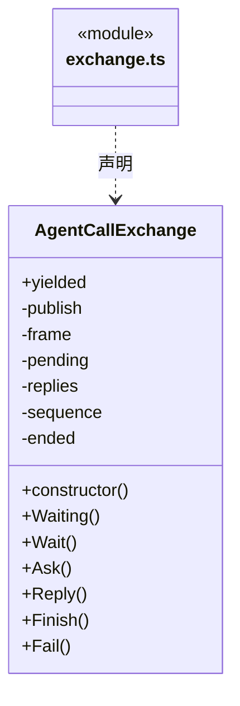
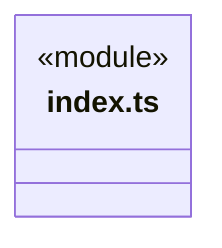
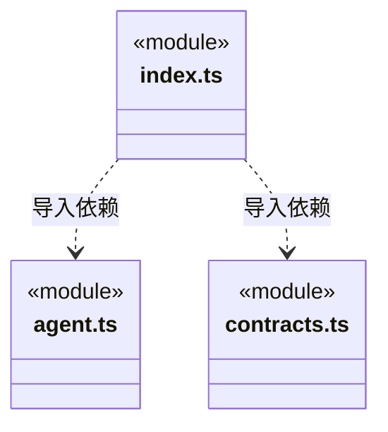

# src/logic/agents 架构

本目录只维护这一份说明。设计与契约直接编辑本文；文件清单、类图和导航由 [架构脚本](../../../scripts/source-architecture.mjs) 更新，生成区域之外的人工说明会保留。

## 封装意图

独立 Agent 对象、单次执行循环和调用调度：纯契约与实现分离，调度通过注入端口执行，不依赖 Application 或具体引擎。

## 类与模块的设计意图

下表依据源码声明及文件头说明定位封装。字段表示该实例持有的状态或协作引用，不表示它拥有被引用服务的生命周期；实际资源责任和调用限制见下文契约及源码注释。

| 类／模块 | 实现形式与实例字段 | 封装依据 |
| --- | --- | --- |
| [Agent](agent.ts) | 实例类；持有 `definition`、`conversation` | 一次受理中的冻结 Agent；调度与循环依赖本对象，不反向持有它们。 |
| [AgentConstraintError](contracts.ts) | 实例类；持有 `code`、`constraint` | 可信准入失败的数值快照；只携带约束，不携带模型正文或凭据。 |
| [AgentCallExchange](exchange.ts) | 实例类；持有 `frame`、`pending`、`replies`、`sequence`、`ended`、`yielded`、`publish` | 一次只保留一个原题；发布端使用独立快照。答案先持久记录再消费，重复答案返回原回包，不唤醒第二次。 |
| [index.ts](index.ts) | 函数／契约模块 | 运行与调度归 execution；仅需数据契约的调用方直接引用 contracts，避免加载运行实现。 |

## 接口设计契约

### Agent 对象与调用协议

#### 职责与单向依赖

`Agent` 冻结专业指令、权限、无凭据模型选择与对话引用，不保存第二份消息正文。主 Agent 与执行 Agent 是相对调用角色；Application 以同一对象和循环协议装配。

主与子 Agent 都直接使用 execution 的 `LoopRuntime.Start/stop/close`；此目录不再拥有运行循环。Runtime 负责工具授权、日志、取消、引擎关闭和真实排空，调用者仅负责在 done 后关闭所拥有的 Runtime。

`execution/assembly/AgentCallScheduler` 仅协调调用身份、深度、暂停答复和直接结果路由，通过 prepare 取得已获全局准入的 task/runtime/release；不另存本根并发计数。此目录的 contracts 是 Runtime/Bridge 的便携协议入口，不导出调度实现。

#### 工具与记录

- `cbim_agent_list` 从真实岗位目录返回可用 ID、配置及限制原因；不授予执行权限。
- `cbim_agent_call` 仅接受 `agentId` 与 `message`。调用者、根、深度与权限从可信上下文取得；每次同 run/toolCallId 只执行一次，改参复用被拒绝。
- 父 `tool.updated` 与子 `run.started` 使用 `AgentCallReference` 关联。展开详情只查询原 `workspaceId/taskId/runId`，不从时间、名称或页面选择猜测关系。
- 结果精确返回直接调用方。`isError` 明确标识失败、取消或未决工具；工具完成不等于业务目标通过。文字输出有界，完整日志仍可只读查询。

#### 约束与停止

根深度为 0，子调用加 1；深度等于上限可以执行，超出拒绝。真实进程全局准入由 prepare 使用 execution/admission 同步领取，不用父等待规避进程计数。具体限制和支持范围由装配固定，不能由模型参数改变。

调用前 `assertExclusive` 核实父工具批次只有当前已授权调用；子执行期间父新工具被 Runtime 拒绝。直属调用均在等待答复时只放行目录、答复和向上求助工具，写操作与新子调用仍被拒绝。根工作区独占租约持续至后代真实排空。停止通过 AbortSignal 沿调用传播，不影响无关调用树。

关闭失败保留 stranded 与全局占用。Runtime 收尾 drain 重试关闭原循环，不重放工具；未确认退出前不得释放根租约。进程内 attempts 只用于当前执行去重，重启后的未知执行仍由原持久日志拒绝重放。

#### 当前支持范围

Application 的 `agent-calls.ts` 采用深度 8；并发只有 execution/admission 的用户全局设置一份权威状态，父进程仍计入资源。所有数值在工具详情或拒绝结果中说明。

子调用使用已登记、未变更岗位自己的冻结引擎、模型和凭据，不继承根进程启动覆盖；不同模型分别冻结价格并向根请求账本申请和结算。agentRun 记录请求的实际子 task/run，但不改变根作用域授权。缺模型、配置变化或缺所需价格均拒绝，不静默改投。启用旧运行汇总预算时仍返回 `AGENT_BUDGET_MODE_UNSUPPORTED`；预算关闭时仍受深度和真实并发约束。

`AgentCallExchange` 持有原调用的单题等待与答复去重。执行 Agent 的问题工具通过可信端口暂停原循环；父 cbim_agent_call 返回 waiting、callId、questionId 和严格问题结构。父以 cbim_agent_reply({callId,questionId,result}) 答复，等待原子运行的新问题或终态；不新建 task/run。执行父级可继续向上求助，只有根使用用户提问端口。答复身份按直接调用方 run 校验，答案先记录再消费；同答案返回原回包，不同答案拒绝。

等待及续跑通过原工具的 tool.updated 展示。未答复就结束父模型回合触发 AGENT_REPLY_REQUIRED 并停止排空原子树。停止、错题、跨调用者和迟到答案均不重建执行；当前等待对象只存在于进程内，重启后的未知调用不自动恢复。

旧单层派发及其检查点、知识验收等仍用于无新协议标记的历史恢复，不能删除旧读取路径或给旧日志补造新调用身份。后续增加持久等待恢复时须扩展恢复契约；模型捕获留在装配账本，问答交接留在 exchange，不能把逻辑堆入 Agent 对象。

#### 根运行插入回执

AgentLifecycle 在根运行受理前接收本轮正文与可选队列 scopeId/followupOf；insertInput 仅声明可信回执端口，事务仍由 tasks/runtime 的 ScopeActiveInputService 持有。

#### 问答发布边界

Exchange 校验并持有原题与答案，publish 适配器只取得深拷贝快照；适配器在 await 期间修改输入不得改变答案校验或唤醒原子循环的值。取消发生在答案持久化等待中时，答案发布完成也不得唤醒已取消的等待；原答复 Promise 继续作为去重回执，不重发未知结果。等待发布失败仍保留已经发生的日志事实，但不伪造成功交接或恢复问题。

#### 持久调用引用校验

agentCallReferenceSchema 是日志读取与派生索引共用的严格格式；checkedAgentCallReference 另校验工作区、当前子 task/run，拒绝自引用。它不证明父级授权或周期归属；用量报告仍从可信父工具事实逐层核验，历史索引仍匹配 canonical 首条记录。

#### 人工意见后的副作用边界
AgentToolsBinding.GuardEffects 只返回当前调用的拒绝理由，不授予权限。它由执行调度绑定原 runId；人工意见不授权返工时只允许明确 read/preview，未知或混合副作用均拒绝。独立新运行不继承旧运行的阻止集合，仍重新经过权限和业务校验。

## 开闭边界

本目录的职责及允许协作由[封装意图](#封装意图)限定，输入输出、状态与失败语义以[接口设计契约](#接口设计契约)为准。扩展从已有公开入口及实际装配位置进入；没有明确可替换契约的部分按真实影响修改和验证，不预建未使用的基类或插件入口。

<!-- architecture:generated:start -->

## 文件清单

| 文件 | 形式 | 当前职责 |
| --- | --- | --- |
| [ARCHITECTURE.md](ARCHITECTURE.md) | 说明文档 | 本目录的文件清单、真实声明、依赖与子封装导航。 |
| [agent.ts](agent.ts) | 源码模块 | Logic 中独立 Agent 对象，冻结能力、运行选型和权限，并引用真实对话身份。 |
| [contracts.ts](contracts.ts) | 源码模块 | Agent 调用的便携身份、工具绑定和生命周期契约，供 Runtime 与 Bridge 使用。 |
| [exchange.ts](exchange.ts) | 源码模块 | 单次 Agent 调用内的问答暂停和结果交接，不创建新 Agent 或执行循环。 |
| [index.ts](index.ts) | 源码模块 | 向业务装配公开 Agent 对象与调用契约，不导出 Application 或具体引擎。 |

## 架构类图

成员标记：`+` 公开、`-` 私有、`#` 受保护、`$` 静态；构造函数单独列出。文档和资源仅在文件清单中导航，不作为代码节点。

### agent.ts

直接依赖：[../tools/rules/policy/types.ts](../tools/rules/policy/types.ts)。

### contracts.ts

直接依赖：[../tasks/rules/scope-active-input.ts](../tasks/rules/scope-active-input.ts)、[../execution/rules/types.ts](../execution/rules/types.ts)、[../execution/rules/engine-tools.ts](../execution/rules/engine-tools.ts)。

### exchange.ts

直接依赖：[../tools/rules/questions.ts](../tools/rules/questions.ts)、[../tools/rules/results.ts](../tools/rules/results.ts)。

### index.ts

直接依赖：[agent.ts](agent.ts)、[contracts.ts](contracts.ts)。

### 本目录调用边界

## 子目录导航

无子目录。

[返回上层](../ARCHITECTURE.md)。

每次修改本目录代码，同步维护文件头、关键契约说明及本图。未实现的治理、证据验收和自动编排能力不列入当前类图。

<!-- architecture:generated:end -->
