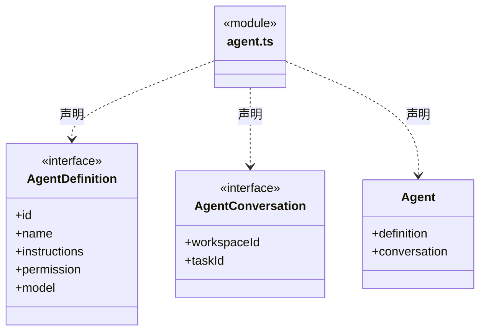
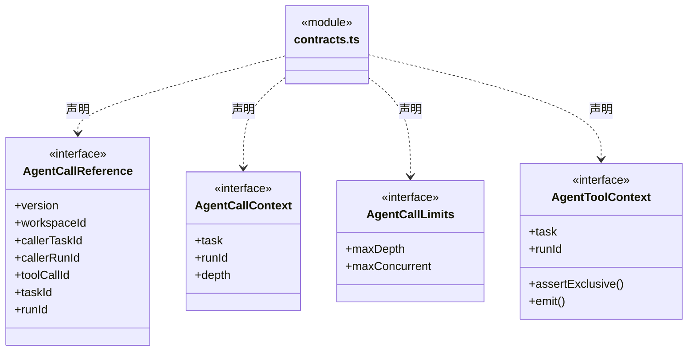
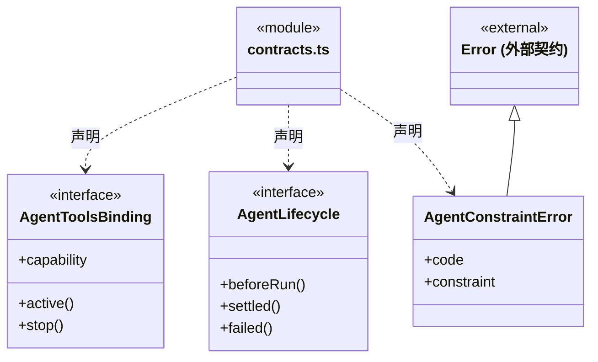
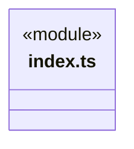
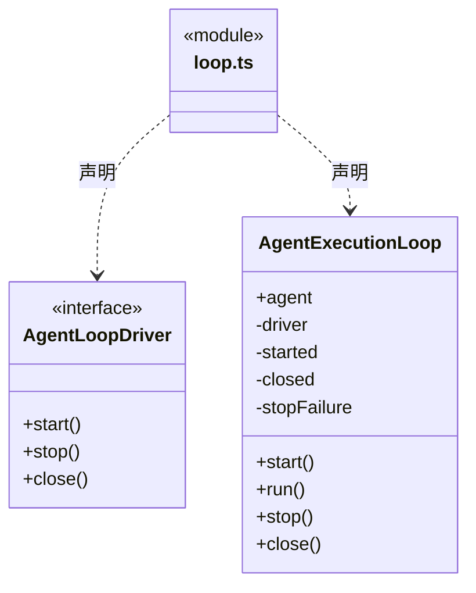
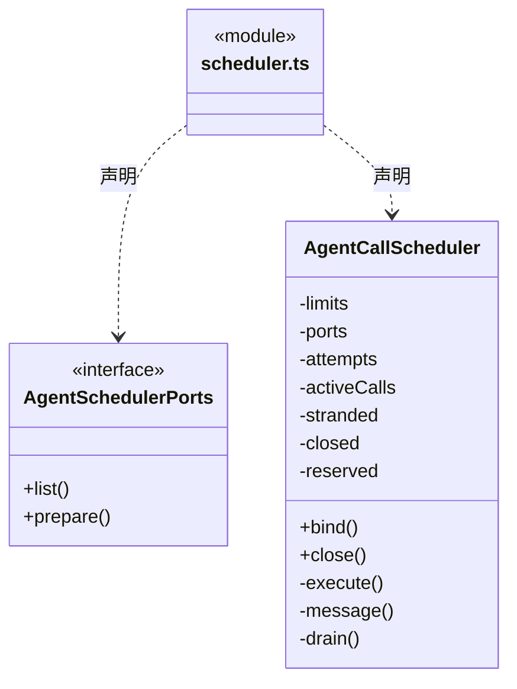
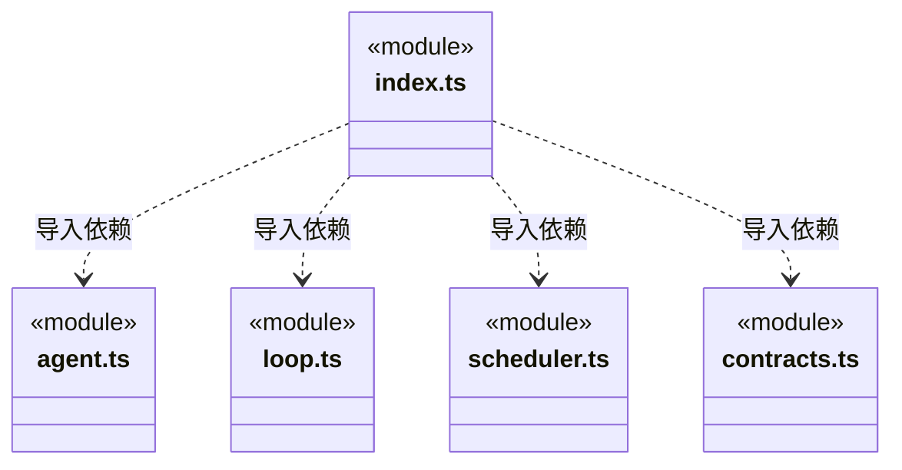
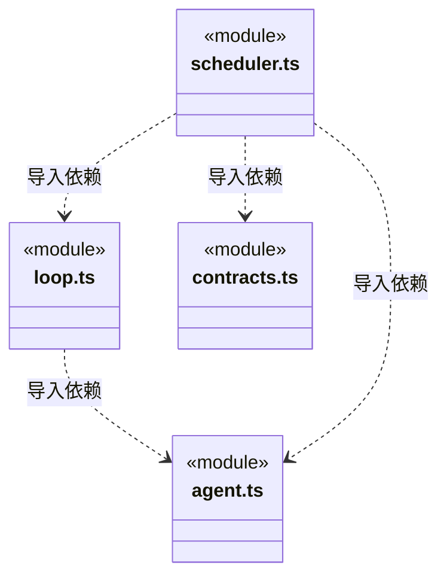

# src/logic/agents 架构

## 目录定位

独立 Agent 对象、单次执行循环和调用调度：纯契约与实现分离，调度通过注入端口执行，不依赖 Application 或具体引擎。

本文描述当前实现。通过分析目录边界后维护的 [源码架构脚本](../../../scripts/source-architecture.mjs) 同步清单和声明；代码变更时仍须核对职责、关键成员与关系。

## 代码清单

| 文件 | 当前职责 |
| --- | --- |
| [agent.ts](agent.ts) | Logic 中独立 Agent 对象，冻结能力、运行选型和权限，并引用真实对话身份。 |
| [contracts.ts](contracts.ts) | Agent 调用的便携身份、工具绑定和生命周期契约，供 Runtime 与 Bridge 使用。 |
| [index.ts](index.ts) | 向业务装配公开 Agent 对象、单次循环和调度器，不导出 Application 或具体引擎。 |
| [loop.ts](loop.ts) | 独立 Agent 执行循环的生命周期封装，由装配注入已有 LoopRuntime/引擎驱动。 |
| [scheduler.ts](scheduler.ts) | 独立 Agent 调度系统，拥有调用关系、递归准入、结果回传和后代停止。 |

## 架构类图

### agent.ts

直接依赖：[../tools/rules/policy/types.ts](../tools/rules/policy/types.ts)。

### contracts.ts

直接依赖：[../execution/rules/types.ts](../execution/rules/types.ts)、[../execution/rules/engine-tools.ts](../execution/rules/engine-tools.ts)。

### index.ts

直接依赖：[agent.ts](agent.ts)、[loop.ts](loop.ts)、[scheduler.ts](scheduler.ts)、[contracts.ts](contracts.ts)。

### loop.ts

直接依赖：[agent.ts](agent.ts)、[../execution/rules/types.ts](../execution/rules/types.ts)。

### scheduler.ts

直接依赖：[agent.ts](agent.ts)、[loop.ts](loop.ts)、[../execution/rules/types.ts](../execution/rules/types.ts)、[contracts.ts](contracts.ts)、[../tools/rules/results.ts](../tools/rules/results.ts)。

### 本目录调用边界

## 子目录导航

无子目录。

[返回上层](../ARCHITECTURE.md)。

每次修改本目录代码，同步维护文件头、关键契约说明及本图。未实现的治理、证据验收和自动编排能力不列入当前类图。

## 设计契约 v1 与落地范围

以下内容区分已接通能力与后续设计；以各节的实现状态为准，不将目标图当作现状图。维护源：[CONTRACT.md](CONTRACT.md)；生成类图时同步附加，勿直接修改本附录。

# Agent、执行循环与调度系统

## 职责与单向依赖

`Agent` 冻结专业指令、权限、无凭据模型选择与对话引用，不保存第二份消息正文。主 Agent 与执行 Agent 是相对调用角色；Application 以同一对象和循环协议装配。

`AgentExecutionLoop` 接收单运行驱动端口，负责一次启动、停止和真实关闭。驱动由现有 `LoopRuntime` 和具体引擎装配，不重新实现 SDK 模型循环。`start` 供主执行管理器使用，`run` 供调度器等待子结果；两者共享同一生命周期。

`AgentCallScheduler` 仅依赖对象、循环及窄执行契约，通过 `prepare` 取得真实子运行。它持有本根调用的身份去重、深度/本地进程上限、取消和回传，不依赖 `AutoCollaboration`、Application 或具体引擎。`contracts.ts` 是 Runtime/Bridge 的便携契约入口，不能通过聚合出口加载调度实现。

## 工具与记录

- `cbim_agent_list` 从真实岗位目录返回可用 ID、配置及限制原因；不授予执行权限。
- `cbim_agent_call` 仅接受 `agentId` 与 `message`。调用者、根、深度与权限从可信上下文取得；每次同 run/toolCallId 只执行一次，改参复用被拒绝。
- 父 `tool.updated` 与子 `run.started` 使用 `AgentCallReference` 关联。展开详情只查询原 `workspaceId/taskId/runId`，不从时间、名称或页面选择猜测关系。
- 结果精确返回直接调用方。`isError` 明确标识失败、取消或未决工具；工具完成不等于业务目标通过。文字输出有界，完整日志仍可只读查询。

## 约束与停止

根深度为 0，子调用加 1；深度等于上限可以执行，超出拒绝。本地额度在任何 await 前同步预留。真实进程全局准入由 prepare 必须另外领取，不用父等待规避进程计数。具体限制和支持范围由装配固定，不能由模型参数改变。

调用前 `assertExclusive` 核实父工具批次只有当前已授权调用；子执行期间父新工具被 Runtime 拒绝，根工作区独占租约持续至后代真实排空。停止通过 AbortSignal 沿调用传播，不影响无关调用树。

关闭失败保留 stranded 与全局占用。Runtime 收尾 drain 重试关闭原循环，不重放工具；未确认退出前不得释放根租约。进程内 attempts 只用于当前执行去重，重启后的未知执行仍由原持久日志拒绝重放。

## 当前支持范围

Application 的 `agent-calls.ts` 采用深度 8、本根子进程数上限 32；实际全局并发遵守用户原有设置，父进程仍计入资源。所有数值在工具详情或拒绝结果中说明。

首片仅支持已登记、未变更、与根使用相同冻结模型配置的 Agent，避免共用根请求账本却按不同价格计费。不同模型返回 `AGENT_MODEL_UNSUPPORTED`，不静默改投。启用逐请求预算时子树共用根账本；启用旧运行汇总预算时返回 `AGENT_BUDGET_MODE_UNSUPPORTED`，避免漏计子运行。预算关闭时仍受深度和真实并发约束。

同调用暂停并由父回答尚未接通；执行 Agent 调问题工具会返回 `AGENT_QUESTION_UNSUPPORTED`，应将问题作为公开结果返回调用方，不直接向用户提问。这个限制不是目标产品已全部实现的声明。

旧单层派发及其检查点、知识验收等仍用于无新协议标记的历史恢复，不能删除旧读取路径或给旧日志补造新调用身份。后续扩展多模型、父子答复和持久调度时，应分别修改装配账本、交互端口与恢复契约，不把逻辑堆入 Agent 对象。
