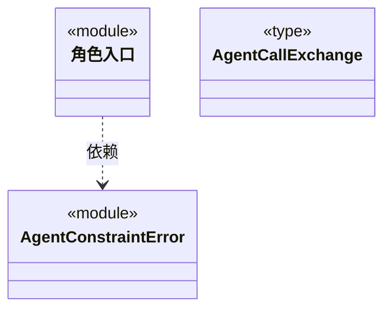

# src/logic/agents 架构

## 设计意图

表达一次 Agent 调用的冻结身份、约束和往返交流，使调用对象与执行循环、资源调度分离。

`Agent` 保存能力与对话引用，`AgentConstraintError` 携带可信拒绝事实，`AgentCallExchange` 关联原题、持久答案和回包。对象不持有 SDK、调度器或重复对话正文；实际循环与递归调用协调分别由 execution 的运行机制和装配实现。

## 主要组成

| 组成 | 定位 |
| --- | --- |
| [角色入口](index.ts) | 保存一次已受理调用的冻结 Agent 身份和约束，供调度器与运行循环使用。 |
| [AgentConstraintError](contracts.ts) | 表达可信准入失败的约束快照，不携带模型正文或凭据。 |
| [AgentCallExchange](exchange.ts) | 协调一次调用中的原题、持久答案与回包，避免重复消费或唤醒。 |

<!-- architecture:generated:start -->

## 架构关系

[上层设计](../ARCHITECTURE.md)

<!-- architecture:generated:end -->
