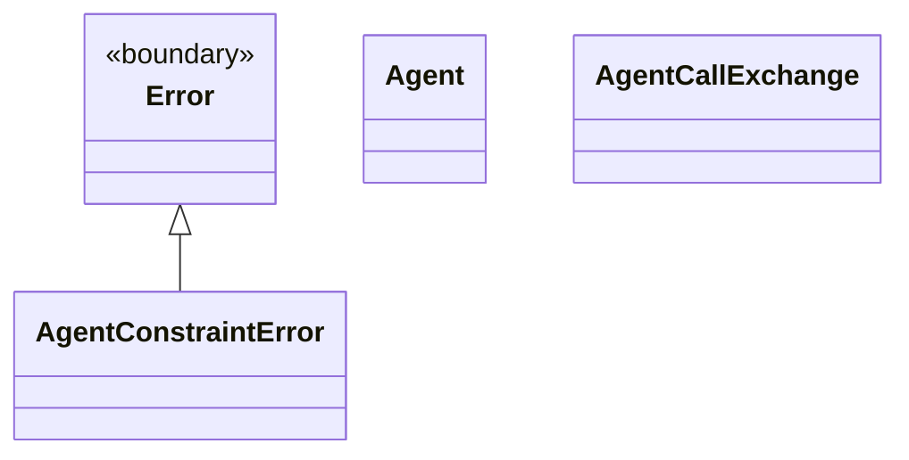

# src/logic/agents 架构

## 设计意图

独立 Agent 对象、单次执行循环和调用调度：纯契约与实现分离，调度通过注入端口执行，不依赖 Application 或具体引擎。

## 主要组成

| 组成 | 定位 |
| --- | --- |
| [Agent](agent.ts) | 保存一次已受理调用的冻结 Agent 身份和约束，供调度器与运行循环使用。 |
| [AgentConstraintError](contracts.ts) | 表达可信准入失败的约束快照，不携带模型正文或凭据。 |
| [AgentCallExchange](exchange.ts) | 协调一次调用中的原题、持久答案与回包，避免重复消费或唤醒。 |

<!-- architecture:generated:start -->

## 架构关系

外部继承／实现边界：`Error`。

[上层设计](../ARCHITECTURE.md)

<!-- architecture:generated:end -->
